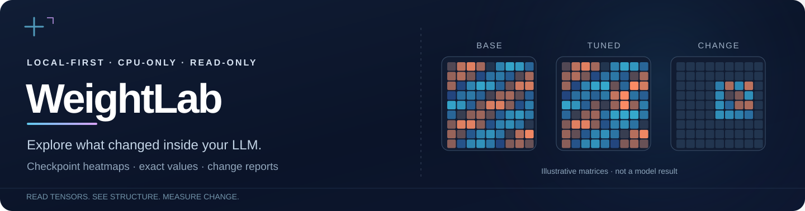
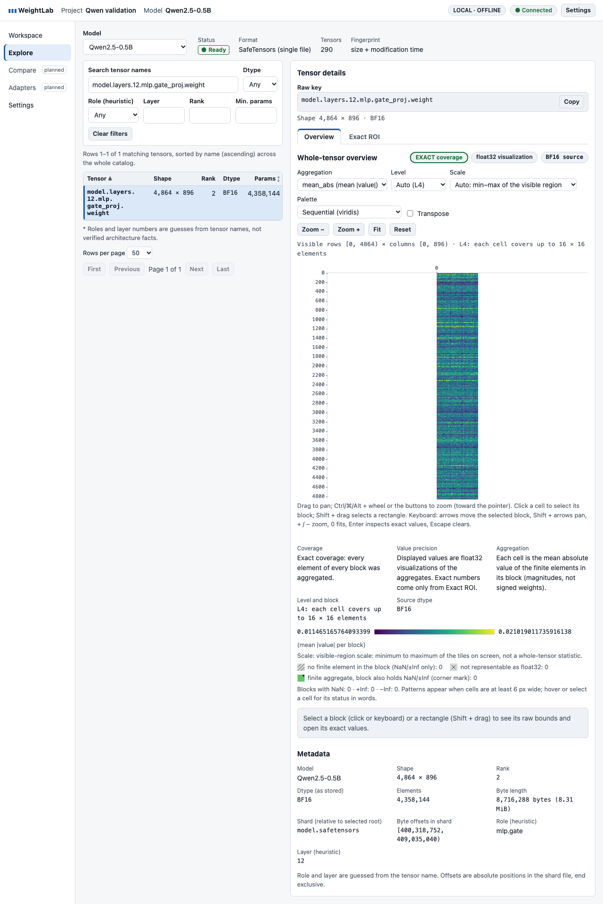
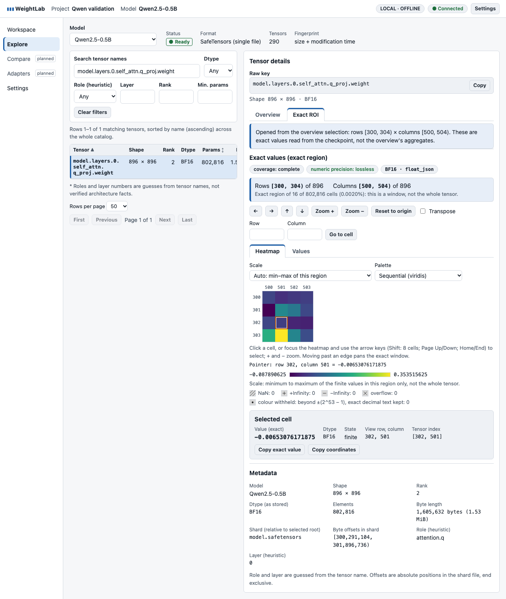
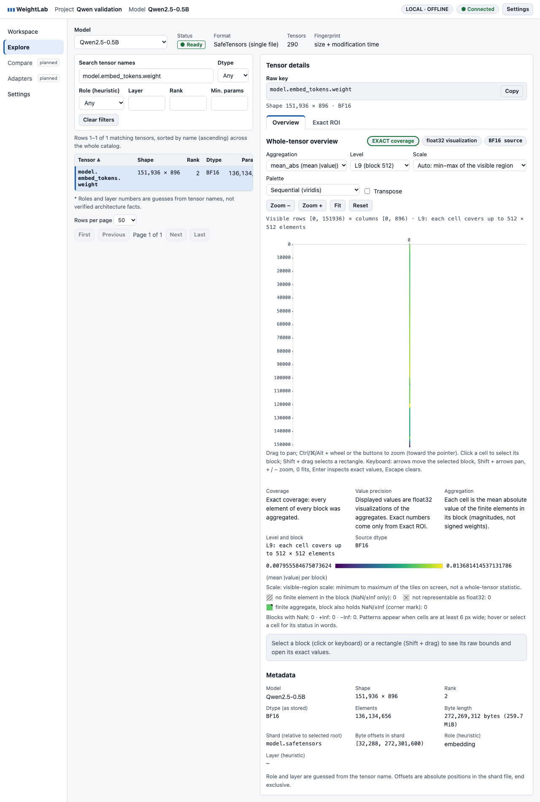
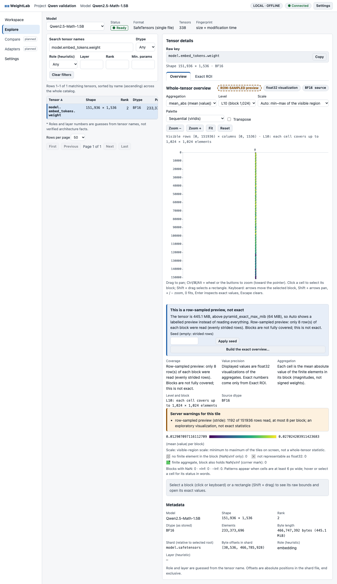
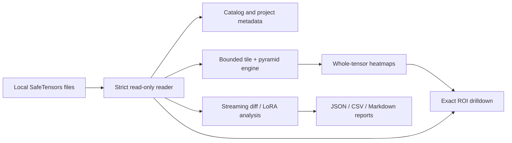

<div align="center">



**Explore LLM weights locally. Visualize tensor structure, inspect exact values, and measure checkpoint changes.**

[Quickstart](#quickstart) · [Screenshots](#see-it-in-action) · [Checkpoint comparison](#compare-checkpoints) · [Python API](#python-api) · [Limitations](#current-scope-and-limitations)

[](https://github.com/szaher/weightlab/actions/workflows/ci.yml)
[](pyproject.toml)
[](#quickstart)
[](#privacy-and-security)
[](#current-scope-and-limitations)

</div>

## Why WeightLab?

You fine-tuned a model. **What changed inside its weights?** Which matrices moved the most? Can you inspect individual parameter values without loading the whole checkpoint into memory?

**WeightLab is a local-first, CPU-only toolkit for answering those questions.** It reads SafeTensors checkpoints in place and offers a browser-based tensor explorer alongside a Python library and command-line checkpoint/LoRA change reports.

- **See the structure:** browse tensor metadata and explore entire matrices as multiresolution heatmaps.
- **Get the actual numbers:** select a region to inspect and copy lossless source values.
- **Measure the change:** rank checkpoint differences by tensor, layer, and role, with reproducible JSON, CSV, and Markdown reports.
- **Control the cost:** use bounded reads, cancellable pyramid builds, caching, and clearly labeled sampled previews.
- **Keep weights local:** no account, GPU, model inference runtime, or hosted backend required.

> **Scientific boundary:** A change in weight magnitude does **not** demonstrate improved reasoning, accuracy, or behavior. WeightLab measures parameters; behavioral claims require independent evaluation and controlled experiments.

## See it in action

These are **real screenshots** captured by browser tests on pinned [Qwen2.5 checkpoints](evidence/phase1-real-models/README.md), not design mockups.

<table>
<tr>
<td width="50%"><a href="evidence/phase1-real-models/screenshots/real-02-mlp-gate-overview.png"></a><br/><b>Whole-tensor heatmaps</b><br/>Pan, zoom, change aggregation, and select regions.</td>
<td width="50%"><a href="evidence/phase1-real-models/screenshots/real-04-exact-roi.png"></a><br/><b>Exact region inspection</b><br/>Go from visual patterns to original tensor values.</td>
</tr>
<tr>
<td width="50%"><a href="evidence/phase1-real-models/screenshots/real-06-embedding-exact.png"></a><br/><b>Large embedding matrices</b><br/>Build an exact overview using resource-bounded pyramids.</td>
<td width="50%"><a href="evidence/phase1-real-models/screenshots/real-08-math-embedding-sampled.png"></a><br/><b>Sampling you can see</b><br/>Previews disclose quality, row sampling, and coverage.</td>
</tr>
</table>

[Workspace](evidence/phase1-real-models/screenshots/real-01-workspace.png) · [Selecting a region](evidence/phase1-real-models/screenshots/real-03-attention-selected.png) · [Pyramid build](evidence/phase1-real-models/screenshots/real-05-embedding-building.png) · [ROI screenshots](evidence/phase1-roi/screenshots/) · [More UI screenshots](evidence/phase1-ui/screenshots/)

## What works today

| Feature | Available | Interface |
| --- | --- | --- |
| Create projects, import local SafeTensors, inspect/search/filter tensor metadata | Yes | Browser app |
| Explore whole 2-D tensors (and 2-D slices of higher-rank tensors), pan/zoom/transpose, five aggregations | Yes | Browser app |
| Exact ROI heatmap and accessible per-cell values table | Yes | Browser app / Python |
| Exact tiles, streamed pyramids, labeled row-sampled previews, cancellable jobs | Yes | Browser app / local API |
| Base vs. fine-tuned checkpoint difference reports | Yes | CLI / Python |
| Supported PEFT LoRA effective-delta analysis | Yes | CLI / Python |
| Graphical checkpoint-delta overlays, Compare and Adapters screens | **Not yet** | Planned |
| Whole-tensor stats jobs, image/report export from UI, inference, activations, causal evaluations | **Not yet** | Planned |

**Important distinction:** You can compare checkpoints and supported LoRA adapters **today via the CLI**. The current UI visualizes *individual checkpoint tensors*, not a side-by-side checkpoint comparison.

## Quickstart

**Requirements:** Python **3.12+**, [uv](https://docs.astral.sh/uv/), and Git. No GPU or Node.js is needed to **run** the app. Repository CI covers macOS, Linux, and Windows; the real-checkpoint visual evaluation was run on macOS/Chromium.

```bash
git clone https://github.com/szaher/weightlab.git
cd weightlab
uv sync --locked
uv run weightlab start
```

Open the link printed in your terminal, which looks like:

```text
http://127.0.0.1:<port>/#token=...
```

WeightLab serves the browser UI and local FastAPI backend on the same loopback origin. The URL contains a **per-launch access token**: open it locally, don't share it, and keep the terminal running.

### Your first five minutes

1. Click **Create project** in the browser.
2. Import a checkpoint by **absolute path**, specifying an allowed **selected root**. You can use the repository's bundled `examples/fixtures/tiny_base.safetensors` and make `examples/fixtures` the selected root. This reads the file *in place*; there is no upload.
3. Open **Explore**, select a 2-D weight tensor, and inspect its shape, dtype, and metadata.
4. Open **Overview** to pan, zoom, change aggregation (mean, mean-absolute, RMS, min, max), and select a region.
5. Choose **Inspect exact values** to see the original source values in the Exact ROI heatmap or values table.

Print the fixture's absolute paths if needed:

```bash
uv run python -c "from pathlib import Path; p=Path('examples/fixtures').resolve(); print('Root:',p); print('Model:',p/'tiny_base.safetensors')"
```

**No models to download:** the bundled deterministic fixtures are enough to try the UI and CLI. To reproduce the real-Qwen workflow, see the [pinned checkpoint validation](evidence/phase1-real-models/README.md).

### Install a local wheel

```bash
uv build --wheel
uv tool install dist/weightlab-*.whl
weightlab start
```

The wheel includes the compiled web UI, so **Node.js is only needed to rebuild it**. WeightLab is currently `0.0.1.dev0` (pre-release); do not assume it has a published PyPI package.

## Compare checkpoints

Use `weightlab diff` to measure numerical changes between two checkpoints, including compatible sharded SafeTensors directories:

```bash
uv run weightlab diff \
  examples/fixtures/tiny_base.safetensors \
  examples/fixtures/tiny_ft.safetensors \
  --out ./weightlab-report

# report.json, report.md, tensors.csv, layers.csv, roles.csv
```

For your own checkpoints:

```bash
uv run weightlab diff /path/to/base /path/to/fine-tuned --out /path/to/reports
```

Or inspect a supported **PEFT LoRA** adapter's effective weight changes against its base:

```bash
uv run weightlab diff \
  examples/fixtures/tiny_base.safetensors \
  --adapter examples/fixtures/tiny_lora \
  --out ./weightlab-lora-report
```

Reports include per-tensor and rollup **delta L2, delta RMS, relative L2, cosine similarity, max absolute delta, and non-finite counts**. Compatibility classes distinguish verified file identity from declared lineage or mere shape matching. Support for LoRA variants is intentionally limited and unsupported modules are reported rather than silently interpreted.

**Exit codes:** `0` means complete; `3` means a report was written but is **incomplete**; `2` means error; `130` means cancelled. Check `complete` and any caveats before interpreting results.

Full details: [CLI reference, metrics and LoRA support](docs/cli/weightlab-diff.md).

## Python API

Read a bounded region from a checkpoint without loading the whole model:

```python
from weightlab import open_checkpoint
from weightlab.analysis.roi import encode_roi

with open_checkpoint(
    "examples/fixtures/tiny_base.safetensors",
    selected_root="examples/fixtures",
) as checkpoint:
    print(checkpoint.metadata()[:3])
    roi = checkpoint.read_roi_raw("demo.layers.0.mlp.up_proj.weight", 0, 4, 0, 8)
    print(encode_roi(roi).to_json())
```

Compute a structured change report:

```python
from weightlab.analysis.change_report import Options, run

report = run(
    "examples/fixtures/tiny_base.safetensors",
    "examples/fixtures/tiny_ft.safetensors",
    options=Options(sort="relative_l2"),
)
print(report["complete"])
```

The Python API remains **pre-release**. See [change report documentation](docs/cli/weightlab-diff.md) and [reader implementation](weightlab/formats/checkpoint.py).

## How it works



- **Strict file reader:** validates metadata, shards, offsets, and paths; reads only bounded file regions.
- **Visual layer:** multiresolution `256 × 256` tiles, optional exact pyramids, explicit row-sampled previews, and distinct coverage/precision labels.
- **Numerical layer:** raw ROI values are lossless; tile aggregate visualizations use float32 and must not be mistaken for exact individual parameters. Non-finite values and unrepresentable numbers get explicit states.
- **Application:** local FastAPI + React, SQLite for projects, bounded job handling and cache budgets.

### Privacy and security

WeightLab runs locally by default and does not require a cloud account. The server accepts **loopback-only** binds and protects its local API with a launch token. Imported model files are read in place, not uploaded, rewritten, or deleted when a project is deleted. The application is designed without background telemetry or model-data exfiltration. Reports contain tensor names, shapes, statistics, file names, sizes, and possibly digests, so **review reports before sharing**. See [security design](docs/12_SECURITY_AND_PRIVACY.md).

### Verified on real models

The project contains reproducible validation against pinned **Qwen2.5-0.5B / Instruct** and **Qwen2.5-Math-1.5B / Instruct** checkpoints. The recorded macOS run compared **1,256 tensor metadata entries**, **184 exact ROI windows**, and **1,048 tiles** with an independent reader. It reported zero mismatches for the described numerical checks. During that run the backend's **peak RSS was 166.3 MiB**, with a **36 GiB RAM / Apple M3 Pro** host; this is a benchmark observation, **not** a general memory guarantee or proof of the 8 GiB laptop target.

Reproduce the measurements and inspect limitations in [real model evidence](evidence/phase1-real-models/README.md) and [the machine-readable benchmark](evidence/phase1-real-models/results/benchmark.json). Browser validation was in Chromium; a practitioner usability study has **not** been completed.

## Current scope and limitations

- **Format:** SafeTensors (single files or sharded indexes). No GGUF, PyTorch `.bin`, or general quantized checkpoint format support.
- **Overview:** whole-tensor heatmap aggregation is not a lossless display of every original scalar. Use **Exact ROI** for actual values.
- **Comparison:** numerical deltas are not causal evidence of improved behavior; independent checkpoints may be poorly aligned even when shapes match.
- **UI:** Compare/Adapters pages, graphical delta/LoRA overlays, stats jobs, and UI export are not built.
- **Experimental features:** inference, activations, transfer experiments, and evaluation are not present.
- **Maturity:** pre-release; field-tested practitioner feedback, non-Chromium browser coverage, and the intended 8 GiB laptop target remain unverified.

## Development and contributing

The code is under active development. Use reproducible fixtures, add tests for numerical and security behavior, and avoid weakening validation to satisfy an acceptance gate.

```bash
uv sync --locked
uv run pytest
uv run ruff format --check .
uv run ruff check .
uv run mypy
```

Frontend changes require Node.js (see [frontend documentation](frontend/README.md)):

```bash
cd frontend
npm ci
npm run lint
npm run typecheck
npm test
npm run build
npx playwright install chromium
npm run e2e
```

**Explore further:** [evaluation kit](evaluation-kit/README.md) · [test evidence](evidence/) · [OpenAPI contract](contracts/openapi.yaml) · [architecture](docs/03_SYSTEM_ARCHITECTURE.md) · [numerical methods](docs/05_NUMERICAL_METHODS.md) · [roadmap](docs/14_DELIVERY_ROADMAP.md) · [issue tracker](https://github.com/szaher/weightlab/issues).

The detailed version **1.2-final specification** remains a frozen engineering baseline; it is **not** the current implementation status. Some historical planning documents and examples describe future behavior, so treat the tested source code and evidence above as the authority for currently working features.

## License

No explicit repository-wide open-source license has been selected in the current source tree. **Do not assume the code is licensed for reuse or redistribution** until a license is added. Contributions and distribution should be discussed with the maintainer.
