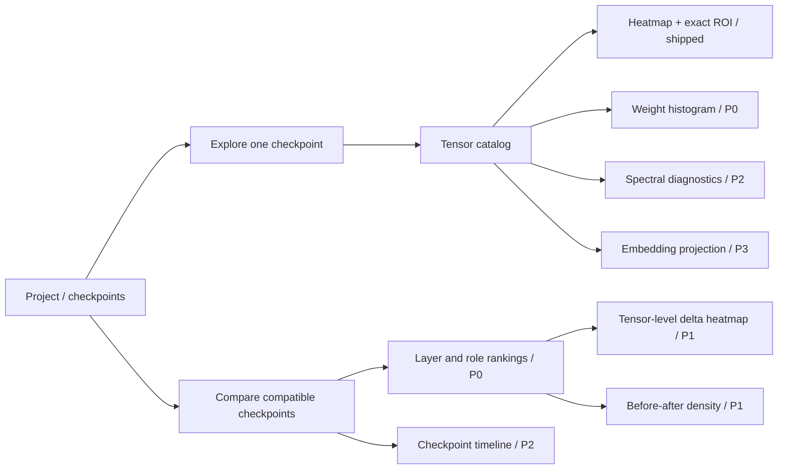

# WeightLab — Visualization Roadmap

> **Status: proposed, not implemented.** This is the *living feature roadmap* for plots and analysis views beyond WeightLab's existing single-tensor heatmaps. It defines intended user outcomes, sequencing and acceptance criteria; it does **not** promise ship dates or imply features have shipped.
>
> [What works today](README.md#what-works-today) · [Frozen engineering delivery baseline](docs/14_DELIVERY_ROADMAP.md) · [Numerical methods](docs/05_NUMERICAL_METHODS.md) · [Performance budget](docs/11_PERFORMANCE_BUDGET.md)

## Product direction

**From a heatmap viewer to a trustworthy, local-first model-weight analysis workbench.**

Answer three progressively deeper questions:

1. **What is in this checkpoint?** Tensor layout, distribution, zeros, tails and exceptional values.
2. **What changed between checkpoints?** Where changes concentrate, their direction and scale, and how they are distributed.
3. **How do parameters evolve or organize?** Trends across training snapshots and structure in embeddings or matrix spectra.

Existing features: SafeTensors metadata/catalog, whole-tensor **heatmap overview**, exact ROI inspection, resource-bounded tile/pyramid engine, and **CLI/Python** checkpoint and supported LoRA change reports. **A graphical Compare/Adapters workflow does not exist yet.**

## Proposed delivery order

| Order | Visualization | User question | Prerequisite | Status |
| --- | --- | --- | --- | --- |
| **P0 / 1** | **Layer / role / tensor change rankings** (horizontal bars, sortable table) | Which layers or components changed the most? | Existing `weightlab diff` report + new Compare API/UI | **Planned** |
| **P0 / 2** | **Weight distribution histograms** (single tensor; optional A/B overlay) | Are weights sparse, heavy-tailed, shifted or anomalous? | New bounded scan / stats service | **Planned** |
| **P1 / 3** | **Delta heatmaps** (B − A; optionally supported LoRA effective delta) | Where in a matrix did values change? | Compatibility and lineage checks; derived tile/ROI source | **Planned** |
| **P1 / 4** | **Before/after scatter or 2-D density** | Is change concentrated around unchanged values? | Matched A/B chunks; bounded points or binned density | **Planned** |
| **P2 / 5** | **Singular-value spectrum / effective-rank diagnostics** | Which matrix directions dominate? | Bounded, optional numerical jobs | **Planned** |
| **P2 / 6** | **Checkpoint evolution timeline** | How did weight changes evolve during training? | Checkpoint series, consistent baseline and provenance | **Planned** |
| **P3 / 7** | **Embedding projections** (PCA first; UMAP optional) | How are selected embedding vectors arranged? | Bounded row selection, labels/tokenizer opt-in, dimensionality-reduction jobs | **Planned** |

**Priorities reflect suggested engineering order**, not a release commitment. The first four items extend the current model/CLI and visualization architecture; the later items need more numerical infrastructure and scientific review.

## Navigation model (proposed)

Target interaction: **model → layer / role → tensor → distribution / visualization → exact values**. A plot click should preserve checkpoint identity, tensor key, coordinates, dtype, coverage and quality flags when linking to the existing Exact ROI explorer.

## Feature specifications and acceptance criteria

### P0.1 — Layer, role and tensor change dashboard

**Value:** A graphical answer to "What changed during fine-tuning?" without reading CSV files.

- Reuse per-tensor / per-layer / per-role delta L2, relative L2, RMS, cosine and counts from the existing CLI analysis rather than inventing new calculations.
- Rank with sortable bars plus a keyboard-accessible table; filter by layer, role and tensor; drill into the selected tensor.
- Show matched, missing, tied, shape/dtype-incompatible and unmeasured/withheld items separately. Surface the **X / V / L / S** compatibility verdict and source lineage caveats before rankings.
- Distinguish whole-layer rollups from averages and from per-tensor results. Label each metric and its direction (**B − A** where applicable).
- **Acceptance:** deterministic fixture pairs produce the same ranking, values, compatibility flags and completeness status as `weightlab diff`; incomplete reports are never shown as complete; runs stay local and within budgets.

**Suggested first implementation PR:** read-only Compare results view over the existing diff engine, with clear eligibility and incomplete-result handling. This is a *new UI feature*, not the already-shipped CLI.

### P0.2 — Streaming weight distribution histogram

**Value:** Reveal range, distribution shape, zero concentration, outliers and non-finite counts in a checkpoint without losing the underlying numeric truth.

- Single-tensor view first, followed by optional base/derived overlay. Support finite-value histogram counts; report zeros, NaN, +Inf and −Inf separately.
- Show bin edges, counts, source dtype, scanned vs total element counts, quality/provenance and whether the values are exact/estimated. Define binning for constant tensors and extreme ranges explicitly.
- Exact whole-tensor mode must be an explicit, bounded, cancellable scan (with bytes/time estimate); a sampled preview must be labeled and reproducible via a seed/policy. Do **not** imply the existing heatmap tiles alone supply an exact value distribution.
- Allow linear/log-count y-axis and a zero-centered view where appropriate, without silently excluding overflow/extreme values.
- **Acceptance:** compare exact histograms with independently computed counts on synthetic BF16/F16/F32/F64 and integer fixtures, including negative zero, non-finite and high-precision edge cases; cancellation yields no misleading complete result.

### P1.1 — Delta heatmap and supported LoRA overlays

**Value:** Go from a ranked changed tensor to the spatial pattern of its update.

- For eligible matched tensors, render **B − A** as a new derived tile source; make sign, colour scale, coordinate axes and coverage labels obvious. Offer exact paired ROI inspection.
- For supported PEFT LoRA, optionally render the **effective** update `scale × (B_lora @ A_lora)`, explicitly distinct from adapter factor weights and from base/derived comparison.
- Preserve compatibility, cost and unsupported-module gates; no silent rebasing of independently trained/unaligned models, no unsupported adapters presented as valid.
- Never call float32 aggregate tile values "lossless"; raw exact paired values/deltas must expose their own numeric precision policy.
- **Acceptance:** golden synthetic fixture deltas and supported LoRA blocks match independent reference values; transpose, slice, NaN/Inf, cache invalidation and cancellation all have tests.

### P1.2 — A/B scatter and density plot

**Value:** See whether most parameters remain close to their original values or deviate together.

- Plot x = base parameter and y = derived parameter with an **unchanged y=x reference line**; show tensor name, matched coverage and compatibility caveats.
- Avoid a browser scatter of millions of points. Use **bounded seeded samples** and/or a streamed 2-D binned density with explicit bin counts, bounds and overflow handling.
- Permit selection/drilldown to individual weights **only** when the plotted sample retains raw coordinates; density bins represent many weights and must not pretend to identify a single cell.
- **Acceptance:** synthetic equal tensors fall on the diagonal; changed fixtures show expected offsets; sampling repeats with the same seed; non-finite and out-of-range counts remain visible and testable.

### P2.1 — Spectral diagnostics

**Value:** Investigate structure and effective rank in dense matrices or updates, not just element magnitudes.

- Display singular-value spectrum, decay and chosen effective-rank metrics for selected 2-D tensors and eligible deltas; explain normalization and metric definitions.
- Start with **small-matrix exact SVD** subject to preflight size limits. For larger matrices, an *opt-in*, bounded, reproducible approximate method may be added with error/coverage disclosure; never label approximation as exact.
- Show compute/IO estimates, progress and cancellation; no GPU required and no full-size dense matrix materialization by default.
- **Acceptance:** exact results match an independent numerical reference within a documented tolerance; approximate runs disclose method, seed and error criteria; oversized requests are refused or require deliberate user opt-in.

### P2.2 — Checkpoint evolution timeline

**Value:** Track model changes throughout fine-tuning rather than only comparing two snapshots.

- Import/associate an **ordered sequence of checkpoints**; choose an explicit baseline, show change metrics by step/layer/role over time, and offer drilldown to a checkpoint pair.
- Timestamps/training steps must come from supplied metadata or user-provided labels—never inferred from filenames silently.
- Require compatible tensor identities and report per-step missing tensors, dtype differences and unverifiable lineage; distinguish delta-to-base from delta-to-previous-step.
- Compute on demand with a bounded cache and reuse the existing diff engine where compatible.
- **Acceptance:** synthetic 3+ snapshot sequence reproduces known trends and correct baselines; missing steps/tensors appear as gaps rather than zeroes; no erroneous causal claims about training improvement.

### P3.1 — Embedding projections (PCA first, UMAP optional)

**Value:** Explore geometry of selected token embedding rows and how their positions may shift.

- Start with **PCA** on an explicitly selected or seeded sampled subset of embedding rows; show explained variance and exact subset/coverage. UMAP may be an optional dependency/compute mode, not part of the core install.
- Add optional vocabulary/tokenizer mapping **only if supplied locally**; no automatic download or implied semantic labels. Preserve row-to-token provenance.
- Label projections as lossy views of high-dimensional vectors. Display sampling/method/seed, and caution that 2-D distances and clusters may be misleading.
- **Acceptance:** deterministic fixture embeddings yield repeatable PCA coordinates up to documented sign conventions; tokenizer alignment and invalid indexes fail closed; UI remains responsive under the configured resource budget.

## Cross-cutting definition of done

Every new visualization must satisfy all of these before being marked **Shipped**:

1. **Truthfulness:** clear source checkpoint(s), tensor, dtype, axes, method and operation; distinguish exact coverage, statistical estimation, sampled preview and numeric rounding.
2. **Correctness:** independent numerical reference with adversarial fixtures (BF16, precision edges, zeros, NaN/Inf, huge tensors, lineage mismatch where applicable). Never suppress withheld or incomplete results.
3. **Resource bounds:** preflight compute/bytes/memory budget, streaming or bounded sampling, cancellable heavy jobs, no unbounded browser points or DOM elements. Reuse cache invalidation when files change.
4. **Privacy/security:** local-first, read-only inputs, no automatic network/model download, no token or path leakage in visual exports.
5. **Usability/accessibility:** keyboard navigation, legends and tables/alternate text, clear selection-to-ROI behavior, screenshots and browser E2E evidence.
6. **Evidence:** publish actual runtime/RSS/accuracy measurements on fixtures and at least one real model where appropriate; do **not** claim the 8 GiB laptop target without testing it.

## Scope and change control

This roadmap records *potential implementation work* and user value, **not new requirements silently added to the frozen 1.2-final specification**. Any new API schema, numeric formula, compatibility rule, persistent data shape or budget must go through the appropriate versioned ADR/contract/fixtures/tests/change-log process before implementation (see [ADR-019](docs/16_DECISIONS_RISKS_AND_OPEN_QUESTIONS.md) and [design change control](docs/16_DECISIONS_RISKS_AND_OPEN_QUESTIONS.md#5-change-control)).

**Next action:** Implement **P0.1 Layer/Role/Tensor Change Dashboard** as a vertical slice. Validate the numeric/API contract and build one usable visual flow before moving to histogram scans.
