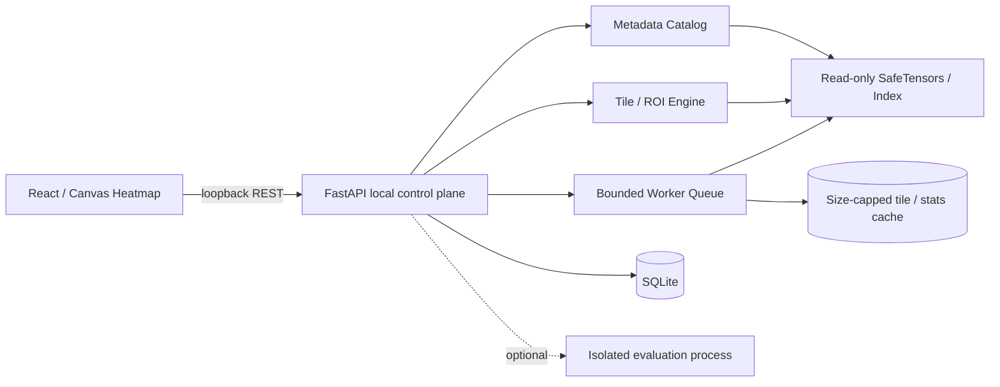
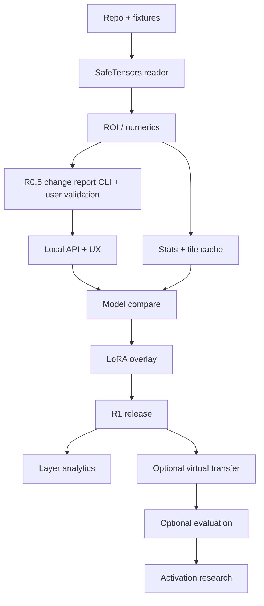

# WeightLab: Complete Product & Engineering Blueprint

**Design baseline:** 5 November 2026, frozen as 1.2-final (ADR-019; tag `spec-v1.2-final`). Additive successor revision: ADR-020 (contract 0.4.0)

**Delivery state:** Product documentation and synthetic proof fixtures; **the WeightLab application has not been implemented**.

This volume is generated from `docs/*.md` by `scripts/build_documentation.py`; edit the source documents, not this file. It includes the product requirements, functional requirements, architecture, format reader design, mathematical semantics, scientific experiment plan, UI specification, API and persistence model, performance constraints, threat model, QA strategy, delivery plan, research references and packaging instructions. Machine-readable contracts, the fixture generator/checker and agent execution instructions live alongside it in the repository.

**Key constraint:** Default weight inspection runs locally on a normal laptop, without GPU or whole-model RAM loading. Running an LLM for evaluations/activation investigations is **optional**, separate and may require more RAM.

---


\newpage

# 01 — Product Requirements Document (PRD)

**Product:** WeightLab  
**Document status:** Approved planning baseline (design intent, not delivery evidence)  
**Product philosophy:** Explore weights cheaply; compare scientifically; intervene cautiously.

## 1. Problem statement

LLM checkpoints contain millions or billions of numerical parameters, but existing workflows often require bespoke Python notebooks, heavyweight runtime dependencies, substantial RAM, or manually written scripts to explore them. Developers cannot easily answer: Which parameters changed during fine-tuning? Do changes concentrate in specific transformer components? Is an update sparse, low-rank, or unusually large? How does an adapter modify effective weights? Are two checkpoints really aligned and comparable? What changed in measured behavior when a layer update was removed?

A heatmap is a useful interaction, not a sufficient scientific explanation. WeightLab must combine an honest visual representation with numerical methods, checkpoint provenance, controlled interventions and reproducible evidence.

## 2. Positioning

**For:** Model engineers, fine-tuning researchers, curious ML practitioners, interpretability researchers and educators.  
**Who need:** Fast local understanding of model parameter structure and differences.  
**WeightLab is:** An offline, laptop-first interactive tensor explorer and experimental model-diff laboratory.  
**Unlike:** Large inference platforms or full training observability stacks.  
**It prioritizes:** Minimal dependencies, bounded resource use, accurate numerical comparisons, and reproducibility over always-on model inference or distributed services.

## 3. Jobs to be done

- J01: "Open a checkpoint and locate relevant layers/tensors without writing code."
- J02: "See a 2D matrix as a heatmap and zoom to exact numerical elements."
- J03: "Compare a base checkpoint to a math-fine-tuned checkpoint and quantify the change."
- J04: "Understand which transformer components changed most: Q/K/V/O, MLP, embeddings, norms."
- J05: "Inspect a LoRA adapter without materializing the full merged model."
- J06: "Check whether apparent heatmap anomalies survive alternative normalizations and exact statistics."
- J07: "Export a reproducible, caveated report of what changed."
- J08: "Test whether an identified update is behaviorally useful, using optional evaluation."
- J09: "Experiment with transferring changes to a compatible target under controlled conditions."
- J10: "Perform these tasks without accidentally exhausting RAM, CPU or disk."

## 4. Personas

**P1 — ML engineer:** Knows SafeTensors/PyTorch; limited time; wants before/after model diffs on a development laptop. Success = answer basic change-location question in minutes without loading a full model.  
**P2 — Researcher:** Needs statistically honest plots, exact formulas and reproducible manifests; may enable optional activation/evaluation packages. Success = export a documented, rerunnable analysis.  
**P3 — Student/educator:** Has only a laptop; wants an accurate, interactive visual mental model. Success = can inspect supplied fixtures and learn what weights do *not* prove.

## 5. Product principles

1. **Evidence, not visual storytelling:** No claim of "math neuron" or "reasoning layer" from weight magnitude alone.
2. **Local first:** Checkpoints remain on disk; network is optional and off by default.
3. **Progressive disclosure:** Quick visualization first; advanced statistics/experimental methods on demand.
4. **Hard resource ceilings:** Use small tiles and streaming algorithms; jobs have cancel buttons and budgets.
5. **Transparent uncertainty:** Differentiate exact, estimated, truncated and unsupported analyses.
6. **Reproducible:** Persist file identity, transform chain, software version, seed, eval set and metrics.
7. **Interoperable:** SafeTensors and Hugging Face sharded indices first; GGUF later with format-aware decoding.
8. **Safety:** Never deserialize arbitrary pickle, execute a model repo's custom code, or overwrite original checkpoint.

## 6. Objectives and success measures

| Objective | Metric | Release acceptance |
|---|---|---|
| First value | Import synthetic fixture -> interactive heatmap | First-time walkthrough works offline |
| Weight inspection | ROI value accuracy | Lossless for every supported dtype through typed ROI encoding (floats as exact float64 JSON numbers or raw bits, 64-bit integers as decimal strings); tiles are labeled lossy float32 visualizations; unrepresentable results return `UNSUPPORTED_PRECISION` or `overflowed`, never a silently rounded "exact" value (doc 09 section 2) |
| Compare | Delta and norms | Match independent NumPy reference within dtype tolerances |
| Memory | App memory footprint | R1 8 GB laptop gate under documented test profiles; backend idle RSS <= 300 MiB and peak RSS <= 1 GiB during bounded work (doc 11) |
| User autonomy | No cloud credentials needed | Offline E2E green |
| Validity | Misleading comparisons blocked | All incompatible-model and ambiguity fixtures rejected or explicitly labelled inspection-only |
| Reliability | No failure on malformed input | No crash, unhandled exception or arbitrary file reads in fuzz fixtures |
| Reproducibility | Export manifest complete | Full configuration and file fingerprints included |

Thresholds are requirements to verify, **not results already achieved**. Track p50/p95 latencies on reference devices, not a single unverifiable performance promise.

## 7. Scope and staged delivery

### R0 — engineering spike (must be completed before full UI)

- Synthetic SafeTensors fixture generator with known matrices (constant, ramp, pseudo-random, NaNs, infinity, rank 0, 1D, 1x1, 3D), **F16 and BF16 tensors (mandatory: most current LLM checkpoints are BF16)**, at least two shard files, LoRA pairs (rank-1 via `rank_pattern`, rank-2, rsLoRA, unsupported DoRA), compatibility sets and malformed binaries. Provided by `scripts/generate_demo_fixtures.py` and verified by `scripts/check_demo_fixtures.py`.
- Reader proof: tensor catalog, exact rectangular ROI, bytes read evidence, bounded RAM for an oversized sparse synthetic checkpoint, using bounded positioned reads (ADR-011) with WeightLab's own BF16/F16 decoding (the safetensors NumPy backend cannot read BF16).
- No heatmap tile, API or UI in R0: reader, catalog and exact ROI only, behind a Python interface. Tiles start in Phase 1 (doc 14).
- Unit tests independently verifying every ROI value read, plus real G0 benchmark evidence (memory, mutation); fixture self-checks alone are not G0 evidence.

### R0.5 — change report CLI (validation release)

- `weightlab diff BASE DERIVED` and `weightlab diff BASE --adapter DIR` produce a ranked table of every matched tensor: exact delta L2 and RMS, relative L2, cosine(A,B), max-abs delta, element and non-finite counts, heuristic role/layer; plus per-layer and per-role rollups (FR-023).
- One bounded streaming pass over both checkpoints (no full tensor in RAM), progress, Ctrl-C cancel with no partial result reported as complete.
- Compatibility class (V/L/S/X), unmatched / tied / shape-mismatched tensors printed before any numbers; rows from Class S/X pairs carry the caveat.
- JSON, CSV and Markdown output with the provenance schema from doc 10.
- Exit: used by 5-10 practitioners on real checkpoints; their feedback sets the priority order of R1 UI work (doc 14, Phase 0.5). This answers jobs J03/J04 before any UI exists.

### R1 — minimum useful product (P0)

- Local directory/file import by typed absolute path (mandatory; browsers cannot hand local paths to the server and model bytes are never uploaded), with an optional server-side native folder dialog where available; format validation, metadata preview, sharded index support.
- Model overview: the R0.5 ranked change table (per tensor, per layer, per role) as the entry point into heatmaps.
- Searchable tensors by name, shape, dtype, transformer component and layer.
- 1D vectors as line plot; 2D matrices as heatmap; 3D+ requires explicit axis/index or reduction selection.
- Pan, zoom, semantic hover tooltip, rectangular selection, arbitrary ROI numerical table, per-tensor statistics.
- Exact/estimated quality badge and signed, symmetric difference colors.
- Side-by-side checkpoint compare for same-shape matching tensors; base + supported LoRA virtual delta.
- Compatibility classification and warnings, unmatched/shape mismatch report, provenance labels.
- Local project/session, export PNG and JSON result/manifest, cancelable long jobs.
- Synthetic offline first-run demo; keyboard navigation and empty/error/loading states.

### R2 — enhanced weight analytics (P1)

- Layer dashboards and charts beyond the R0.5/R1 ranked table, spectral approximations, covariance/correlation where well-defined, time-series of checkpoint changes.
- Quantization-error inspection only when original/dequantized tensor pairs and mapping are available.
- Deterministic sampling strategies and uncertainty displays.
- User-facing notes, comparison bookmarks, reproducible report (HTML/Markdown).

### R3 — experimental transfer/evaluation (P1/P2)

- Virtual update overlay: target + alpha*delta (no permanent output until explicit export).
- LoRA per-module enable/disable and scaling; same-base verified adapter operations first.
- Evaluation subprocess integration with explicit CPU and RAM limits and prior estimated model size; math and control sets; CSV/JSON comparison results.
- Predefined matched-baseline experiments and failure modes; multiple seeds and bootstrap confidence intervals when applicable.
- Model export only if atomic space checks, provenance and audit record pass.

### R4 — mechanistic interpretability / alignment (research)

- Opt-in framework adapters for capture of selected activations and causal interventions on *small supported* models.
- Feature/head/path association views clearly distinguished from weight visualizations.
- Cross-family correspondence proposals are investigatory; direct transfer disabled without validated alignment.

## 8. Out of scope by default

- Hosting arbitrary user checkpoints; SaaS tenancy; automatic Hugging Face model download; weights as human-interpretable concepts; universal reasoning transfer; training/fine-tuning execution; model-wide full-precision SVD on laptops; live billions-of-parameters inference; unbounded prompts/activation caches; automated claims of causal behavior from passive visual differences; arbitrary .pt/.bin pickle import; editing users' original model files.

## 9. Key flows

**Flow A:** Open app -> Demo -> choose `mlp.up_proj.weight` -> inspect tile -> select ROI -> exact values -> export.  
**Flow B:** Import base and derived fine-tune -> lineage check -> ranked change table -> choose a top-ranked tensor -> switch Raw A / Raw B / Delta / Relative Delta -> compare aggregates -> save finding.  
**Flow C:** Base + PEFT LoRA -> parse config and matrix pairs -> verify target names, rank, scale and base lineage -> visual overlay for one ROI -> compare magnitude and sign.  
**Flow D (R3):** Create experiment -> select source delta and compatible target -> alpha grid -> run small held-out eval -> inspect evidence and control metrics -> export no original files modified.

## 10. First run and error states

- No files: show synthetic sample and button `Open local checkpoint`.
- Missing shard: show exact filename, do not silently skip; partial catalog may be visible but compare/exact stats disabled for affected tensors.
- Non-finite tensor: render with special marker, count NaN/+Inf/-Inf, exclude from finite-only statistics and document policy.
- Low disk: reading still allowed if no export/cache required; write operation blocked with estimate.
- Mismatch: red compatibility explanation; never attempt silent name/shape remapping.
- Too large query: offer lower-resolution preview and exact ROI request; never exceed budget and crash.
- Quantized GGUF: initially unsupported with explicit explanation rather than reinterpret packed integers as float weights.

## 11. Release quality gates

Each feature is not "done" until: acceptance story passes, reference numeric tests pass, memory and CPU budgets verified on CI/specified local test devices, cancel handling verified, accessibility checked, clear unsupported state implemented, provenance exported, and negative-path tests pass. Exit criteria are in documents 13-15.

## 12. Business and adoption assumptions

Start as OSS/devtool; validate the R0.5 change report with 5-10 practitioners before building the R1 UI, and again before adding commercial features. Potential later paid features: team-shared research reports, large multi-checkpoint comparisons, enterprise managed provenance or workflow integrations; none are necessary for R1. Instrument success only with local, opt-in analytics; never phone home.


\newpage

# 02 — Functional Requirements and User Acceptance

Conventions: **P0** mandatory R1, **P1** R2/R3, **P2** optional R4. Every requirement has stable ID. IDs appear in backlog and tests. Input sizes and resource ceilings may force the UI to offer sampling rather than exact full scans; this is not a silent degradation.

## A. Project and import

- **FR-001 [P0]:** Create/open local project with project name, timestamp, app/schema version and references to paths, not duplicates of checkpoint bytes.
- **FR-002 [P0]:** Import one `.safetensors` file or a local model directory with `model.safetensors.index.json` and referenced shards, by typed absolute path, read in place. No HTTP upload of model bytes; an optional native folder dialog is a convenience only (doc 09 section 1.1).
- **FR-003 [P0]:** Safely parse tensor metadata without materializing data. List tensor name, shape, dtype, file/shard, byte extent, parameter count and estimated byte count.
- **FR-004 [P0]:** Explicitly reject unsupported formats with an actionable explanation; no eager `torch.load`, pickle or remote code execution.
- **FR-005 [P0]:** Detect non-regular files, symlink escapes (when project policy restricts paths), missing/duplicate shards, incorrect offsets, malformed headers, unsupported dtype, and changed files after import.
- **FR-006 [P0]:** Search/filter by tensor name, shape, dtype, block index and guessed transformer role; role guessing may fail and must be labeled heuristic.
- **FR-007 [P0]:** Compute stable file identity (size, high-resolution mtime, normalized path and optional full SHA-256 on demand); report identity strength. Quick identity is not cryptographic proof.
- **FR-008 [P0]:** Persist and reopen project. File moves trigger relink flow; file mutation invalidates cached summaries.
- **FR-009 [P1]:** Import a multi-checkpoint timeline and parse user-provided training step metadata; missing steps require manual ordering.
- **FR-010 [P1]:** GGUF metadata preview and float tensor inspection with documented tensor layout conversion; packed quantized tensors supported later via verified decoders.

## B. Tensor visualization

- **FR-011 [P0]:** 2D dense weight heatmap with pan/zoom, axis labels, cell coordinates, exact value on hover/click at sufficiently high resolution, and tile error/loading indicators.
- **FR-012 [P0]:** At model-scale zoom, show aggregated downsampled data, not randomly selected pixels posing as a complete matrix.
- **FR-013 [P0]:** Support aggregation modes mean, min, max, mean-absolute and RMS; signed means may cancel, so RMS/mean-absolute are emphasized for magnitude.
- **FR-014 [P0]:** Represent NaN, Inf, missing data, underflow and zero distinctly in legend and tooltips.
- **FR-015 [P0]:** Offer robust color scaling: symmetric diverging for signed delta; fixed range, percentile-clipped (clearly marked) or min/max for raw weights. Default colorblind-safe diverging palette.
- **FR-016 [P0]:** Show row/column coordinate ranges and actual matrix dimensions; origin top-left, row-major logical indexing for all screens. No implicit transpose.
- **FR-017 [P0]:** Display vector as line or histogram with sorted/strided sampling warning, and 3D+ as axis slices selected by user; no semantic assumption for unknown dimensions.
- **FR-018 [P0]:** Exact ROI table within bounded cell count. ROI larger than threshold gives download/export of chunked CSV or asks to narrow request.
- **FR-019 [P0]:** Tensor details: dtype, element/finite/zero/non-finite counts, min, max, mean, population standard deviation, L1/L2/Frobenius norms (when applicable), each with `coverage` (complete/sampled) and `numeric_precision` (lossless/rounded/overflowed), and elapsed scan. Exact percentiles only for an ROI (<= `roi_max_cells`, exact sort, linear interpolation between order statistics, non-finite excluded). Global tensor percentiles are **deferred to R2** (FR-021).
- **FR-020 [P0]:** Disable or cancel expensive full scans. Data rendering must remain interactive during scans.
- **FR-021 [P1]:** Tensor histograms, per-row/per-column profiles, outlier hotspots, sign histograms and numerical precision analysis; global percentiles from a deterministic mergeable sketch whose algorithm, rank-error bound and golden adversarial tests are fixed by an ADR before R2.
- **FR-022 [P1]:** Model-layer treemap or matrix overview driven by catalog and aggregate summaries.
- **FR-023 [P0]:** Ranked change report. For a compatible A/B pair or base + adapter, compute per matched tensor in one bounded streaming pass: exact delta L2, RMS, relative L2 (denominator policy visible), cosine(A,B), max-abs delta, element/finite/non-finite counts; roll up by layer index and role (heuristic, labeled). Delivered as CLI in R0.5 and as the UI model overview in R1; JSON/CSV/Markdown export with provenance. Sorting by a metric never implies causal importance.

## C. Checkpoint comparison

- **FR-030 [P0]:** Choose A and B with explicit model provenance, strict tensor key match and shape/dtype compatibility. Output matched, missing, tied, renamed-suspected and shape-mismatched tensors. A tensor is reported as `tied -> <source key>` only with positive evidence: `tie_word_embeddings: true` in `config.json` together with a known architecture key mapping (e.g. `lm_head.weight` <-> `model.embed_tokens.weight`), or trusted alias metadata. Absence of a key alone is `missing`. The absent tensor is never synthesized.
- **FR-031 [P0]:** Compare same-shaped tensors using `delta=B-A` in explicitly documented promoted computation dtype; no arithmetic on packed quantized representation.
- **FR-032 [P0]:** Modes: A, B, delta, abs(delta), ratio `abs(delta)/(abs(A)+epsilon)` with epsilon visible and configurable, masked epsilon-near-zero values.
- **FR-033 [P0]:** Delta summary: L1, L2, max abs, RMS, relative L2 with denominator policy and dot-product/cosine with explicit degeneracy handling.
- **FR-034 [P0]:** Both raw and delta heatmaps use independently visible value ranges; side-by-side comparison uses optional locked shared scale to avoid deceptive colors.
- **FR-035 [P0]:** Label comparisons `strict lineage verified`, `compatible shape but lineage unverified`, or `incompatible` with exact reasons; unverified compare limited to descriptive inspection and opt-in acknowledgement.
- **FR-036 [P0]:** Idempotent previews: same file versions, tile, method and config -> same result bytes/values, subject to documented floating-point platform variance.
- **FR-037 [P1]:** Layer-level aggregate bar chart built on FR-023 data, select top changed projections, checkpoint timelines and normalized change index.
- **FR-038 [P1]:** Conservative matched tensor mapping for known Qwen/Llama naming conventions; raw keys and explicit confidence always visible.

## D. LoRA and virtual updates

- **FR-040 [P0]:** Load PEFT-style adapter directory with `adapter_model.safetensors` and `adapter_config.json` for supported vanilla linear LoRA modules.
- **FR-041 [P0]:** Validate A/B pairing, shapes `(r,in)` and `(out,r)`, target mapping `(out,in)`, adapter rank and per-module alpha including `rank_pattern` / `alpha_pattern`, and `layers_to_transform` / `layers_pattern`. Honor `fan_in_fan_out` (base weight stored transposed, e.g. GPT-2 `Conv1D`): either apply the documented transpose and record `transpose=true` in provenance, or reject; never guess. Reject explicitly: DoRA (`use_dora` or `lora_magnitude_vector` keys), embedding LoRA (`lora_embedding_A/B`, different layout) in R1, LoHa/LoKr/IA3, prompt tuning, `modules_to_save` effects and non-linear targets.
- **FR-042 [P0]:** Implement `delta=s*(B@A)` for chosen tile or streaming numerical summary only; `s=alpha/r` for standard LoRA and `alpha/sqrt(r)` for rsLoRA (respect module rank/alpha patterns).
- **FR-043 [P0]:** Overlay `effective W = base W + delta` for compatible base/adapter with no permanent merged file. Support `alpha_override` slider only as user-controlled experimental scale separate from adapter's native scaling.
- **FR-044 [P0]:** Strict base-lineage verification through configured base ID, user confirmation and available matching hashes; mismatch produces warning and disables default transfer.
- **FR-045 [P1]:** Compare multiple adapters trained on the same known base; per-module update similarity and overlap; report which modules have no adapter.
- **FR-046 [P1]:** Create virtual partial-update configurations (module toggles, scale) stored as experiment configs; changes to original checkpoint forbidden.

## E. Experiments and interpretation

- **FR-050 [P1]:** Create versioned experiment definition containing source, target, update selector, lambda/alpha sweep, evaluation dataset hash, inference backend, generation settings and hardware details.
- **FR-051 [P1]:** Require valid transfer mode before enabling operations: same-base LoRA, verified common ancestor task delta, or explicit experimental mode with severe warning; refuse shape-incompatible direct addition.
- **FR-052 [P1]:** Virtual-update preview must work with CPU-only weight analysis, independent of inference availability.
- **FR-053 [P1]:** Local evaluation subprocess is opt-in and separate from viewer process; plan memory before launching, expose status/cancel, and stop on timeout or resource cap.
- **FR-054 [P1]:** Paired baseline vs modified run with identical prompts, tokenizer, backend and decoding settings; record exact-match/other metric and per-item outcomes.
- **FR-055 [P1]:** Include negative control (random/shuffled delta with comparable magnitude) and non-math retention/control tasks.
- **FR-056 [P1]:** Export interpretation labels `descriptive`, `correlational`, `interventional evidence`, `unverified`; no claim that a single tensor is a capability.
- **FR-057 [P2]:** Small-model activation recorder with token-level selective hooks; show runtime cost estimate before capture.
- **FR-058 [P2]:** Activation patching and ablation with matched clean/corrupt datasets, careful causal interpretation and multiple-example uncertainty.
- **FR-059 [P2]:** Weight alignment/correspondence research environment with original coordinate systems preserved; never equate two tensors merely because names/shapes match.

## F. Persistence, exports and user trust

- **FR-060 [P0]:** Export image with legend, axes, scale, tensor full key, model fingerprints, zoom, slice, color transform and sampling status.
- **FR-061 [P0]:** JSON export schema with versioned provenance and data quality, no secret local absolute paths unless user confirms.
- **FR-062 [P0]:** Session and bookmark persistence, restore last view, relink missing models.
- **FR-063 [P0]:** Offline demo without any external network; never require login.
- **FR-064 [P0]:** No background uploads, automatic model downloads or analytics collection; explicit network consent required for future features.
- **FR-065 [P0]:** User-facing status for current RAM estimate, active scan, file I/O, progress, cancel, slow disk, and cache size.
- **FR-066 [P0]:** Undo/restore settings; original checkpoint always read-only.
- **FR-067 [P1]:** Portable Markdown/HTML research report with selected images, exact formulas, source provenance, limitations, evaluation metrics and experiment configurations.

## G. Quality and negative acceptance scenarios

- **AC-001:** Open the 2D synthetic 8x8 with known entries; hover all 64 cells and compare with `expected_results.json` `base_full`, produced by an independent reference parser (not the reader under test).
- **AC-002:** A file of 10GB+ on disk can be cataloged and one bounded ROI requested without proportional process RAM use.
- **AC-003:** Deliberately missing shard reports missing filename and no false results.
- **AC-004:** Same-shaped but different-base checkpoints receive `lineage unverified`, not `compatible for transfer`.
- **AC-005:** Values `NaN`, `+Inf`, `-Inf` do not silently color as zero, poison finite-only summaries or crash serialization.
- **AC-006:** Full scan cancel stops worker and frees allocations; UI remains responsive.
- **AC-007:** Two matched SafeTensors checkpoints of same base yield correct delta and row/col coordinates.
- **AC-008:** LoRA tile for rank 2 equals independently computed dense `B@A` fixture to stated tolerance.
- **AC-009:** R1 app installs and runs offline on supported macOS, Windows and Linux CPU-only hosts.
- **AC-010:** Invalid/huge coordinates and malformed JSON return explicit HTTP 4xx, not server crash.
- **AC-011:** Export filenames/manifest never contain auth tokens or source model bytes unintentionally.
- **AC-012:** UI indicates sampled/aggregate tiles and distinguishes them from exact cell values.
- **AC-013:** BF16 and F16 tensors in `tiny_dtypes.safetensors` decode bit-exactly to the expected float32 values, including NaN, +Inf, -Inf, -0.0 and each dtype's max finite value.
- **AC-014:** Truncation, append, size or mtime change, atomic replace/rename and symlink swap of a checkpoint file during a read or job yield `FILE_CHANGED` and the backend process survives. A same-size in-place rewrite that preserves mtime is detected only by `consistency=verified` jobs; this limitation is shown in the UI and docs (doc 03 section 6).
- **AC-015:** `compat/tied_embeddings` vs `compat/untied_reference` reports `lm_head.weight` as tied (config + known mapping), `compat/missing_head_no_tie_evidence` reports it missing; the permuted same-function pair is Class S with a visible caveat although its function is identical.
- **AC-016:** `tiny_precision_a/b` round-trip losslessly through the ROI API: U64 max, I64 min, 2^53-1, 2^53, 2^53+1, F64 extremes, the 2^-52 F64 difference and signed zero. The finite F64 pair whose delta overflows is reported `overflowed`; the F32 delta beyond float32 range is `NOT_REPRESENTABLE` in tiles. Nothing rounded is labeled lossless.
- **AC-017:** The non-finite golden blocks of `tiny_edge.safetensors` produce the status bitfields in `expected_results.json` in both binary and JSON tiles; legend and hover show the same NaN/+Inf/-Inf kinds.
- **AC-018:** A derivative whose metadata names a genuine base SHA-256 but was not built from it is reported with `base_file_identity_verified=true`, `lineage_trust_level=unverified_claim`; it is never shown as proven trained-from-base and is not T1-eligible without a trusted lineage statement.

## H. User stories

1. As a student, I want an offline demo so I can use the app before downloading a large model.
2. As an engineer, I want to import a sharded SafeTensors model so I can list tensors without needing Torch.
3. As an engineer, I want an exact 32x32 ROI so I can validate a surprising heatmap pattern.
4. As an engineer, I want to sort layers by normalized change so I can identify candidate regions to investigate.
5. As a researcher, I want source/target provenance so I do not draw conclusions from unaligned checkpoints.
6. As a researcher, I want a fixed symmetric delta color scale so I can compare signs reliably.
7. As an experimenter, I want to disable individual adapter modules and evaluate behavior without rewriting the base model.
8. As a cautious user, I want strict memory and CPU ceilings so that opening a huge model never makes my laptop unusable.
9. As an educator, I want the UI to explain why a color difference is not proof of a learned capability.
10. As an OSS contributor, I want deterministic fixture-based CI tests so regressions are easy to reproduce.


\newpage

# 03 — System Architecture and Execution Model

## 1. System context

WeightLab is a locally installed HTTP service bound to `127.0.0.1` with a bundled/static React UI opened in the user's browser. The backend is Python 3.11+ using FastAPI, Pydantic, NumPy and SafeTensors. PyTorch, Transformers, PEFT, GGUF decoding and inference engines belong in **optional plugins or isolated subprocesses**, never the default startup path.



## 2. Component boundaries

**UI:** Routes, state, heatmap canvas/WebGL optionally, request coalescing, throttling, cancellation and accessible controls. Must not run model inference.  
**Local API:** Validates requests, manages project and permissions, applies resource budget policy, returns stable JSON and binary tiles.  
**Catalog module:** Imports selected local files, verifies SafeTensors metadata/shard index, persists references and renders normalized semantic tensor inventory.  
**TensorReader abstraction:** `tensor_metadata()`, `read_roi()`, `iter_contiguous_chunks()`. SafeTensors first. Default implementation uses bounded positioned reads (`os.pread` / `readinto`) into preallocated buffers over validated byte ranges, with WeightLab's own BF16/F16 decoding; mmap is an optional, measured backend (ADR-011, section 6).  
**Numerics:** Performs streaming reductions with numerically stable accumulation, sampling, min/max, percentiles, delta composition and LoRA ROI matmul.  
**Tile engine:** Serves tiles by direct bounded reads when the covered bytes are small, otherwise from an exact aggregate pyramid built in one streaming pass for that exact source and view; only sources above `pyramid_exact_max_mib` get a row-sampled preview. Cold requests return 202 with a deduplicated build job, never a silently sampled tile (ADR-012, section 5; decision table in doc 09 section 3). Tile and ROI-table budgets are separate.  
**Job supervisor:** Caps concurrency and memory; cancellation between chunks; progress; per-job CPU limits; batch results stored in SQLite or small cache.  
**Persistence:** SQLite WAL, narrow schema, project state and file references only. Cache is disposable and size-bounded.  
**Optional experiment runner:** Separate process with its own dependencies, model resource preflight and explicit user opt-in.

## 3. Repo layout

```text
weightlab/
  pyproject.toml                  # core Python deps only
  uv.lock                         # locked exact deps, committed
  README.md
  LICENSE
  frontend/
    package.json, package-lock.json
    src/app/, src/components/, src/features/, src/api/, src/types/
    e2e/
  weightlab/
    __init__.py
    cli.py                        # weightlab start / doctor / demo / diff
    api/app.py
    api/routes/{health,projects,models,tensors,tiles,comparisons,jobs,exports}.py
    core/{config,limits,errors,provenance,math}.py
    formats/{base,safetensors_reader,dtypes,shards,peft_lora}.py
    analysis/{tile,pyramid,roi,stats,diff,report,lora}.py
    storage/{db,repository,migrations,cache}.py
    tasks/{queue,worker,cancel}.py
    optional/{evaluation,gguf,activation}.py
  tests/
    unit/, property/, fixtures/, integration/, security/, perf/
  docs/
    architecture.md, api.md, research.md
  scripts/
    generate_demo_fixtures.py     # provided; golden fixtures + expected_results.json
    check_demo_fixtures.py        # provided; independent reference parser
    run_benchmarks.py
```

## 4. Data path for heatmap

1. UI requests model catalog and tensor metadata; backend returns only metadata, never entire tensor.
2. Viewport determines requested tensor region and resolution level (`aggregation`), tile boundaries and optional 3D slice.
3. UI sends at most a fixed maximum number of in-flight requests; aborts old ones on pan/zoom.
4. API validates model identity, coordinates and view budgets; checks cache key.
5. Engine computes exact low-resolution ROI or deterministic block aggregate in bounded chunks and returns values as little-endian FP32 binary plus JSON metadata or JSON for tiny debugging payloads.
6. UI colors values using legend/min-max policy, overlays non-finite/missing masks and draws axes without stretching coordinate meaning.
7. Exact per-cell reading is separate API call; hovering an aggregate tile displays aggregate + covered index range, not a fabricated exact value.

## 5. Tile pyramid algorithm

**Coordinate convention:** Logical 2D tensor `(R,C)`, rows downward, columns rightward, zero-based, half-open rectangles `[r0,r1)×[c0,c1)`. For view level `L`, `block_size=2^L` input cells per aggregate cell. A rendered tile is `tile_size=256` aggregate cells per side (smaller at tensor edges). Tile `(x,y)` covers raw columns `[x*256*2^L,(x+1)*256*2^L)` and raw rows `[y*256*2^L,(y+1)*256*2^L)` clipped to tensor dimensions. All downsampling anchored at origin to guarantee deterministic parent-child consistency.

At `L=0`: actual cell values (within the tile budget `max_tile_cells`, independent of the ROI-table budget). At `L>0`: aggregate summaries for the covered real cells using selected aggregation. A mean of children must be **count-weighted** at partial edges, and RMS must aggregate sums of squares rather than averaging per-block RMS values; min/max combine trivially. Aggregate records (format below) are sufficient for every aggregation: mean = sum/finite_count, mean_abs = sum_abs/finite_count, RMS = sqrt(sum_sq/finite_count), min/max direct. All fields merge by addition (counts, sums) or min/max.

**Exact pyramid first (ADR-012).** Typical LLM weight matrices are 30-250 MiB on disk (4096x4096 BF16 = 32 MiB; 4096x14336 BF16 = 112 MiB). Reading one end to end in row stripes is sequential I/O and is cheaper than scattered sampling. Therefore:

- **Direct reads** when the bytes covered by the requested tile are <= `direct_tile_max_mib` (default 64 MiB). Levels 0-3 always qualify for every supported dtype (an L3 tile covers at most 2048x2048 cells = 32 MiB at F64).
- **Exact pyramid** otherwise. Base level 4 (16x16-cell blocks) and coarser levels merged from children, built in one streaming pass. Pyramids are built on demand per source and view (never for a whole model at import).
- **Row-sampled preview** only for sources above `pyramid_exact_max_mib` (default 1024 MiB on disk, e.g. large-vocabulary embeddings / `lm_head`): whole rows chosen by deterministic stride or SplitMix64 seed (doc 05 section 5), read sequentially and labeled with rows sampled. The exact pyramid is available there only as an explicitly requested job.
- **Cold cache:** a request that needs a pyramid that is not ready returns 202 with a `pyramid_build` job, deduplicated by pyramid identity; the UI shows a progress placeholder and never substitutes a sampled tile for a source under the limit (doc 09 section 3).
- Per-cell scattered sampling is not used: k point samples per block over a 256x256 output is about 4M random accesses, each of which can touch a separate 4 KiB page, which is more I/O than an exact scan of most tensors.

**Aggregate record format v1** (little-endian, versioned as `pyramid_record_format=1`, part of the cache key):

| Record | Fields | Size |
|---|---|---|
| Base (L4, <= 256 cells) | `finite_count, nan_count, pos_inf_count, neg_inf_count` as uint16; `flags` uint8 + 7 B padding; `sum, sum_abs, sum_sq` float64; `min, max` float64 over finite values | 56 B |
| Coarse (L >= 5) | the same counts as **uint64** (an L8 block already holds 65,536 cells); `flags` uint8 + 7 B padding; sums and min/max float64 | 80 B |

- Counters are merged with checked addition; overflow (impossible below 2^64 elements) aborts the build with `RESOURCE_LIMIT` rather than wrapping.
- min/max are stored in float64, which is exact for every float dtype up to F64 and for integers within +/-2^53. For I64/U64 sources pyramid min/max/sums are `numeric_precision=rounded`; exact integer values come from the ROI API.
- `flags`: bit 0 `SUM_OVERFLOW`, bit 1 `SUM_ABS_OVERFLOW`, bit 2 `SUM_SQ_OVERFLOW`, set when a float64 accumulator becomes +/-Inf although every input was finite (e.g. F64 values near 1e200 squared). Flags propagate to parents. An aggregation that depends on an overflowed field is returned with tile status `NOT_REPRESENTABLE` and `numeric_precision=overflowed`; it is never shown as a source Inf or as an exact finite value.
- Blocks outside the tensor are not stored; edge blocks hold only their real cells, so parents are count-weighted automatically.
- Storage for all levels: one base record per 256 cells plus about one third as many coarse records, i.e. (56 + 80/3) / 256 = 0.323 B per cell: about **16.1% of a BF16 tensor's size**, 8.1% of F32, 4.0% of F64. The disk cache cap (`tile_cache_disk_mib`) and LRU eviction apply; a pyramid that cannot fit is kept in memory for the session or refused with `RESOURCE_LIMIT`.

**Pyramid and tile identity.** A pyramid is valid only for one exact `(source kind, input file fingerprints, tensor key(s), view: row_axis, col_axis, fixed_indices, transpose, operation parameters: transform, epsilon, LoRA native scale, experiment multiplier, module mask, numerics_version, pyramid_record_format)`. Two slices of one 3D tensor, two LoRA multipliers or two transforms therefore never share a pyramid. The tile cache key adds level, x, y, size, aggregation, quality mode and sampling seed. Identities are serialized as canonical sorted-key JSON and hashed with SHA-256 (doc 10 section 6). Any change to an input's fingerprint invalidates every pyramid and tile that includes it.

**Derived sources need their own pass.** A `delta` pyramid is built by a paired streaming pass over A and B computing `B - A` elementwise in float64 and aggregating the result; RMS, mean-absolute, min and max of `B - A` cannot be derived from separate A and B pyramids (only the signed mean can, and only with identical finite support). A pair where either input is non-finite yields the IEEE result of the subtraction, which is counted in the non-finite counters by its computed kind and in `invalid_pair_count`. LoRA sources stream `s * B[rows] @ A` in row blocks without materializing the full product, within `max_lora_scan_gmac`.

Current viewport cost and estimated bytes scanned remain visible.

**Separate budgets.** Heatmap tiles and the exact-value ROI table are different products. A tile returns at most `max_tile_cells` = 256x256 = 65,536 values for rendering; the numeric ROI table / JSON is capped at `roi_max_cells` = 4,096. Level-0 tiles carry exact cell values as colors; exact numbers shown as text come from the ROI endpoint or from a level-0 tile payload the client already holds.

## 6. Controlled reader strategy

**Default: bounded positioned reads (ADR-011).** The reader validates the header (doc 04 section 2), then serves reads with `os.pread` (POSIX) or seek + `readinto` (Windows) into preallocated, size-capped buffers covering whole row stripes of the validated byte range. Reasons:

- **BF16:** the safetensors NumPy backend cannot return BF16 (verified with safetensors 0.8.0: `TypeError: data type 'bfloat16' not understood`), and BF16 is the dominant dtype of current LLM checkpoints. WeightLab decodes BF16 itself (`uint16` bits shifted left 16, viewed as float32) and F16 via NumPy `<f2`. F8 variants (`F8_E4M3`, `F8_E5M2`, `F8_E8M0`, ...) are rejected with `UNSUPPORTED_DTYPE` in R1 until decoders with golden vectors exist.
- **Crash safety:** with mmap, truncating the file during a read raises SIGBUS on macOS/Linux and kills the Python process; stat checks before and after a job cannot prevent this. Positioned reads turn the same event into a short read, which the reader reports as `FILE_CHANGED`.
- **Windows:** an open mapping blocks deletion or rename of the user's file; positioned reads hold only short-lived, LRU-capped handles. Seek + `readinto` shares a file position, so on Windows every job and thread uses its own handle (POSIX `os.pread` is position-independent and may share one).
- **Explicit memory accounting:** peak usage is the sum of live buffers, not page-cache behavior.

mmap may be added later as an opt-in backend if benchmarks show a benefit, only inside an isolated worker process (so SIGBUS cannot take down the API) and with the same allocation tests. The safetensors library remains a reference validator: every fixture must be accepted or rejected identically by WeightLab's parser and upstream. Non-contiguous column slices are served by reading the covering row stripes and slicing in memory; the I/O estimate reports stripe bytes, not selected bytes.

Never dereference untrusted offsets without range validation. Keep file handles under an LRU cap (`max_file_handles`) to avoid descriptor exhaustion.

**Change detection and snapshot consistency.** An `fstat` on an open handle cannot see an atomic replace of the *path* (the old inode stays open), and checks race with in-place writes. WeightLab therefore defines two levels:

- **`best_effort` (default):** before a job, after every read batch and at the end, compare (a) the open handle's `fstat` (size, `mtime_ns`, `ctime_ns`, device + inode on POSIX / volume serial + file index on Windows) and (b) a fresh `stat` of the path (same fields, following the symlink chain once) against the identity recorded at import. Any difference, a short read, or a path that now resolves elsewhere (replace, rename, symlink swap) raises `FILE_CHANGED`, discards the result and invalidates caches for that file. Limitation: a same-size in-place rewrite that also preserves `mtime_ns` and `ctime_ns` is not detectable this way.
- **`verified` (job option):** additionally hash every input file before and after the job (two full reads) and fail with `FILE_CHANGED` if the digests differ. This is the only mode that may be described as a consistent snapshot.

Documentation and UI must not claim that "any mutation" is detected; they state the best-effort rule and the verified option.


## 7. Task / concurrency model

- Interactive priority queue: one active per user project for heavy scans; up to 2 interactive tile computations by default.
- Long-running statistics/compare job in separate worker/process or cancellable cooperative thread; results persisted only on success.
- Memory reservations (`estimated_peak_bytes + active_reservations <= budget`) admitted before execution. Reject/queue above budget.
- Max 1 heavy job concurrent by default; `MAX_CORES=min(2, available)` default; expose configuration.
- Each job has `created`, `queued`, `running`, `completed`, `canceled`, `failed`, `interrupted` states. App restart marks running jobs interrupted.
- API request cancellation and job cancellation are distinct; no detached zombie workers.

## 8. Normalized tensor roles

Roles are `embedding`, `attention.q`, `attention.k`, `attention.v`, `attention.o`, `mlp.up`, `mlp.down`, `mlp.gate`, `norm`, `lm_head`, `other`, `unknown`; role and layer extraction are heuristics, never required for raw metadata. Plugin architecture matchers can parse known naming families; raw tensor key is canonical identity. No heuristic key matching is valid evidence for merging.

## 9. Error model

Use stable structured errors (`VALIDATION_ERROR`, `UNAUTHORIZED`, `FORBIDDEN_ORIGIN`, `NOT_FOUND`, `CONFLICT`, `PATH_OUTSIDE_ROOT`, `INVALID_FORMAT`, `MISSING_SHARD`, `INVALID_ROI`, `RESOURCE_LIMIT`, `RATE_LIMITED`, `UNSUPPORTED_DTYPE`, `UNSUPPORTED_PRECISION`, `INCOMPATIBLE_TENSOR`, `LINEAGE_UNVERIFIED`, `FILE_CHANGED`, `NONFINITE_POLICY`, `OPTIONAL_RUNTIME_MISSING`, `NOT_ACCEPTABLE`; the enum in `contracts/openapi.yaml` is authoritative). API never returns a Python traceback to frontend; sanitized diagnostics go to local opt-in logs.

## 10. Packaging model

R1 installs as one CLI package (`uv tool install .` or `pipx install .`) plus prebuilt static frontend assets bundled in wheel. `weightlab start` binds to random/selected localhost port, prints local URL, creates user data dir and SQLite file. Later native desktop shell is optional; minimize packaging complexity initially. Windows supports native Windows Python, not just WSL. Test headless CI and browsers.

## 11. Design constraints and gotchas

- Reading != free memory: OS page cache and large scans can exert memory pressure even with low process RSS. Measure RSS and system memory pressure separately.
- File mutation during a read: best-effort detection compares handle and path identity per batch; only `verified` jobs prove snapshot consistency (section 6). Never mmap in the API process (SIGBUS).
- `safetensors.numpy.save_file` (0.8.0), used by fixtures and any future export, writes non-C-contiguous arrays in memory order, i.e. silently transposed, and does not keep multi-key `__metadata__` order stable between runs. Always pass `np.require(a, requirements="C")` (not `np.ascontiguousarray`, which turns 0-d arrays into 1-d) and use one metadata key where byte reproducibility matters.
- The browser can become the RAM bottleneck with large tiles or retained arrays; enforce per-view tile count (default 12 visible + 8 prefetched) and LRU purge.
- A single 2D matrix of 100k x 100k has 10B cells; avoid full-row materializations.
- "Exact global statistics" cost O(N) element reads; queued and cancelable, not instant.
- `model.safetensors.index.json` can reference paths; resolved files must remain within explicitly selected model directory unless user separately authorizes location.
- BF16 conversion, quantized tensors and LoRA scaling must have independent mathematical reference tests.


\newpage

# 04 — File Formats, Reader Contract and Compatibility

## 1. Format capability matrix

| Input | R1 | Later | Notes |
|---|---|---|---|
| Single SafeTensors | Metadata, ROI, stats, compare | More dtypes | Core format |
| HF sharded SafeTensors + index JSON | Full support | — | Parse `weight_map`, verify referenced files |
| SafeTensors F8 (`F8_E4M3`, `F8_E5M2`, ...) | Explicit unsupported R1 (`UNSUPPORTED_DTYPE`) | R2 | Needs decoder and golden vectors; never reinterpret as int8 |
| PEFT vanilla LoRA adapter SafeTensors | Supported modules/scale | DoRA, IA3, variants | Must validate adapter_config and A/B pair |
| GGUF FP16/F32 | Explicit unsupported R1 | R2 | Names/layout differ; require format reader |
| GGUF Q4/Q5/etc | Explicit unsupported R1 | R2/R3 | Dequantization and block packing format-aware |
| `.bin`, `.pt`, `.pth` | Unsupported | Evaluate safe conversion tool | Never load pickle by default |
| ONNX | Unsupported | Possible reader plugin | Different tensor naming/graphs |
| safetensors from non-LLM network | Raw numerical inspection allowed | Architecture views | Do not imply transformer semantics |

## 2. SafeTensors structural contract

The format stores an 8-byte little-endian header byte length, JSON metadata (may be right-padded with spaces), and a tensor data region. Each tensor definition has dtype, shape and `[begin,end)` byte offsets relative to the start of the tensor data region. Supported core dtypes: F64, F32, F16, BF16, I64, I32, I16, I8, U64, U32, U16, U8, BOOL where a safe numerical conversion exists. **F16 and BF16 are mandatory from R0**; BF16 is decoded by WeightLab because the safetensors NumPy backend cannot represent it (doc 03 section 6). F8 variants, complex and any unknown dtype string are rejected with `UNSUPPORTED_DTYPE` until explicitly tested. Exact inspection is lossless for every listed dtype through the typed ROI encodings of doc 09 section 2 (64-bit integers as decimal strings, floats as exact float64 JSON numbers or raw bits); tiles are float32 visualizations and are labeled as such. 64-bit integers are never converted to JavaScript Number.

Mandatory validation:

1. Header byte length N: 8-byte little-endian prefix, `N <= 100,000,000` (the upstream safetensors cap) and `8 + N <= file size`. The header may be right-padded with spaces.
2. **Strict JSON:** valid UTF-8; standard JSON only, so `NaN`, `Infinity` and `-Infinity` tokens are rejected (Python `json.loads` accepts them by default: pass `parse_constant` that raises); duplicate keys rejected at every level (`object_pairs_hook`); nesting depth bounded (parse failure or `RecursionError` -> `INVALID_FORMAT`). The top level is an object; `__metadata__`, if present, maps strings to strings only (no nesting, numbers or null).
3. **Strict entries:** every other key is a tensor name (UTF-8, <= 4096 bytes, compared byte-for-byte, no Unicode normalization) whose value has exactly the fields `dtype`, `shape`, `data_offsets`. `dtype` is a known string; `shape` is a list of at most 32 non-negative JSON integers (booleans and floats rejected; in Python `bool` is an `int` subclass, so test `type(v) is int`); `data_offsets` is two JSON integers. Element count and byte length use exact integer arithmetic (`math.prod`), and `end - begin == numel * dtype_size`. Zero-sized dimensions are legal (`numel = 0`, `begin == end`): such tensors appear in the catalog with an "empty tensor" state, have no heatmap, and report statistics with `count = 0` and null values.
4. Offsets non-negative and within payload, and the ranges of all tensors, sorted by `begin`, must tile the data region exactly: no overlap, no gap, no trailing bytes. This matches what the upstream safetensors validator enforces (fixtures `overlapping_offsets`, `gap_in_offsets`).
   WeightLab is deliberately stricter than upstream in two places, recorded as permitted differences in `expected_results.json`: rank above 32 and unknown fields in a tensor entry are rejected by WeightLab but accepted by safetensors 0.8.0. For all other fixtures, upstream acceptance is the compatibility oracle.
5. No out-of-bound reads; handle and path identity revalidated before, during and after each job (doc 03 section 6).
6. Detected file changes during analysis fail the job with `FILE_CHANGED`; do not continue against stale offsets. Detection is best-effort unless the job runs with `consistency=verified`.
7. JSON metadata strings are treated as data, not executable code.

Prefer mature official library for parsing and validation; supplemental low-level mmap must use validated ranges only.

## 3. Sharded index contract

Expected `model.safetensors.index.json` with `weight_map`: exact tensor name -> relative `.safetensors` shard, parsed with the same strict JSON rules as headers. Every value must be a string holding a relative POSIX-style path: no backslashes, no drive letter or UNC prefix, not absolute, no `..` component; it is normalized against the selected root and must not escape it through symlinks or reparse points. Keys are compared byte-for-byte. Check every key exists once in its referenced shard and do not treat a catalog from incomplete shards as complete. `metadata.total_size`, if present, must be an integer; a mismatch with the shards is a warning, not an error. Track missing/extra keys and report them. Path traversal is rejected even if the OS would permit it. No automatic downloads.

## 4. Reader interface

```python
@dataclass(frozen=True)
class TensorMeta:
    key: str
    shape: tuple[int, ...]
    dtype: str
    shard_id: str
    data_offset: int
    byte_length: int
    role: str | None

class TensorReader(Protocol):
    def metadata(self) -> list[TensorMeta]: ...
    def read_roi_2d(self, key: str, r0: int, r1: int, c0: int, c1: int,
                    axes: tuple[int,int] | None = None,
                    fixed_indices: dict[int,int] | None = None) -> np.ndarray: ...
    def iter_flat_chunks(self, key: str, chunk_bytes: int) -> Iterator[np.ndarray]: ...
```

Contract: `read_roi_2d` returns exactly `(r1-r0,c1-c0)` in logical layout, within caller budget; never return writable views backed by original bytes; exact value conversion to native float32/f64 may be needed for arithmetic. Every call uses only authorized tensor key and bounded coordinates. `iter_flat_chunks` covers each numeric element exactly once in deterministic order for exact stats. For non-contiguous data, implement stripe planner and I/O cost estimation rather than allocation of full matrix.

## 5. Tensor dimensions and shapes

- Rank 0: scalar numerical metadata, single value.
- Rank 1: render line/histogram/table, not a fake 2D heatmap without labeling.
- Rank 2: raw heatmap `(rows,cols)` exactly as stored.
- Rank >=3: require choice of `row_axis`, `col_axis` and fixed indices for remaining axes; each selected axis must differ; dimension order never guessed silently. Optional reductions for remaining axes are P1 and must state method and cost.
- Rank 0 and 1 comparisons still supported for stats when shapes match.
- Transposition requires explicit UI toggle and appears in provenance as `transpose=true`.

## 6. LoRA mapping contract

For an ordinary linear layer with weight `W` shape `(out_features,in_features)`, `A` shape `(r,in_features)`, `B` shape `(out_features,r)`, `delta = scale * B @ A`. Support only a **declared tested subset**:

- **Key mapping:** saved PEFT keys have the adapter name stripped: `base_model.model.<module path>.lora_A.weight`. Canonical mapping strips the `base_model.model.` prefix and the `.lora_A.weight` / `.lora_B.weight` suffix, then appends `.weight` (or `.base_layer.weight` where the base was saved wrapped). It is a controlled function with tests; no fuzzy name matching without explicit user confirmation.
- **Scale per module:** `r = rank_pattern.get(module, r)`, `alpha = alpha_pattern.get(module, lora_alpha)`; `scale = alpha/r`, or `alpha/sqrt(r)` when `use_rslora`. Pattern keys are matched as PEFT does (suffix/regex), with tests per form.
- **Layer selection:** `layers_to_transform` / `layers_pattern` restrict which layers carry the adapter; modules outside it are `no adapter`, not errors.
- **`fan_in_fan_out=true`** means the base weight is stored `(in,out)` (GPT-2 `Conv1D`): the effective delta is `scale * (B @ A).T` in the stored layout. Apply it only with a dedicated golden test and `transpose=true` in provenance; otherwise reject. This is the classic silent-transpose bug.
- **Unsupported, fail closed:** `use_dora` or `lora_magnitude_vector` keys (fixture `tiny_lora_dora_unsupported`), embedding LoRA (`lora_embedding_A/B`), `modules_to_save`, LoHa/LoKr/IA3, non-linear targets. Disable effective-weight inference for those modules and show which parts cannot be accounted for.

Example precise tile computation:

```python
# W, A, B must already have validated compatible shapes.
# [r0:r1, c0:c1] is desired ROI, and r is adapter rank.
A_sub = A[:, c0:c1].astype(np.float32)
B_sub = B[r0:r1, :].astype(np.float32)
delta_roi = scale * (B_sub @ A_sub)
base_roi = reader.read_roi_2d(weight_key, r0, r1, c0, c1)
effective_roi = base_roi.astype(np.float32) + delta_roi
```

Allow output ROI only if intermediate arrays fit budget. If user chooses a large ROI, tile it or reject with limit error. For native PEFT adapter + base, distinguish adapter's training scale from extra experimental scale `lambda`.

## 7. Model comparability classification

Two questions are kept apart in every compatibility decision (`LineageAssessment` in `contracts/openapi.yaml`):

1. **Is the base file the one the derivative names?** `base_file_identity_verified` is true when the base files are byte-identical to a reference the derivative's record names, established by (a) SHA-256 of every referenced base file equal to a hash recorded in the derivative's provenance (`base_identity_method=sha256_recorded`), or (b) the offline Hugging Face hub cache: the derivative declares the base repo **and revision**, the base snapshot is that revision, and each LFS blob's filename (the hub cache names LFS blobs by the file's SHA-256) matches a fresh hash (`hf_cache_blob_sha256`). No download.
2. **Was the derivative actually trained from that base?** A hash match cannot prove this: anyone can write a genuine base hash into a fabricated derivative's metadata, and model cards are unsigned claims. `lineage_claim_source` records where the ancestry statement comes from (`adapter_config`, `model_card`, `weightlab_manifest`, `synthetic_fixture_generator`, `user_attestation`, `none`) and `lineage_trust_level` how far it is trusted: `proven_by_construction` (only fixtures built by WeightLab's generator), `trusted_statement` (a manifest the user explicitly marks as trusted, e.g. from their own training run), `unverified_claim`, or `none`.

**Class V (base identity verified):** `base_file_identity_verified=true` plus the same architecture, tensor names/shapes and tokenizer/config where behavioral interpretation requires it. Class V means "the base file is the one named", **not** "training ancestry proven". `lineage_evidence` is `cryptographically_verified`.

User attestation is not a route to Class V. When the user states that these exact files were the training base, the hashes are recorded and the pair stays Class L with `lineage_evidence = user_attested`, `lineage_claim_source = user_attestation`; it satisfies the T2 acknowledgment (doc 06 section 6) and nothing more. Real-world adapters usually record only `base_model_name_or_path` without a revision or hash: Class L with `lineage_evidence = declared`. Weight similarity (for example per-tensor cosine(A,B) > 0.99 across all matched tensors) is recorded as supporting evidence for Class L, never as proof.

Transfer eligibility (doc 06 section 6) needs both: T1 requires Class V **and** `lineage_trust_level` in {`proven_by_construction`, `trusted_statement`}; Class V with `unverified_claim` is research-mode only. The generated fixture pair `tiny_base`/`tiny_ft` is Class V with `proven_by_construction` because the generator builds one from the other, and the UI says so ("synthetic: ancestry known by construction").

**Class L (lineage declared or attested, not cryptographically verified):** Metadata references same base ID (`declared`) or the user attested it (`user_attested`), but no cryptographic proof; side-by-side descriptive comparisons allowed; transfer behind acknowledgment, default disabled; the evidence kind is shown wherever the class is shown.  
**Class S (shape-compatible only):** Exact names/shapes but unknown or different origin; difference may be meaningless due to parameter permutation/alignment; display with prominent caveat; transfer disabled.  
**Class X (incompatible):** Missing required tensors, shape mismatch, incompatible dtype/architecture or unsupported packing; no direct numerical combine. Per-tensor matching subsets may still be visualized as **unverified inspection**.

File content hash can establish identity, not functional equivalence or shared optimization trajectory. Naming equal tensors is never proof of semantic alignment.

**Tied parameters.** A missing key is reported as `tied -> <source key>` only with positive evidence: `tie_word_embeddings: true` in `config.json` together with a known architecture mapping (`lm_head.weight` <-> `model.embed_tokens.weight` for Llama/Qwen-style keys, `lm_head.weight` <-> `transformer.wte.weight` for GPT-2-style keys), or trusted alias metadata. Without such evidence the key is `missing` (fixture `compat/missing_head_no_tie_evidence`). A comparison against an untied model compares the source tensor once and states that the tie differs. Missing values are never invented.

## 8. GGUF specific later considerations

GGUF contains metadata and tensors with documented block formats; quantized values are packed groups, not ordinary fp16 floats. Require validated parser/decoder, test vectors for each quantization type, and documented layout conversion from GGUF naming/transpose conventions. Compare dequantized numeric values only with disclosed precision loss. Inference via llama.cpp does not imply correctness of arbitrary GGUF heatmap slicing. Do not use packed block bytes as heatmap values.

## 9. Data integrity / provenance

Persist canonical path/selected root, type, file size, high-resolution mtime and optional SHA-256; loaded tensor key/shape/dtype; API parser version; program version; color/aggregation/sampling settings; source role maps; adapter scale config. Never assert a hash from only path+mtime is collision-resistant.

## 10. Required format tests

- 1x1, empty permitted tensor shapes, 2D odd dimensions, 3D, huge metadata, shard index, BF16 bit decode.
- Truncated header, corrupt JSON, negative/overflow shape, offset overlap, missing shard, key missing in shard, path traversal, symlink escape.
- LoRA A/B swapped, rank mismatch, `rank_pattern`/`alpha_pattern`, rsLoRA factor, `fan_in_fan_out`, embedding LoRA rejected, nonstandard module, missing source base, DoRA present.
- BF16/F16 bit decode incl. specials; F8 and unknown dtype rejected; duplicate key; gap and overlap in offsets; tied embeddings.
- Change file mid-read -> fail and invalidate cache.


\newpage

# 05 — Numerical Semantics, Statistics and Visualization Math

## 1. Prime rule

Numerical methods are products, not implementation details. Every metric includes formula, dtype, missing-value policy, approximation status, and enough metadata for reproduction. A heatmap pixel may represent one true parameter, hundreds of parameters, or a sample: the UI must disclose which.

## 2. Scalar representations

- Raw `W[i,j]`: input data in source dtype or displayed promoted float; tooltip includes original dtype.
- `Delta[i,j] = W_B[i,j] - W_A[i,j]`: explicit orientation B minus A.
- `Absolute delta = abs(Delta)`.
- `Relative delta = abs(Delta)/(abs(W_A)+epsilon)`; default epsilon `1e-8` for float32 comparisons, user adjustable; not a statistical percent and can be unstable near zero, hence mask/flag entries with `abs(W_A) < epsilon`.
- `LoRA delta = s (B @ A)` with native adapter scale and optional separate experiment multiplier.
- `Virtual W(alpha) = W_target + alpha*Delta_source` with alignment/lineage eligibility checks.
- `Gradient`: never call a weight difference a gradient. Delta is an accumulated result of optimization, not an instantaneous derivative.

## 3. Numerical promotion / accumulation

Default arithmetic conversion: raw values are never converted for exact inspection (the ROI API encodes them losslessly, doc 09 section 2). For computation, F16/BF16/F32 are promoted to float64 (exact), F64 stays float64, and deltas and LoRA products are computed in float64; tiles convert the final aggregate to float32 for display only. Integers up to 32 bits promote exactly to float64; I64/U64 statistics use Python integers for counts, min and max and float64 (marked `rounded`) for sums and means. Stable online Welford for mean/variance (Chan et al. merge for chunks) and scaled sum of squares for norms (LAPACK `dnrm2`-style), so finite inputs never overflow an L2 norm.

**Coverage vs precision.** Streaming every element makes *coverage* complete; it does not make float64 arithmetic exact. Every metric therefore carries two independent labels:

- `coverage`: `complete` (every element in scope was read) or `sampled`.
- `numeric_precision`: `lossless` (the value is a source value, e.g. min/max of a float tensor, a count, or an ROI value), `rounded` (result of float64 arithmetic within the stated tolerance), `overflowed` (an intermediate or the result left the float64 or float32-display range although inputs were finite; the value is withheld), or `unsupported`.

The UI's "exact" badge means `coverage=complete`; precision is shown next to it. Overflowed values are never displayed as source NaN/Inf or as finite statistics. Fixture `tiny_precision_a/b` covers F64 1e300 extremes, a finite pair with an overflowing delta, and a sum of squares that overflows.

**R1 tolerance:** Tests state per-dtype tolerances, e.g. for float32 direct deltas `atol=1e-6, rtol=1e-5`; LoRA matmul float32 `atol=2e-5,rtol=1e-4` for fixture shapes; refine based on BLAS cross-platform numerical behavior. Do not set blanket tolerance for every tensor scale/dtype.

## 4. Exact streaming statistics

For finite elements `x1...xn`:

- count `n`, zeros, negatives, positives; NaN/+Inf/-Inf separate.
- mean `mu = sum(x)/n`, standard deviation **population** `sigma=sqrt(sum((x-mu)^2)/n)` unless `sample=true` explicitly.
- L1 `sum(abs(x))`, L2/Frobenius `sqrt(sum(x^2))` for matrix, RMS `sqrt(sum(x^2)/n)`.
- maxAbs, min, max.
- `relative_L2 = ||B-A||_2 / max(||A||_2, epsilon_norm)`; expose denominator and a `near_zero_reference` flag.
- cosine similarity `dot(A,B)/(||A||*||B||)`; null for zero norms or no overlapping finite pairs.
- Pearson correlation requires enough nonconstant finite pairs; null for zero variance or `n<2`.
- Percentiles: R1 offers exact percentiles only for an ROI (<= `roi_max_cells` values, exact sort, linear interpolation between order statistics, non-finite excluded and counted). Global tensor percentiles are deferred to R2 (FR-021): an ADR will fix a deterministic mergeable sketch, its rank-error bound and adversarial golden distributions before they ship. Never label global percentiles exact without proof.

For deltas, pairs with non-finite in either input excluded from finite pair metrics but counted in `invalid_pair_count`. All metrics declare total tensor elements vs analyzed finite elements.

## 5. Sampling

Supported sampling modes:

1. **Exact ROI:** Values for every element in small rectangle; no sampling.
2. **Deterministic stride preview:** Select predictable grid representatives; visually diagnostic but biased on periodic structures; label `stride preview`.
3. **Seeded pseudorandom sample:** For distribution summaries, sample positions by reproducible seed and report n and seed, avoiding duplicate indices where relevant. Positions are derived from SplitMix64 (`splitmix64(seed_mix ^ counter)`, reference implementation in `scripts/generate_demo_fixtures.py`), where `seed_mix` hashes (file fingerprint, tensor key, level, tile, user seed). Never use NumPy RNG streams, whose output is not guaranteed stable across NumPy releases.
4. **Exact pyramid / aggregate scan:** Stream all elements once in row stripes and build exact block aggregates for every level (doc 03 section 5). Default for tensors <= `pyramid_exact_max_mib`; an explicit queued job above it.
5. **Row-sampled tile:** Only for tensors above `pyramid_exact_max_mib`. Read a declared number of whole rows (deterministic stride or seeded selection) sequentially and aggregate them per block; report `sampled_rows`, total rows and policy. Per-cell scattered sampling is not used because its random I/O can exceed an exact scan.

Do not use ordinary sampled estimates to infer tiny differences in models without confidence/variance reporting. Where uncertainty is not estimated, mark `exploratory` not statistically validated. Sampled L2 norms must be called *estimates* with explicit scaling and error caveat.

## 6. Aggregation definitions

For a block `S` of original tensor elements:

- mean: `sum_{i in finite S} x_i / count_finite`
- mean-absolute: `sum |x_i| / count_finite`
- RMS: `sqrt(sum x_i^2 / count_finite)`
- min / max: min or max over finite values
- non-finite mask: show if any NaN/Inf; optionally show fraction overlay
- empty/all-nonfinite: return null with the status bitfield (`NO_FINITE` plus the kinds present, doc 09 section 3), never fabricate zero

For a *difference heatmap* compute elementwise difference then aggregate, in a dedicated paired streaming pass (doc 03 section 5); subtracting independently aggregated RMS or absolute values is **not** the same operation (fixture expectation `rms_delta_vs_difference_of_rms`). For signed mean, `mean(B-A)=mean(B)-mean(A)` with identical finite pair support only. For a LoRA overlay, compute each needed block/ROI without allocating the full effective weight.

## 7. Color/legend

- Default signed difference: colorblind-safe **diverging** centered at exactly zero; symmetric `[−M,+M]`, where M is visible fixed or robust percentile threshold; out-of-range clipped samples indicated.
- Default raw: sequential palette for magnitude with optional diverging option for signed raw, user-controlled.
- Shared-scale comparison between A/B; raw side-by-side autoscaling prohibited unless visibly unlocked and per-panel legends shown.
- Missing/non-finite transparent checkerboard or patterned neutral texture; separate markers for NaN, Inf and unavailable.
- Quantization and relative delta views use separate legend with method text.
- Keep real numeric scale and data min/max distinct; changing scale must not change underlying values.

## 8. Relationship between weights

The UI may show:

- Row/column cosine similarities, but computing all pairwise similarities is O(n^2) in number of rows and costly. Permit selected rows or bounded samples first.
- Norm profiles across rows/columns, activation-independent descriptive geometry.
- Sign agreement, delta direction cosine and overlap of large-magnitude changes.
- Singular value spectra estimated via randomized SVD on bounded tensors only, labeled approximations; full decomposition may require large RAM.
- Cross-layer comparison with different shapes only via **summaries**, never elementwise subtraction.
- Attention/MLP role aggregation helps navigation but does not prove a semantic function.

## 9. Causal interpretation guardrails

**Observed update:** `||Delta||` high means parameters changed in magnitude, not that they were responsible for reasoning improvement.  
**Association:** A change correlates with improved benchmark accuracy; it may be confounded by other updates.  
**Intervention:** Disable/restore/scale update and measure output change with matched settings; supports more causal claims about that specific intervention, subject to distribution shift and interactions.  
**Mechanistic proof:** Requires deeper circuit and activation evidence beyond weight heatmaps.

## 10. Numerics acceptance fixtures

Fixture family:

- Linear ramp 8x8 with known cell values; parity tests for x/y axes, transpose and ROI.
- All zeros (relative denominators and zero cosine).
- Constant 1 (zero variance Pearson).
- Mixed signs with exactly known mean/RMS.
- BF16/F16 known values, NaN, +/-Inf, -0.0 and max finite (`tiny_dtypes.safetensors`).
- Nan/Inf/−Inf mask.
- Delta introduced at two known coordinates.
- LoRA rank-1 (via `rank_pattern`) and rank-2 hand-computable examples; rsLoRA rank-4; DoRA rejection.
- Odd-size 257x263 sine matrix for tile boundary and weighted parent aggregation (edge block expectations at L1 and L3).
- Large sparse file fixture to test bounded RAM and cancellation.
- Same-shape permuted representation with identical function (`compat/permuted_same_function`) to show why simple coordinate alignment is misleading.

## 11. Exported metric schema

Every metric object includes `name`, `value`, `units`, `method`, `source_dtype`, `compute_dtype`, `element_count`, `finite_count`, `sample_count`, `coverage`, `numeric_precision`, `seed` (if any), `epsilon` (if any), `numerical_warnings`, `tool_version`, and model fingerprint references (`Metric` in `contracts/openapi.yaml`). 64-bit integer counts and extrema are decimal strings.


\newpage

# 06 — Research Protocol: Weight Changes, Math Ability and Transfer

## 1. Research questions

**RQ1:** Which weights change when a specific fine-tune improves math accuracy?  
**RQ2:** Are those changes concentrated by component or layer more than a matched control training run?  
**RQ3:** Are changes in weight magnitude/direction related to behavioral improvements?  
**RQ4:** Can selected updates be transferred to a compatible target while preserving general capabilities?  
**RQ5:** Do interventions on an identified update produce changes beyond random matched-norm control updates?  
**RQ6:** What do different models with nominally similar math ability have in common in *representations or function*, not merely raw coordinates?

## 2. Starting experiment (evaluable on a laptop)

Use a small **verified base model** and one math adapter from it. Avoid relying on random unaudited public "math" checkpoints to establish lineage; instead generate fixture adapter and, if possible, train or obtain a documented small math adapter. Suggested family Qwen2.5 0.5B / Qwen3 0.6B **subject to the exact available release, license and device support verified by implementer**. The first test may use synthetic tiny model before real language models. Exact model IDs are configuration, not hardcoded into the viewer.

Dataset: small, license-reviewed held-out arithmetic/word-problem subset. Distinguish tasks from training data; record possible contamination. Include parity, answer extraction and numeric-equality metrics with a fully deterministic answer parser. For a rigorous study, use separate reasoning benchmarks and multiple seeds; small samples are only illustrative.

## 3. Experimental groups

A. Base model (unchanged).  
B. Same base + native math LoRA (positive control).  
C. Same base + math LoRA with selected layer/module disabled, implemented as a small derived adapter file with that module's A/B removed (adapters are megabytes, so no merged checkpoint is written).  
D. Same base + math LoRA scaled by `lambda in {0, 0.25, 0.5, 0.75, 1.0, 1.25}`.  
E. Same base + random/shuffled adapter delta matched in norm and relevant structure (negative control).  
F. Distinct same-base adapter target + sourced math delta (research transfer arm; ensure effective combined scaling convention).  
G. Incompatible/unrelated model: do **not** directly transfer; show compatibility report only.

For cross-checkpoint full-parameter task vectors: A=pretrained checkpoint, B=A fine-tuned; `Delta=B-A`; target C must share sufficiently verified weight coordinate system and intended evaluation configuration. Direct addition to independent B-family checkpoint is disabled until alignment experiment protocol exists.

## 4. Primary and secondary outcomes

Primary: paired held-out accuracy with per-example results (`exact match` after documented answer normalizer, or task-specific numeric checker); improvement relative to base.  
Secondary: non-math task retention, inference latency, token count, sample variation, update magnitude by layer, direction cosine between updates, distribution metrics.  
Negative outcomes: gain only on training-like tasks, control degradation, non-reproducible output, increased hallucination or token verbosity with no accuracy gain.

Do not claim "better at reasoning" from math score alone; it is evidence for measured task performance under stated prompts and generation settings.

## 5. Paired evaluation contract

- Use identical system instructions, prompt templates, tokenizer, chat template, context length, seed, decoding and hardware backend for both arms.
- Deterministic decoding `temperature=0` is preferable for first small experiment, but backend nondeterminism should be recorded. Multiple-seed protocol for stochastic sampling.
- Include per-item `question_id`, prompt hash, reference answer, raw model response, parser result, correctness, token count, response time, error cause and branch ID.
- Calculate paired accuracy difference; show confidence intervals via bootstrap across questions only when enough items exist, with bootstrap seed and method.
- Report raw counts not just percentages; visually label small-N result as exploratory.
- Freeze eval set before inspecting results to reduce cherry-picking; store declared exclusions and reasons.

## 6. Transfer eligibility rules

**T1:** LoRA adapters whose base is Class V (base file identity verified) **and** whose lineage statement is `proven_by_construction` or `trusted_statement`, with compatible target names/scaling -> eligible virtual composition; note potential interference. Class V with `unverified_claim` falls to T2.  
**T2:** LoRA adapter + same model architecture and base ID, where base identity is unverified (`declared`, `user_attested`) or the lineage statement is an `unverified_claim` -> require explicit user acknowledgment (a recorded attestation counts) and block export until verified and trusted, or overridden in recorded research mode.  
**T3:** Full-task delta and second fine-tune descended from exact shared base with matching tensor keys/shapes/dtypes/tokenizer, where the shared-base claim is Class V and `trusted_statement` or better -> permitted research-mode weighted addition, never silently assumed to improve behavior.  
**T4:** Similar model names/architectures but different training base or unverified coordinate system -> descriptive compare only; no automatic direct merge.  
**T5:** Different shapes/families -> no direct addition; an advanced projection/alignment study is separate scope, potentially using activation matching and calibration data, and requires proof of mapping.

## 7. Layer intervention

Module scale vector `m` where `m_l=0` disables adapter update in layer l and `m_l=1` enables it; `W_eff_l=W_base_l + m_l*s*B_l@A_l`. Grouping may use attention.q/k/v/o vs mlp.up/down/gate vs norms. Distinguish *block removal* from zeroing original weights. Realize `m` for evaluation by writing a derived adapter (module removed for `m_l=0`, `B_l` multiplied by `m_l` otherwise) whose hash is persisted; the base checkpoint is never rewritten. Model inference adapter must apply exactly this convention; UI preview must match evaluation's effective model. Persist method and virtual-update hash.

Intervention designs:

- Leave-one-layer-out: full adapter except layer `l` turned off.
- Only-one-layer-in: all off except `l`.
- Select attention/MLP family update selectively.
- Scale selected update while retaining the rest.

These interventions can interact; a simple sum of individual effects need not explain total gain. Present as empirical sensitivities, not independent causal attributions.

## 8. Statistical and scientific safeguards

- Sample variance and small test sizes limit conclusions.
- Training data overlap or benchmark contamination can masquerade as learned general reasoning.
- Different tokenizers/prompt templates make behavioral comparisons ambiguous.
- High raw weight deltas can reflect optimizer dynamics or representational reparameterizations, not greater causal importance.
- Same-shaped tensors can be unaligned due to symmetries/permutations.
- Full LoRA matrices A/B have non-unique factorizations; compare **effective** B@A delta rather than expecting A to align directly across independent trainings.
- Quantization error can confound transfer, especially if virtual update is applied before/after dequantization.
- Public models can use modified training pipelines, tied/untied embeddings, RoPE differences, differing layer counts or hidden base changes.

## 9. Experiment artifact

One experiment directory contains:

```text
experiment-<uuid>/
  manifest.json           # schema v1, file identity, model lineage, config, tool version
  eval_items.jsonl        # input IDs and reference outcomes, only if license permits
  runs/base.jsonl         # model outputs and per-item scores
  runs/treatment.jsonl
  runs/control.jsonl
  metrics.json            # paired aggregate and uncertainty
  interventions.json     # layer/module switches and alpha sweep
  assets/*.png            # plots with all axes/legends
  README.md               # protocol, limitations, conclusions
```

Never write model weights by default. Exports of merged model (later) require a distinct confirmation with disk estimate and license review.

## 10. Exit criteria for a publishable research claim

- Documented shared base lineage and exact weight coordinate system.
- Independent numerical unit tests for applied virtual delta.
- Held-out fixed eval set and at least one non-target control set.
- Negative control update and matched inference settings.
- Repeatability across seeds or deterministic reruns, uncertainty reported.
- Transparent negative results and failure modes.
- Clearly bounded claim: e.g., "on N specified arithmetic examples, toggling LoRA modules in layers X–Y changed accuracy by D points"; not "found math weights".

## 11. Relevant prior research

See `17_RESEARCH_AND_REFERENCES.md`: task arithmetic, TIES merging, Git Re-Basin, reasoning change localization, TransformerLens. WeightLab does not claim these methods as novel. Its distinctive goal is integrating *accurate, local, low-resource* inspection with reproducible experimental comparison.


\newpage

# 07 — Optional Activation / Inference Design

## 1. Why optional?

Weights are static checkpoint data. Activations require a forward pass on actual input and can be much more memory-expensive than weight inspection, especially with many layers, tokens and captured positions. R1 must work without inference, Torch or GPU. R3/R4 require separate installation and explicit preflight.

## 2. Capability levels

- **Level 0 (R1):** Weight-only exploration; no model execution; all calculations operate on checkpoint tensors.
- **Level 1 (R3):** Generate/evaluate outputs for a small model on CPU in an isolated subprocess. **Default backend: `transformers` + `peft` on CPU, loading the same SafeTensors files the viewer inspected** (about 2 GiB at FP32 or 1 GiB at BF16 for a 0.5B model), so the evaluated effective weights equal the previewed ones (ADR-015). Module masks and scales are realized as small derived adapter files (doc 06 section 7). `llama.cpp` is an optional faster backend, but it needs GGUF conversion and usually quantization, so its runs are labeled `weights differ from viewer: <quant type>` and cannot satisfy the R3 'preview equals evaluated model' gate. Hardware/model support must be checked before launch.
- **Level 2 (R4):** Selected activation capture for small supported models through optional PyTorch/TransformerLens plugin. Selection by layer, token positions and hook names; no full-network cache default.
- **Level 3 (research):** Activation intervention (zero/restore/patch) and causal metrics. Multiple runs and datasets required; substantial runtime warning.

## 3. Preflight estimator

Estimate: model file memory mapping and working set, runtime KV cache `(layers * heads_or_kv_heads * head_dim * tokens * bytes * K/V factor)` adjusted for architecture and quantization, captured activation `(selected_layers * selected_positions * hidden_dim * bytes * batch)` and output buffers. These are **rough estimates**, not permission to exceed hard OS/process limits. Show available RAM and planned maximum; refuse impossible combinations; enforce subprocess memory restrictions where operating system allows and track observed RSS/commit.

## 4. Backend contract

```python
class EvaluationBackend(Protocol):
    def probe(self) -> BackendCapabilities: ...
    def estimate(self, model, prompt_set, generation_config) -> ResourceEstimate: ...
    def run(self, experiment_spec, cancel_token) -> Iterator[EvaluationItem]: ...
```

Capabilities: `supports_model_format`, `supports_adapter`, `supports_virtual_delta`, `supports_module_mask`, `supports_activation_hooks`, `cpu_only`, `max_context_length`. Never pretend llama.cpp supports arbitrary custom per-layer delta injections; implement an explicitly tested adapter or announce unsupported feature. A fallback that writes a large merged checkpoint defeats laptop goals and is not automatic.

## 5. Activation capture contract

`capture_scope`: named hook points + layers + token positions + batch size + dtype. Default capture selected 1-3 layers and 1-16 token positions on toy models. Return small matrices and metadata. Refuse unbounded `all_layers/all_tokens/full_residual` without explicit high-budget override. Data may contain user prompt content; treat as private. Store only chosen aggregate visualization unless user opts into full capture.

## 6. Interpretation

Attention weights are token-to-token attention coefficients, **not** the trained Q/K/V weight matrices. A screenshot labeled `attention heatmap` must specify which object it depicts. Activation patching is a causal intervention conditional on tested examples and model, not proof of universally localized math/reasoning. It is possible to find many layers involved in a distributed capability.

## 7. Evaluation dataset lifecycle

- R1 demo: purely synthetic numerical fixtures, no model download.
- R3 example: a small disclosed math subset with licensing check, independent control set, answer parser tests and no reliance on network on rerun.
- Each dataset version has SHA-256, `split`, `source`, `license`, `prompt_template`, `normalizer`, and potential contamination warnings.
- User can supply local JSONL with schema validation. Arbitrary Python scoring scripts prohibited by default; scorer plugins are explicit locally trusted code.

## 8. Cancellation and fault isolation

Run optional inference in subprocess with timeout, CPU/thread cap, OS-level containment as available, process group kill on cancel and structured error result. A failed inference must not take down the viewer; background crash reported with traceback only in local diagnostic log (redacted where possible).

## 9. Non-goals

No automatic full fine-tuning, no guarantees of cross-engine output equivalence, no activation capture for all arbitrary architectures, no language-agent execution, no user code execution from model directories, no multi-tenant web service.


\newpage

# 08 — UX, Wireframes, Interaction and Accessibility

## 1. Information architecture

Top-level navigation:

1. **Workspace:** Import files; models; saved projects; storage status.
2. **Explore:** Model layer tree + tensor inspector + heatmap and numerical sidebar.
3. **Compare:** Model A / B selectors, compatibility and synced heatmap views.
4. **Adapters:** LoRA configuration, modules, native/experimental scale, effective-delta explorer.
5. **Experiments (R3):** Create, run, observe and compare intervention tests.
6. **Settings:** Offline policy, resource limits, caches, display preferences, export policy.

One persistent top bar: project, active models, CPU/RAM budget status and task indicator. Browser title identifies local-only mode.

## 2. Explore view wireframe

```text
┌────────────────────────────────────────────────────────────────────────┐
│ WeightLab   Project: Math Investigation    LOCAL    RAM 412/1024 MiB │
├────────────────┬───────────────────────────────────┬──────────────────┤
│ Model catalog  │ Model: base-qwen ...              │ Tensor details   │
│ Search tensors │ Tensor: layers.8...q_proj.weight  │ 2048 x 2048 F16 │
│ > embeddings   │ [Raw] [Abs] [RMS]    Scale: +/-X  │ Mean, RMS, L2   │
│ > Layer 0      │                                   │ Exact / Sampled │
│ > Layer 1      │   [Heatmap Canvas / 256px Tiles]  │ ROI coordinates │
│ > ...          │                                   │ Finite/NaN      │
│ > Layer 8      │                                   │ [Exact ROI]     │
│   q_proj       │                                   │ [Stats Job]     │
│   k_proj       │ [zoom] [pan] [select ROI] [legend]│ [Export]        │
├────────────────┴───────────────────────────────────┴──────────────────┤
│ Task: Tile scan 38%      row-sampled, 64 rows/blk       [Cancel]     │
└────────────────────────────────────────────────────────────────────────┘
```

## 3. Compare view

Header requires A file and B file plus `compatibility badge` with click-through reasons. Shared tensor selector and four modes: A / B / delta / abs delta. Two-panel synchronized zoom with optional lock, legend that states whether scales shared. Below heatmaps: delta metric strip, per-layer summary list and links to exact ROI. Prominent caution when lineage unverified. Optional "Show alignment details" reveals raw keys/shapes/dtypes/mapping. Never imply "B is better" from delta without an eval result.

## 4. LoRA view

Top: Base checkpoint + Adapter directory -> mapping status. Middle: table (`module`, `base weight`, `rank`, `native scale`, `status`) with filter and unsupported details. Inspector: Raw Base / Adapter A / Adapter B / Effective Delta / Virtual Merged (visualization only). Experimental multiplier slider visually separated and disabled until user chooses to enter experiment mode. All charts disclose `delta=s*B@A` and selected parameter names.

## 5. Interaction specifications

- **Open local model:** a path field (paste or type an absolute path; recent paths offered) is the mandatory method, with an optional "Browse..." button only when the server reports the `native_directory_dialog` capability. Browsers cannot reveal local paths and model bytes are never uploaded, so drag-and-drop shows how to copy a path (Finder Option-Command-C, Explorer Shift+right-click "Copy as path") instead of importing. Windows drive, long-path and UNC paths are accepted (UNC with a slow-network warning); permission errors explain the OS reason without suggesting elevation. Progress during validation; errors actionable.
- **Tensor list:** virtualized for thousands of entries, keyboard searchable, sort shape/size/name; semantic tags heuristic.
- **Pan/zoom:** scroll wheel + modifier with accessible zoom buttons; deterministic coordinate mapping; no approximate hover presented as exact.
- **ROI selection:** pointer drag, display raw bounds while dragging, max preview selection limit, exact-read action for selected region.
- **Tooltip:** tensor key, row/col, displayed exact scalar **or** block range + aggregation + count + sample status; source dtype.
- **Color scale:** automatic robust or explicit min/max, auto sign-symmetric for delta, legend pinned and printed on export.
- **Status:** pages show `ready`, `computing`, `sampled`, `exact`, `stale`, `unsupported`, `canceled`, `failed`.
- **Error:** copyable code, explanation and corrective action. No stack trace in production UI.
- **Cancel:** immediately de-queues or sends cooperative cancellation, returns to usable state and releases memory.

## 6. First-launch wizard (max 3 steps)

1. Welcome: "Analyze LLM weights on this computer. No upload or GPU required." Buttons: **Explore demo**, **Open checkpoint**.
2. Resource mode: Laptop-safe defaults (1 GiB backend working-set budget, <=2 CPU workers) adjustable in Settings.
3. Exploration hint: "This image represents weights, not explanations for model behavior." Single linked 30-second tutorial.

## 7. Empty/error states

- No files: `Start with the included 8x8 fixture`.
- Unsupported format: exact filename and supported import types; `Do not run code from this file`.
- Huge exact scan: `Estimated read: 18.4GB; this could take time` and `Sample preview` / `Queue exact` / `Cancel`.
- Unmatched tensor: side-by-side metadata and candidate mappings, no silent patching.
- Access permission: explain OS path access without suggesting unsafe elevation.
- Network denied: app fully works; no login popup.

## 8. Accessibility

WCAG 2.2 AA design target for core operations. Complete keyboard navigation, visible focus, aria labels for color controls and zoom, never use color as sole signal, text legend table and underlying numeric ROI for a visual heatmap. Respect reduced motion, high contrast, non-colorblind discriminability, scalable fonts and screen reader table alternatives. Pan/zoom action has buttons, not gesture-only access. Dialogs trap focus appropriately and return focus on close.

## 9. Visual language

Dark/light theme; neutral structural chrome and restrained accent colors. Avoid rainbow heatmap because it creates false perceptual boundaries. Signed differences use balanced diverging scale; raw magnitudes sequential scale; pattern and tooltip for non-finite. In model overviews show L2-normalized stats only with clear legends; raw magnitude and normalized metrics must never share an unlabeled chart.

## 10. UX acceptance walkthrough

A new user with no model files starts demo, selects a known tensor, sees 2D heatmap, switches to "Exact ROI", gets correct 4x4 values, opens compare demo, observes known changed elements with zero-centered legend, opens compatibility explanation, saves a JSON/PNG report, closes/reopens project, and can cancel a longer scan. Test must be automated by Playwright with offline network blocked.


\newpage

# 09 — Local API Contract

**Base URL:** `http://127.0.0.1:{port}/api/v1`  
**Protocol:** JSON metadata + compact binary payloads for heatmap tiles, no external API dependencies.  
**Security:** Random local bearer token (`secrets.token_urlsafe(32)`) generated at each launch and delivered in the URL fragment printed by `weightlab start` (`http://127.0.0.1:PORT/#token=...`, the pattern Jupyter uses). Browsers never send the fragment in HTTP requests, so it does not reach server logs; the UI moves it to `sessionStorage`, removes it from the address bar and history with `history.replaceState`, and sends `Authorization: Bearer` on every API call. The static UI shell contains no secret. Host allowlist, Origin checks and CSP are specified in doc 12 section 4. Token is not stored in project exports (ADR-016).  
**Versioning:** `/api/v1` with `schema_version` on every durable record. `contracts/openapi.yaml` (0.3.0, frozen with blueprint 1.2-final; 0.4.0 adds comparison reports, ADR-020) is binding: every request body is a closed schema (`additionalProperties: false`) with size limits; unknown fields, unknown source kinds and contradictory fields are rejected with 422. Clients tolerate unknown optional *response* fields.  
**Ownership:** IDs are opaque server-issued strings matching `^[a-z]{3}_[A-Za-z0-9]{1,64}$`. Any ID referenced in a request must belong to the request's project; otherwise the response is 404, never 403, so the API is not an existence oracle across projects.

This document adds behavioral rules the schema cannot express. `contracts/examples/api_examples.json` holds positive and negative payloads that `scripts/check_contracts.py` validates against the schema.

## 1. Endpoints (R1)

| Method | Path | Purpose | Notes |
|---|---|---|---|
| GET | `/health` | version, status, offline, capabilities | unauthenticated; no paths or project data |
| GET/POST | `/projects` | list / create | |
| GET/DELETE | `/projects/{id}` | get / delete | delete removes app metadata and (default) cache, never checkpoint files |
| GET/POST | `/projects/{id}/models` | list / import in place | typed absolute path; no upload (section 1.1) |
| POST | `/models/{model_id}/relink` | reconnect a moved model | all per-file quick fingerprints must match, else 409 `FILE_CHANGED` |
| GET | `/models/{model_id}/tensors` | catalog page | filters `q`, `dtype[]`, `role[]`, `layer`, `rank`, `min_numel`; `sort`, `order`, `limit`, `offset` |
| GET | `/models/{model_id}/tensors/{tensor_id}` | tensor metadata | shape, dtype, numel, shard relpath, file byte extent, heuristic role/layer |
| POST | `/tensors/roi` | exact ROI, lossless typed values | section 2 |
| POST | `/tiles` | heatmap tile | section 3 |
| GET | `/tiles/{cache_key}/metadata` | full tile metadata | |
| POST | `/comparisons` | compatibility + lineage assessment | optional `user_attestation` |
| GET | `/comparisons/{id}` | summary with counts and `LineageAssessment` | |
| GET | `/comparisons/{id}/entries` | matched / missing / tied / mismatched rows | paged, filter by status |
| GET | `/comparisons/{id}/report` | change report of the latest completed `comparison_report` job | ADR-020; 404 until one completed |
| GET/POST | `/projects/{id}/adapters` | list / import PEFT adapter | per-module mapping, native scale, support status |
| GET/POST | `/projects/{id}/bookmarks` | saved views | typed `SavedView` |
| DELETE | `/projects/{id}/bookmarks/{bookmark_id}` | remove bookmark | |
| POST | `/jobs` | queue bounded job | deduplicated, section 5 |
| GET | `/jobs/{id}` | state, progress, typed result | |
| POST | `/jobs/{id}/cancel` | idempotent cancel | |
| POST | `/exports` | export views (JSON/PNG) | job; result carries `export_id` |
| GET | `/exports/{id}` | export record | |
| GET | `/exports/{id}/download` | export bytes | section 6 |
| GET/PATCH | `/settings` | resource and privacy settings | PATCH validates hard bounds; `offline`/`telemetry_enabled` read-only |
| POST | `/dialogs/select-directory` | optional native folder picker | only with capability `native_directory_dialog` |

Tensor IDs are deterministic API-safe opaque IDs mapping to exact raw keys. Never use unescaped arbitrary tensor names as URL path segments.

### 1.1 Importing a model: typed path, no upload

Browsers do not reveal local absolute paths to a web page, and uploading multi-GB checkpoints through HTTP would contradict the read-in-place design. R1 therefore requires **typed or pasted absolute paths** (`entry_path` and `selected_root`) as the mandatory import method. The server resolves and validates them (doc 12 section 3). An optional server-side native folder dialog (`POST /dialogs/select-directory`) runs a platform helper on the host (`osascript` on macOS, PowerShell on Windows, `zenity`/`kdialog` on Linux) when present and returns the chosen path; the first-run workflow never depends on it. Drag-and-drop shows an explanation instead of importing, because dropped files expose no path. Windows paths are accepted as `C:\...` and long-path `\\?\C:\...`; UNC paths (`\\server\share\...`) are accepted with a "network location, reads may be slow" warning. Permission errors return 403 with the OS reason and never suggest elevation.

## 2. ROI request: exact and lossless

`POST /tensors/roi`:

```json
{
  "source": {"kind": "tensor", "model_id": "mod_a", "tensor_id": "tns_0009"},
  "view": {"row_axis": 0, "col_axis": 1, "fixed_indices": {}, "transpose": false},
  "roi": {"r0": 10, "r1": 14, "c0": 20, "c1": 24},
  "value_encoding": "auto"
}
```

Response (abridged):

```json
{
  "schema_version": 2,
  "source": {"kind": "tensor", "model_id": "mod_a", "tensor_id": "tns_0009"},
  "roi": {"r0": 10, "r1": 14, "c0": 20, "c1": 24},
  "shape": [4, 4], "source_dtype": "BF16",
  "value_encoding": "float_json", "coverage": "complete", "numeric_precision": "lossless",
  "values": [[0.1015625, -0.0, 0.25, 0.5]],
  "nonfinite_mask": null, "warnings": []
}
```

**Source, compute and display dtypes.** The source dtype is what the file stores. For raw tensor sources the ROI is **lossless**:

| Source dtype | `value_encoding` (auto) | Exactness |
|---|---|---|
| F16, BF16, F32, F64 | `float_json`: JSON number that parses to exactly the source value as IEEE float64; the serializer emits the shortest round-trip representation and `-0.0` for negative zero | lossless (F16/BF16/F32 embed exactly in float64) |
| I8, I16, I32, U8, U16, U32 | `int_json` | lossless (within ±(2^53−1)) |
| I64, U64 | `int_decimal_string`: decimal strings, always, regardless of magnitude | lossless |
| BOOL | `bool_json` | lossless |

`value_encoding: "hex_bits"` returns every element as its raw source bit pattern (lowercase hex at source width, e.g. BF16 `"0x7fc1"`), which also preserves NaN payloads; it is available for `kind=tensor` only. In `auto` mode non-finite floats are `null` with `nonfinite_mask` (`nan`, `pos_inf`, `neg_inf`); JSON `NaN`/`Infinity` literals are forbidden. Display rounding (for example 6 significant digits in a table cell) is a client presentation choice; the tooltip and copy action show the full value.

Derived sources (`delta`, `lora_delta`, `virtual_effective`) are computed in float64 and reported with `numeric_precision: "rounded"`; a value whose computation overflows although its inputs are finite is `null` with mask `overflow` and `numeric_precision: "overflowed"`, never presented as a source Inf or as an exact finite value. A request whose result cannot be represented under these rules returns 422 `UNSUPPORTED_PRECISION`.

ROI max cells (`roi_max_cells`) is 4096 by default, configurable within a hard upper bound; this is the numeric-table budget, separate from the heatmap tile budget `max_tile_cells` = 65,536 (doc 03 section 5). Coordinates are half-open, at most 2^53−1 (JavaScript safe integers), and validated before any file read. Every axis that is neither `row_axis` nor `col_axis` must appear exactly once in `fixed_indices`; `row_axis != col_axis`.

## 3. Heatmap tile request

`POST /tiles` (all fields typed in `TileRequest`):

```json
{
  "source": {"kind": "tensor", "model_id": "mod_a", "tensor_id": "tns_0009"},
  "view": {"row_axis": 0, "col_axis": 1, "fixed_indices": {}, "transpose": false},
  "tile": {"level": 4, "x": 0, "y": 1, "size": 256},
  "aggregation": "mean_abs",
  "quality": {"mode": "auto"}
}
```

Tiles are **lossy visualizations**: display values are float32 (`value_precision: float32_visualization`) and exact numbers always come from section 2. Coverage, however, is never misrepresented: every tile is either `exact` (all covered elements aggregated) or `row_sampled` (labeled).

**Quality decision table.** Let *covered bytes* be the source bytes under the tile at this level, *limit* = `pyramid_exact_max_mib` (default 1024 MiB) applied to the source tensor's on-disk size (for paired sources, the larger input), and *pyramid* the pyramid with this tile's identity (doc 03 section 5).

| Condition | `auto` | `exact` | `row_sampled` |
|---|---|---|---|
| covered bytes <= `direct_tile_max_mib` (default 64 MiB; always true for L0–L3) | 200 exact by direct read | same | 422 (not needed) |
| pyramid ready | 200 exact from pyramid | same | 422 |
| pyramid not ready, source <= limit | 202 + `pyramid_build` job | 202 + job | 422 |
| pyramid not ready, source > limit | 200 `row_sampled`, labeled | 202 + job | 200 `row_sampled` |

Jobs are **deduplicated** by pyramid identity: concurrent requests for the same pyramid receive the same `job_id` (`deduplicated: true`). While a job is pending, the UI shows a "building exact overview, x%" placeholder with the I/O estimate, never a sampled tile in its place, and may show already-available lower levels. After `completed` the client repeats the request and gets 200 exact. Canceling the job returns all waiters to 202-on-request; nothing marks a tile exact unless the pyramid completed. A pyramid enters the disk cache only if it fits `tile_cache_disk_mib` after LRU eviction; otherwise it is kept in memory for the session or the job is rejected with `RESOURCE_LIMIT`.

**Response formats**, chosen by `Accept`:

- `application/vnd.weightlab.tile.v2` (default, binary): `rows*cols` float32 little-endian display values in row-major order, immediately followed by `rows*cols` uint8 **status bitfields**. Body length is exactly `rows*cols*5` bytes.
- `application/json`: only for tiles with <= 16,384 cells (128x128), for tests and debugging (`TileJson`). It carries the identical information: `values[i][j]` is the float32 display value when the cell is drawable and `null` otherwise; `status` is the same bitfield.

**Status bitfield** (one byte per cell; `TileStatus`):

| Bit | Name | Meaning |
|---|---|---|
| 1 | `NO_FINITE` | no finite element in the cell's block; value is a placeholder and is never drawn |
| 2 | `HAS_NAN` | block contains at least one NaN |
| 4 | `HAS_POS_INF` | block contains at least one +Inf |
| 8 | `HAS_NEG_INF` | block contains at least one −Inf |
| 16 | `NOT_REPRESENTABLE` | a finite aggregate exists but cannot be shown as float32 (e.g. F64 1e300, or a delta of 6.8e38) or its computation overflowed; value placeholder, exact value via ROI or stats |
| 32, 64, 128 | reserved | must be 0; clients reject tiles that set them |

A cell is drawable iff `(status & 17) == 0`. The kind of non-finite content is never lost: an L0 NaN cell is `3` (`NO_FINITE|HAS_NAN`), +Inf `5`, −Inf `9`; a finite block containing a NaN and a +Inf is `6` with its finite aggregate as value; an all-non-finite block containing all three kinds is `15`. Legend and hover derive their non-finite labels from these bits. Golden cases: `edge.nonfinite_blocks.weight` in `examples/fixtures/expected_results.json`.

Binary metadata headers: `X-WeightLab-Rows`, `X-WeightLab-Cols`, `X-WeightLab-Row-Start`, `X-WeightLab-Row-End`, `X-WeightLab-Col-Start`, `X-WeightLab-Col-End`, `X-WeightLab-Level`, `X-WeightLab-Quality` (`exact` or `row_sampled`), `X-WeightLab-Value-Precision` (`float32_visualization`), `X-WeightLab-Sampled-Rows`, `X-WeightLab-Aggregation`, `X-WeightLab-Cache-Key`. Full metadata (source identity, view, true block coverage, finite/non-finite counts, invalid pair count, sampling policy) is at `GET /tiles/{cache_key}/metadata`. The cache key is the SHA-256 of the canonical tile identity (doc 03 section 5 and doc 10 section 6). Color is client-side so colors can change without disk reread.

## 4. Derived sources

`Source` is a discriminated union on `kind` with exactly these variants:

| `kind` | Required fields | Meaning |
|---|---|---|
| `tensor` | `model_id`, `tensor_id` | raw tensor |
| `delta` | `comparison_id`, `entry_id`, `transform` (`b_minus_a`, `abs_b_minus_a`, `relative_abs`), optional `epsilon` | elementwise B − A of one matched comparison entry, computed in a paired pass |
| `lora_delta` | `adapter_id`, `module_id`, `experiment_multiplier` | `multiplier * native_scale * B @ A` |
| `virtual_effective` | `adapter_id`, `module_id`, `experiment_multiplier`, `research_mode` | base W + the LoRA delta, visualization only |

```json
{"kind": "delta", "comparison_id": "cmp_001", "entry_id": "ent_0042", "transform": "b_minus_a"}
```

The adapter's experiment multiplier is separate from its native PEFT scale and both are stored. `virtual_effective` requires the adapter's base lineage to be class V, or `research_mode: true`, which is recorded in provenance; otherwise 409 `LINEAGE_UNVERIFIED`. LoRA sources honor the module's `transpose` flag (supported `fan_in_fan_out` only).

## 5. Jobs

`POST /jobs`:

```json
{
  "kind": "tensor_stats",
  "source": {"kind": "tensor", "model_id": "mod_a", "tensor_id": "tns_0009"},
  "consistency": "best_effort",
  "budget": {"max_working_set_mib": 768, "max_threads": 2, "max_wall_seconds": 600}
}
```

Kinds: `tensor_stats`, `pyramid_build` (with `source` and `view`), `compare_stats`, `file_hash` (with `model_id`, no `source`), `comparison_report` (with `comparison_id`, no `source`, `view` or `model_id`; ADR-020); exports create jobs of kind `export`.

`comparison_report` (ADR-020) computes the comparison's change report with the same code as `weightlab diff` (per-tensor metrics, layer and role rollups, compatibility, caveats, `complete`); its `JobResult` is `{kind, comparison_id, complete, published}`. Submission errors: 422 `RESOURCE_LIMIT` when the comparison has more than 32,768 entries or `max_working_set_mib` is below `128 MiB + 16 KiB x entries`; 409 `LINEAGE_UNVERIFIED` for a Class S/X comparison with policy `strict` (create it with `descriptive_only`); 409 `CONFLICT` for a comparison created before ADR-020 (recreate it); 409 `FILE_CHANGED` when either model changed since import. The job fails with `CONFLICT` when the models' structure fingerprint, counts or lineage no longer match the comparison's record. The report is written in the same transaction that marks the job `completed`; it replaces the stored report only when the job was submitted later than the stored one's job (`published: false` otherwise). Canceled, failed and interrupted jobs never publish. Hashing (lineage, attestation, `verified`) checks cancellation and wall time per 4 MiB chunk. An incomplete report (`complete: false`) is stored and served as incomplete. `GET /comparisons/{id}/report` returns the stored snapshot with `consistency`, `created_at` and `current_model_status` (a stat of each model's files; no tensor bytes are read). Response 202 is a `Job`. States: `created → queued → running → completed | failed | canceled`; `queued → canceled`; `running → interrupted` when the app restarts. Timeouts and budget overruns end as `failed` with `RESOURCE_LIMIT`. `result` is a typed `JobResult` and is non-null only for `completed`; canceled, failed and interrupted jobs never carry a partial result. `POST /jobs/{id}/cancel` is idempotent. Identical pending jobs (same kind and identity) are deduplicated. `budget` values are upper bounds requested by the client: the server rejects with 422 `RESOURCE_LIMIT` (server caps in `details`) any value above its configured caps and never raises its own limits on request. `consistency: "verified"` hashes every input file before and after the job (two full reads) and fails with `FILE_CHANGED` on any difference (doc 03 section 6).

## 6. Export

`POST /exports` takes typed `SavedView`s, `format` `json|png` (Markdown is R2), `strip_absolute_paths=true` by default and `include_raw_values=false` by default (true requires an explicit confirmation in the UI). Model bytes are never included in R1. The file is written only under the configured export directory with a server-generated name (`^[A-Za-z0-9._-]{1,128}$`). The completed job's result carries `export_id`; `GET /exports/{id}` returns the record (state, size, SHA-256) and `GET /exports/{id}/download` returns the bytes with `Content-Disposition: attachment` and `Cache-Control: no-store`. Because the download requires the bearer token like every route, the UI fetches it and saves it through a Blob object URL; plain links and query-string tokens are not used.

## 7. Error envelope

```json
{
  "error": {
    "code": "RESOURCE_LIMIT",
    "message": "Exact tile scan would exceed the configured disk read budget.",
    "details": {"estimated_read_mib": 4096, "allowed_mib": 1024},
    "retryable": true,
    "recommended_action": "Queue the exact overview job or zoom in."
  },
  "request_id": "req_0123"
}
```

`code` is one of the enum in `Error` (OpenAPI); `details` is a flat map of scalars. No stack traces, model bytes, directory listings outside approved root or arbitrary local path disclosures in error payloads.

## 8. WebSocket vs polling

Use ordinary polling in R1 with 500-1000ms adaptive interval for jobs (`poll_after_ms`). WebSocket is unnecessary for first release and complicates security. If future streaming is added, secure with same origin/token and bounded message size.

## 9. Contract test list

- Static: `scripts/check_contracts.py` (OpenAPI valid, all refs resolve, every positive example accepted and every negative example rejected, fixture status values valid).
- Generated client: a client generated from `contracts/openapi.yaml` completes every first-run E2E journey (doc 08 section 10) using only described routes.
- Behavior: catalog filters and pagination correct against the fixture catalog; settings PATCH round-trip and bound rejection; relink after move and refusal after change; project delete leaves checkpoint files byte-identical; export download requires the token and returns the recorded SHA-256; all four source kinds round-trip; `comparison_report` results equal `weightlab diff` on the fixture pairs (complete and incomplete) and drift (structure, lineage, counts), changed files, legacy records, strict policy, cancellation (including during hashing), deadlines, crashes and deletion at the commit boundary, opposite completion orders of concurrent jobs, 20,000-entry reports and path redaction leave no wrong report; unknown/missing/contradictory fields, cross-project IDs and oversized bodies rejected; coordinate overflow beyond 2^53−1 rejected; UTF-8 special tensor keys (`tiny_edge.safetensors`); stale fingerprint; lossless ROI for `tiny_precision_*` (U64 max, I64 min, 2^53±1, F64 extremes, signed zero) and `overflowed` for the overflowing delta; binary tile body length `rows*cols*5`, byte order, status bitfields and JSON parity for the non-finite golden blocks; cold/warm tile requests below and above the pyramid limit, duplicate concurrent requests deduplicated, cancel and restart with no false exact badge; job budget above server caps rejected; explicit 404/409/413/422/429 errors; security cases from doc 12 section 8.


\newpage

# 10 — Persistence, Schemas and Provenance

## 1. Storage philosophy

Projects store **references**, not copied checkpoints. SQLite is local, single-user, schema migrated and backed up cautiously. Expensive derived tile cache is disposable; durable experiment records are not. No credential material is persisted in plaintext project database. Add content-addressed cache keys tied to file identity and method version.

## 2. Relational entities

```text
Project 1--* ImportedModel 1--* Tensor
       1--* Bookmark
       1--* Comparison -> Model A, Model B
       1--* Adapter -> ImportedModel base
       1--* Job
       1--* Experiment -> models, eval dataset, runs
       1--* Export
```

## 3. Suggested SQLite schema (initial)

```sql
PRAGMA journal_mode=WAL;
PRAGMA foreign_keys=ON;
CREATE TABLE schema_migrations (version INTEGER PRIMARY KEY, applied_at TEXT NOT NULL);
CREATE TABLE projects (
  id TEXT PRIMARY KEY, name TEXT NOT NULL, created_at TEXT NOT NULL,
  updated_at TEXT NOT NULL, settings_json TEXT NOT NULL
);
CREATE TABLE models (
  id TEXT PRIMARY KEY, project_id TEXT NOT NULL REFERENCES projects(id),
  display_name TEXT NOT NULL, selected_root TEXT NOT NULL, entry_path TEXT NOT NULL,
  format TEXT NOT NULL, architecture_hint TEXT, lineage_json TEXT NOT NULL,
  quick_fingerprint_json TEXT NOT NULL, sha256 TEXT, status TEXT NOT NULL,
  imported_at TEXT NOT NULL
);
CREATE TABLE model_files (
  id TEXT PRIMARY KEY, model_id TEXT NOT NULL REFERENCES models(id),
  relpath TEXT NOT NULL, size_bytes INTEGER NOT NULL, mtime_ns INTEGER NOT NULL,
  file_id TEXT, sha256 TEXT, fingerprint_method TEXT NOT NULL, verified_at TEXT,
  UNIQUE(model_id,relpath)
);
CREATE TABLE tensors (
  id TEXT PRIMARY KEY, model_id TEXT NOT NULL REFERENCES models(id),
  raw_key TEXT NOT NULL, rank INTEGER NOT NULL, shape_json TEXT NOT NULL,
  dtype TEXT NOT NULL, shard_relpath TEXT NOT NULL, byte_length INTEGER NOT NULL,
  role TEXT, layer_index INTEGER, UNIQUE(model_id,raw_key)
);
CREATE TABLE adapters (
  id TEXT PRIMARY KEY, project_id TEXT NOT NULL REFERENCES projects(id),
  base_model_id TEXT NOT NULL REFERENCES models(id), config_json TEXT NOT NULL,
  adapter_path TEXT NOT NULL, mapping_json TEXT NOT NULL, status TEXT NOT NULL
);
CREATE TABLE comparisons (
  id TEXT PRIMARY KEY, project_id TEXT NOT NULL REFERENCES projects(id),
  model_a_id TEXT NOT NULL REFERENCES models(id), model_b_id TEXT NOT NULL REFERENCES models(id),
  compatibility_json TEXT NOT NULL, created_at TEXT NOT NULL
);
CREATE TABLE comparison_report_seq (seq INTEGER PRIMARY KEY AUTOINCREMENT);  -- migration 0003, ADR-020
CREATE TABLE comparison_reports (  -- migration 0003; written only with its job's completed row
  comparison_id TEXT PRIMARY KEY REFERENCES comparisons(id) ON DELETE CASCADE,
  job_id TEXT NOT NULL, job_seq INTEGER NOT NULL,  -- replaced only by a larger job_seq
  consistency TEXT NOT NULL, complete INTEGER NOT NULL CHECK (complete IN (0,1)),
  report_json TEXT NOT NULL, created_at TEXT NOT NULL
);
CREATE TABLE bookmarks (
  id TEXT PRIMARY KEY, project_id TEXT NOT NULL REFERENCES projects(id),
  view_json TEXT NOT NULL, note TEXT, created_at TEXT NOT NULL
);
CREATE TABLE jobs (
  id TEXT PRIMARY KEY, project_id TEXT NOT NULL REFERENCES projects(id),
  kind TEXT NOT NULL, spec_json TEXT NOT NULL, state TEXT NOT NULL,
  progress REAL NOT NULL, result_json TEXT, error_json TEXT, created_at TEXT NOT NULL,
  started_at TEXT, finished_at TEXT
);
CREATE TABLE experiments (
  id TEXT PRIMARY KEY, project_id TEXT NOT NULL REFERENCES projects(id),
  spec_json TEXT NOT NULL, status TEXT NOT NULL, manifest_path TEXT,
  created_at TEXT NOT NULL
);
CREATE TABLE exports (
  id TEXT PRIMARY KEY, project_id TEXT NOT NULL REFERENCES projects(id),
  format TEXT NOT NULL, export_path TEXT NOT NULL, manifest_json TEXT NOT NULL,
  created_at TEXT NOT NULL
);
CREATE INDEX idx_tensors_model_layer ON tensors(model_id,layer_index);
CREATE INDEX idx_jobs_project_state ON jobs(project_id,state);
```

Note: SQLite stores project state only; per-tensor metadata index may require large tens-of-thousands row insert. Use batched transactions and index only necessary queries. Each referenced shard has its own `model_files` row with its fingerprint; the model-level fingerprint is derived from those rows, never stored alone.

## 4. File fingerprinting

Quick fingerprint = `(normalized selected-root-relative path, size, mtime_ns, file ID, identity of each shard)`; fast stale-cache detection but NOT secure proof of equality. Strong fingerprint = SHA256 of all referenced files or separately signed manifests; full hash is O(file size) and may be an expensive job. When files live in a local Hugging Face hub cache, the LFS blob filename is the file's expected SHA-256 and the snapshot directory names the revision; a fresh hash that matches the blob name gives `fingerprint_method=hf_cache_blob_sha256` without any network access (doc 04 section 7). Persist `fingerprint_method`, completeness and last verification timestamp. Present model lineage separately from file identity (model card and HF base reference are claims, not content proof).

## 5. Artifact versioning

All exports/experiments have `schema_version=1`, `tool_version`, `reader_version`, `numerics_version`, `platform`, `project_id`, `sources`, `ops`, `approximation_details`, `warnings`. Add migration when changing semantics; never reinterpret old metrics silently. Validations are in `contracts/*.json` and test suite. Use canonical sorted-key JSON serialization where hashing a manifest.

## 6. Cache

Two independent LRU caches: memory tile cache (default <= 128 MiB backend), disk tile/pyramid/stat cache (default <= 1 GiB). Entries are keyed by the SHA-256 of a canonical sorted-key JSON identity (doc 03 section 5): source kind; every input file's fingerprint; tensor key(s); view (row_axis, col_axis, fixed_indices, transpose); operation parameters (transform, epsilon, LoRA native scale, experiment multiplier, module mask); `numerics_version`; `pyramid_record_format`; and, for tiles, level, x, y, size, aggregation, quality mode and sampling seed. Any fingerprint change of any input invalidates every entry that includes it. Cache may be safely deleted on shutdown or version mismatch. Browser cache <= 64 MiB decoded tile arrays as target; per-project tile prefetch bounded.

## 7. Data retention

User controls local data directory. Deleting a project removes app metadata and optional cache, **not external checkpoint originals**. Deleting experiment outputs requires confirmation. `weightlab doctor` checks DB version and referential integrity; WAL backup uses SQLite backup API rather than raw copy of active DB. Migration must be reversible where safe or backup first.

## 8. Example provenance object

```json
{
  "schema_version": 1,
  "source_model": {"id": "mod_a", "format": "safetensors", "fingerprint_kind": "size_mtime", "strong_hash_verified": false},
  "source_tensor": {"key": "model.layers.0.self_attn.q_proj.weight", "shape": [896,896], "dtype": "F16"},
  "operation": {"kind": "delta", "orientation": "B_minus_A", "compute_dtype": "float32"},
  "view": {"row_axis": 0, "col_axis": 1, "fixed_indices": {}, "roi": [0,128,0,128]},
  "quality": {"exact": true, "sampling_method": null},
  "warnings": ["Model lineage declared but not cryptographically verified"]
}
```

## 9. Privacy note

Absolute paths may include usernames and private project names. Hide by default in exported reports; allow user to include after explicit confirmation. Numeric tensor extracts can reveal proprietary model parameters; exports warn and require deliberate action to export raw values.


\newpage

# 11 — Laptop Performance and Resource Budget Specification

## 1. Hardware profiles and release targets

**Minimum target:** 8 GiB RAM, modern dual/quad-core CPU, SSD, integrated graphics only, macOS/Windows/Linux.  
**Recommended:** 16 GiB RAM, 4+ cores, SSD, browser with Canvas2D.  
**Storage:** Checkpoint itself remains on existing local disk; application needs hundreds of MB for runtime, plus configurable cache; large exact scans require I/O but not a copy of full model.  
**Optional inference:** May require substantially more RAM/CPU and is never included in the R1 guarantees.

Memory targets to **verify**, not guaranteed present-day benchmarks:

| Component | Default cap / target | Failure response |
|---|---:|---|
| Backend steady-state working RSS | <= 300 MiB target idle | investigate leaks |
| Backend peak during R1 bounded tasks | <= 1 GiB target | reject/queue if estimate exceeds cap |
| Backend tile cache | 128 MiB LRU | evict |
| Frontend decoded tile cache | 64 MiB target | evict |
| Exact ROI table (`roi_max_cells`) | <= 4096 cells initial | prompt to narrow/export as stream |
| Tile payload (`max_tile_cells`) | <= 256x256 = 65,536 cells (320 KiB binary incl. status) | no oversized tile responses |
| Exact pyramid (`pyramid_exact_max_mib`) | auto-built on demand per source/view up to 1024 MiB on disk; all levels cost 0.323 B per cell (56 B base + 80 B coarse records): ~16.1% of BF16, 8.1% of F32, 4.0% of F64 tensor bytes | larger sources: row-sampled preview + explicit job; pyramids that do not fit the disk cache stay in memory for the session or are refused |
| Direct tile read (`direct_tile_max_mib`) | 64 MiB covered bytes | above it: pyramid |
| LoRA scan (`max_lora_scan_gmac`) | 50 GMAC per module (rows x cols x rank) | reject with estimate; report module as not analyzed |
| Active tile jobs | 2 | queue/cancel stale |
| Heavy full-scan jobs | 1 | queue |
| CPU workers | max 2 by default | config controls |
| Disk tile cache | 1 GiB cap default | LRU/age eviction |
| Concurrent model handles | max 16 | LRU close |
| UI in-flight requests | <= 6 | abort obsolete requests |

RSS alone cannot certify absence of memory pressure from mmap/page cache or browser allocations. Measure system pressure/swap and frontend process usage.

## 2. Request-class budget

| Operation | Expected complexity | R1 mode | Work limit |
|---|---|---|---|
| Metadata catalog | O(number of tensor headers/shards) | immediate | cap header size and count |
| Exact ROI | O(selected rows/columns + page accesses) | immediate | 4096 cells, I/O estimate cap |
| Tile, covered bytes <= `direct_tile_max_mib` (all L0-L3) | O(covered cells), sequential row stripes | interactive | max bytes read |
| Tile from ready pyramid | O(output cells) | interactive | 202 + deduplicated build job when not ready |
| Exact pyramid build | O(N) sequential, once per tensor version | background, automatic up to limit | cancel, progress |
| Row-sampled tile (above limit) | O(sampled rows x cols), sequential | interactive | fixed row count, max bytes read |
| Exact aggregate | O(underlying elements) | background | explicit approval; bounded chunking |
| Exact tensor statistics | O(N elements) | background | cancel, progress, timeout |
| Pairwise row cosine all rows | O(n²d) | unavailable R1 | selected/sample only |
| Full SVD | superlinear, high RAM | unavailable R1 | only bounded optional R2 |
| LoRA ROI | O((rows+cols)r + rows*cols*r) | interactive bounded | r and dimensions capped |
| LoRA full-module change report (FR-023) | O(out*in*r) multiply-adds per module; Frobenius norm via `s^2 * tr((B^T B)(A A^T))` in O((in+out)r^2) only if independently tested against the direct product | background | `max_lora_scan_gmac`, cancel, completeness flag |
| Full model evaluation | model load + decoding | optional R3 | separate subprocess and preflight |
| Comparison report (ADR-020) | O(analyzed elements) reads + O(entries) report objects | background job | `128 MiB + 16 KiB x entries` reservation, <= 32,768 entries, <= 128 MiB JSON; cancel and wall time per chunk, including hashing |

## 3. I/O estimates

To compute a mean/RMS over every cell in a 2D tensor, the system must read every relevant numeric value at least once absent cached summaries. A 7B F16 model is around 14GB of raw parameter bytes before metadata/extra tensors. Bounded reads avoid copying that entire array into application heap, but scans still read every byte. Scattered access is worse than it looks: sampling k cells per block for a 256x256 tile is ~4M random accesses, each potentially a separate 4 KiB page, which exceeds the cost of a sequential exact scan for most single tensors. Hence exact pyramid first, row sampling only for very large tensors (doc 03 section 5). Display estimated bytes/latency class and let user explicitly request the operation.

## 4. Benchmark suite

- **B01 Catalog:** 2/10/20 GB synthetic SafeTensors fixture, with thousands of tensor keys; measure import seconds and peak backend RSS.
- **B02 Heatmap:** 8192x8192 BF16 matrix: cold pyramid build time and RSS, then L0/L3/L5 tile p50/p95 warm/cold, bytes read, cache hit ratio. Plus a 128256x8192 BF16 (~2 GiB) embedding: row-sampled preview latency and bytes read, then queued exact pyramid.
- **B03 Exact ROI:** rectangular 32x32 and 64x64 at distant offsets; verify exact values, p95 and RSS.
- **B04 Stats:** full 1GB synthetic tensor scan; cancellation at 10% and complete; RSS, CPU load, bytes scanned and time.
- **B05 Compare:** same-shape 1GB pair delta sampled/exact; correctness and resource caps.
- **B06 LoRA:** 8192x8192 base and rank 8/32 adapters; 128x128 effective ROI without full `B@A` materialization.
- **B07 Browser:** 20 minutes repeated zoom/pan, multiple tensors, heap/DOM usage; no monotonic leak.
- **B08 Adversarial:** malformed header, huge declared dimensions, zip/path traversal, cancel/restart, changed file.
- **B09 Slow disk:** rate limited reads, UI remains interactive; task cancel works.
- **B10 Windows/Linux/macOS:** same numeric fixture hashes and no OS-only file-mapping failures.
- **B11 Mutation:** truncate, append, same-size rewrite, atomic replace/rename and symlink swap during a running job on each OS; backend alive, `FILE_CHANGED` or verified-snapshot result, never a stale result.
- **B12 Pyramid footprint:** actual pyramid bytes vs the 0.323 B/cell estimate for BF16/F32/F64 tensors; cache admission and eviction under `tile_cache_disk_mib`.

## 5. Performance definition of done

For R1, the above benchmark suite must publish actual results including machine RAM/CPU/OS, cold vs warm cache, benchmark file size, measured RSS, and reason for deviations. First-release target: backend peak RSS <= 1 GiB in approved interactive and streaming workloads, idle <= 300 MiB; UI responsive during job; zero unbounded allocations. If target fails, narrow limits or design, do not claim achievement.

## 6. Guardrail implementation

- Enforce configurable `memory_budget_mib`, `scan_read_budget_mib`, `max_tile_size`, `max_roi_cells`, `max_threads`, `max_jobs`, `cache_mib`, `max_wall_seconds`, `max_file_handles` centrally.
- Set NumPy/BLAS thread counts before importing computational packages, e.g. `OPENBLAS_NUM_THREADS=2`, `OMP_NUM_THREADS=2`, `MKL_NUM_THREADS=2` if applicable.
- Use semaphores for concurrent tasks and bounded queues (reject with 429 when full).
- Convert only chunks; limit temporary arrays to 16-64 MiB defaults. Treat cost of dtype promotion and paired A/B chunks as x2-3 budget.
- Background process has enforced timeout and kill on cancel. Files opened read-only; no checkpoint modification.
- Use browsers' request abort and tile cache eviction when view changes.

## 7. Metrics

`api_latency_ms`, `scan_bytes_estimated`, `scan_bytes_actual`, `tile_cache_hit`, `backend_rss_mib`, `system_memory_available_mib`, `open_file_count`, `job_queue_depth`, `job_cancel_latency_ms`, `frontend_heap_mib` where measurable. Telemetry stored locally only; no network export.

## 8. Nonnegotiable proof of memory efficiency

Use a synthetic file *larger than available RAM* (sparse/allocated test where supported) and inspect a small rectangular ROI while observing process RSS; then compare against independent exact reference. Include real SSD fixture smoke where possible because sparse files hide physical I/O cost. Test on at least one 8GB machine before claiming the laptop promise; CI runners are not an adequate substitute for real device validation.


\newpage

# 12 — Security, Privacy and Threat Model

## 1. Assets and trust boundaries

**Assets:** Proprietary/local model weights, names/paths revealing user info, project metadata, experiment prompts/answers, computed parameter extracts, local storage and machine availability.  
**Boundaries:** Browser UI -> localhost API -> filesystem reader; separately optional local evaluation subprocess; user-selected files untrusted; any future network connector explicitly untrusted and disabled by default.

## 2. Threats and mitigations

| ID | Threat | Control | Test |
|---|---|---|---|
| SEC-01 | Malicious website probes localhost service | Random startup token delivered via URL fragment (never in HTML or logs), Host allowlist (DNS rebinding), strict same-origin and CORS, CSRF/Origin validation, bound loopback only | Cross-origin and rebinding requests denied; token absent from served HTML and logs |
| SEC-02 | Path traversal from index/model path | Canonical root, relative-only shard names, symlink/reparse-point containment | `../secret` + Windows path tests |
| SEC-03 | Arbitrary deserialization code | SafeTensors only; no `torch.load`/pickle/custom model repo code | Upload .pt rejected |
| SEC-04 | Malformed header causes OOM/overflow | Official validator, upper limits, checked arithmetic, independent file size ranges | Fuzz and property tests |
| SEC-05 | DoS through huge ROI/tile/job | Request budgets, concurrency caps, timeouts, cancellation | 413/422/429 + low RSS |
| SEC-06 | Checkpoint changes, is truncated or replaced after import or during a read | Positioned reads (no mmap in API process, so truncation is a short read not SIGBUS); handle and path identity compared per batch (detects truncate, append, size/mtime change, replace/rename, symlink swap); `consistency=verified` hashes before/after for snapshot guarantees; fail closed with `FILE_CHANGED`; stale cache invalidation | B11 cases on each OS; backend survives; limitation for same-size, same-mtime rewrites documented |
| SEC-07 | Sensitive paths or weights leaked in report | Redacted path default, explicit raw tensor export confirmation, no telemetry | Export privacy tests |
| SEC-08 | Arbitrary process/code launched by inference plugin | Explicit install/enable and declared executable, no shell string interpolation, process isolation | hostile plugin config denied |
| SEC-09 | Browser malicious script injection via model metadata | Render escaped text, CSP, no `dangerouslySetInnerHTML` from filenames | XSS fixtures |
| SEC-10 | Runaway disk cache | Hard disk cap, eviction, temp cleanup, free-space checks | cache saturation test |
| SEC-11 | Binary response confusion / huge payload | Validated payload shapes and `Content-Length`, response limits | malformed tile server tests |
| SEC-12 | Software supply chain | Locked dependencies, SBOM, scanning, signed release planned | CI security gate |

## 3. Filesystem access

User types or pastes the model path (the optional native dialog of doc 09 section 1.1 only fills the same field). Server resolves canonical path, enforces selected root for shard links, only reads regular files, denies device files/pipes/sockets, applies file size/metadata limits. When OS permissions prevent read, return explicit permission error; never ask for administrator privileges by default.

## 4. Localhost API hardening

Bind to `127.0.0.1` by default; `--host ::1` is the only other accepted value (IPv6 loopback), never `0.0.0.0` or `::`. Token: `secrets.token_urlsafe(32)`, new on every launch (restart rotates it), handed to the browser only through the URL fragment printed in the terminal (doc 09). The UI reads it, stores it in `sessionStorage`, then calls `history.replaceState` so it is removed from the address bar and history; any "copy link" action in the UI produces URLs without the fragment. Responses carry `Referrer-Policy: no-referrer`.

- **Host allowlist (DNS rebinding):** requests are accepted only when `Host` is exactly `127.0.0.1:PORT`, `localhost:PORT` or `[::1]:PORT`; anything else gets 403 `FORBIDDEN_ORIGIN` before routing.
- **Origin:** checked on every request that carries it, in addition to the bearer token: it must equal the served origin; otherwise 403. No CORS headers are sent at all (no wildcard, no reflection).
- **CSP for the static UI:** `default-src 'self'; script-src 'self'; style-src 'self'; img-src 'self' blob: data:; connect-src 'self'; object-src 'none'; base-uri 'none'; frame-ancestors 'none'`. No external CDN or fonts.
- Disable the FastAPI Swagger/OpenAPI routes in release builds unless authenticated. Bounded JSON bodies (default 1 MiB) and Pydantic field limits mirroring `contracts/openapi.yaml`. `Cache-Control: no-store` for API responses and downloads. If the user's browser is shared, note other local apps may still have local OS access.
- The offline demo makes no network request; installation itself may need the network (or a local wheelhouse), which is outside the runtime offline guarantee.

## 5. Privacy policy

- R1 works without accounts, remote resources or tracking.
- No silent network requests even for version checks.
- No automatic download of models, dataset or fonts.
- Local file paths are not transmitted to external services.
- Export includes paths only if user explicitly selects option; UI warns if raw weight values are included.
- Optional usage collection requires explicit opt-in, independent of core functionality.
- Project deletion never alters source model files.

## 6. Optional evaluation risks

Inference can execute third-party native libraries; pinned binaries, checksum verification, subprocess isolation, no arbitrary local script plugins by default. Model/tokenizer code from remote repos must never execute silently (`trust_remote_code=False` where applicable). If a plugin cannot enforce the viewer's resource caps, mark it unsupported rather than giving an untrue safety guarantee.

## 7. Release security gate

All high-severity threat cases have automated regression tests; dependencies scanned; no open network listeners; no cookies or tokens exported; sensitive error messages sanitized; CI includes path traversal on Windows and POSIX; known security exceptions documented with severity, owner and remediation before beta release.

## 8. End-to-end security tests (R1)

- Token: generated per launch with sufficient entropy, different after restart, required on every route except `/health`, absent from served HTML, server logs, `Referer` and browser history after load; copied links contain no fragment.
- Host: requests with `Host: evil.example`, a rebinding hostname or a wrong port are rejected before routing; IPv4 and IPv6 loopback behave identically; the server refuses non-loopback `--host` values.
- Origin: a cross-origin request with a valid token is still rejected; no CORS headers are ever present.
- Files: reads outside the selected root (`../`, absolute, symlink and Windows reparse-point escapes) fail with `PATH_OUTSIDE_ROOT`; cache and export downloads require the token and are confined to app directories.
- Limits: oversized bodies 413, too many in-flight requests 429, unknown fields 422.
- Offline: the Playwright run blocks all non-loopback network access and the demo completes.


\newpage

# 13 — Verification, QA and Test Plan

## 1. Test philosophy

The first milestone is mathematical trust, not a polished UI. All numerical results should be checked against a **small independent reference implementation**, not only against another function using the same code path. Tests are mandatory for file safety, memory bounds, OS portability, UI semantics and claim language.

## 2. Test pyramid

1. **Unit (fast):** Schema/validation, slices, indices, dtype conversion, NaN policy, stats algorithms, aggregation, delta, LoRA, cache-key construction.
2. **Property-based:** Random shapes, tile level, ROI bounds, offsets, finite/nonfinite combinations, chunk invariance and aggregation associativity where mathematically valid.
3. **Integration:** Real SafeTensors reader, file index/shards, DB migrations, API errors, concurrent tasks, cancellation, path restrictions.
4. **End to end:** Browser opens bundled demo, inspect/compare/export/reopen, keyboard navigation, offline behavior.
5. **Performance:** RSS/CPU/disk/browsers under reference and adversarial load.
6. **Research protocol:** Evaluate controlled treatments and invariance across identical settings; no conflation of correlated vs causal results.

## 3. Golden fixture generator

Provided: `scripts/generate_demo_fixtures.py --output tests/fixtures/generated --seed 7` and `scripts/check_demo_fixtures.py --root <dir>`. The checker is a **fixture self-check**: it validates the fixture files and `expected_results.json` with an independent reference parser built on `struct` + `json` + `numpy.frombuffer` (no safetensors library for values), a handful of hand-calculated constants, and upstream safetensors as an accept/reject oracle with the permitted differences recorded in `expected_results.json`. It is **not** application conformance and never counts as G0 evidence: the WeightLab suite must separately assert its own reader's values and the error code listed in `malformed_expected` for every malformed fixture (parameterized test).

**Reproducibility.** All fixture values come from integer arithmetic followed by IEEE-754 correctly rounded division/conversion, and pseudo-random values from SplitMix64; no transcendental functions or NumPy RNG. Byte identity is claimed only under the pinned toolchain in `scripts/requirements-spec-tools.txt`; the spec CI regenerates the fixtures on Linux, macOS and Windows and compares SHA-256 with the committed values. If hashes ever differ on a platform, the difference is diagnosed and recorded, and only numeric parity (not byte identity) is claimed for it. It generates:

- `tiny_base.safetensors`: 8x8 ramp (`up_proj`), 8x8 pseudo-random `down_proj`, 257x263 sine matrix, 3D 2x4x8, 1D vector, rank-0 scalar, 1x1, zeros, non-finite matrix.
- `tiny_ft.safetensors`: *same keys/shapes*, 10 known changed positions in `up_proj`; `expected_results.json` holds the full 8x8 base, fine-tune and delta.
- `tiny_dtypes.safetensors`: BF16 and F16 4x4 matrices plus NaN, +/-Inf, -0.0 and max-finite specials (written by a raw writer, since the safetensors NumPy backend cannot write BF16).
- `tiny_sharded/`: valid `model.safetensors.index.json` referencing two shards.
- `tiny_lora/`: rank-2 `up_proj` (alpha 4, scale 2) and rank-1 `down_proj` via `rank_pattern` (scale 4); `tiny_lora_rslora/`: rank-4, alpha 8, scale `8/sqrt(4)=4`; `tiny_lora_dora_unsupported/`: must be rejected.
- `compat/`: `different_ancestry` (Class S), `shape_mismatch` (Class X for one tensor), `permuted_same_function` (identical function, large raw delta), `tied_embeddings` (config evidence) vs `untied_reference`, and `missing_head_no_tie_evidence` (must be `missing`, not tied).
- `tiny_precision_a/b.safetensors`: F64 extremes (+/-1e300, subnormal, max, min normal), signed zero, a 2^-52 difference, a finite pair whose F64 delta overflows, an F32 pair whose delta exceeds float32, I64 min/max and 2^53-1/2^53/2^53+1, U64 max, I32, BOOL, and F64 values whose sum of squares overflows.
- `tiny_edge.safetensors`: zero-sized tensors `[0,4]` and `[3,0]`, a non-ASCII tensor key, a 256x512 F32 tensor whose L8 block holds 65,536 cells and L9 block 131,072 (beyond uint16), and a 32x32 non-finite golden matrix with single NaN/+Inf/-Inf cells, a mixed finite/non-finite block, an all-non-finite block with all three kinds and an all-NaN block.
- `malformed/`: truncated payload, header length beyond file, corrupt JSON, unknown dtype, shape/length mismatch, overflow and negative shapes, out-of-bounds, overlapping and gapped offsets, duplicate key, boolean shape, float offsets, JSON `NaN` token, non-UTF-8 header, nested metadata, non-string metadata, nesting bomb, unknown entry field, rank above 32; index directories `missing_shard/`, `path_traversal/`, `absolute_path/`, `key_not_in_shard/`, `backslash_path/`, `windows_drive_path/`, `non_string_shard/`. Each has its expected error code in `expected_results.json`.
- Generated per test run, not committed: symlink-escape directory (symlinks are not portable in git checkouts), the >RAM sparse file for B01/AC-002, and files truncated mid-read for AC-014.

## 4. Numerical invariants

- Exact ROI `R[r0:r1,c0:c1]` equals independent NumPy slice for all allowed coordinates.
- Tilings partition the requested exact region with no overlaps/gaps (except intentionally off-viewport loaded tiles).
- Level-zero values equal original source; aggregated full-block mean invariant to chunk boundaries.
- Parent sum/finite_count = sum child; parent RMS derived from sums of squares; edge block weighted correctly.
- Compare `Delta(B,A)=−Delta(A,B)` within specified float error and `Delta(A,A)=0` for all finite pairs.
- `||Delta||₂` agrees with independent dense reference for fixtures; zero reference normalization returns flagged result.
- LoRA `B @ A` ROI equals materialized small fixture; alpha scale and `rsLoRA` verified separately.
- NaN/+Inf/-Inf never serialized as nonstandard JSON literals or drawn as legitimate zero.
- Sampling with identical seed/file/settings is deterministic; different seeds change sample positions on fixture when expected.
- Multi-model comparison refuses impossible shapes and never silently transposes a matrix to make it fit.
- BF16/F16 decoding of `tiny_dtypes.safetensors` is bit-exact including specials; F8 and unknown dtypes are rejected.
- Exact pyramid levels equal an independent block aggregation of the dense fixture, including the L1/L3 edge blocks in `expected_results.json`.
- Tile status bitfields for every golden cell/block equal `expected_results.json` in binary and JSON form; reserved bits are never set.
- Pyramid counters exceed 65,535 (L8 of `edge.block256x512.weight`) and a synthetic merge test exceeds 2^32; F64 1e300 extrema survive in pyramid min/max; sum-of-squares overflow is flagged, never shown as Inf or finite.
- RMS(B-A) from a delta pyramid equals the elementwise reference and differs from RMS(B)-RMS(A) (`rms_delta_vs_difference_of_rms`); two slices of `demo.cube.weight` and two LoRA multipliers never share a pyramid.
- ROI values for `tiny_precision_*` are lossless in `auto` and `hex_bits` encodings; derived values are labeled `rounded`/`overflowed`.
- Strict parsing: every malformed fixture fails with its listed code; WeightLab and upstream agree except for the recorded permitted differences.

## 5. File format and security tests

`SEC-01` through `SEC-12` from security doc map to `tests/security/test_*.py`. Fuzz SafeTensors metadata parser through official library and WeightLab's own parser (they must agree on accept/reject); test DOS with declared giant shape; tests for stale project/cached tile after source change; truncate a file during a read and assert `FILE_CHANGED` with the backend process still alive. Windows path normalization incl drive prefix/UNC and reparse points. Enforce explicit root on selected local model directory.

## 6. API contract tests

- `scripts/check_contracts.py`: OpenAPI valid, references resolve, every positive example in `contracts/examples/` accepted and every negative example rejected, experiment manifest invariants enforced.
- A client generated from `contracts/openapi.yaml` completes every first-run E2E journey using only documented routes (doc 09 section 9).
- 400/401/403/404/409/413/422/429 exact error cases.
- No cross-origin unauthenticated sensitive requests; random token is required by all non-public endpoints.
- JSON responses contain no NaN/Infinity literals. Binary tile body is exactly `rows*cols*5` bytes: `rows*cols` float32 little-endian display values followed by `rows*cols` uint8 status bitfields (bits 1 NO_FINITE, 2 HAS_NAN, 4 HAS_POS_INF, 8 HAS_NEG_INF, 16 NOT_REPRESENTABLE; reserved bits 0); a cell is drawn iff `(status & 17) == 0`; header row/col ranges match the body shape; the JSON form of the same tile carries identical values (null exactly for non-drawable cells) and statuses.
- Job cancel idempotency and state machine transitions; no canceled job marked completed.
- Projects persist and survive process restart, cache recomputes safely after version change.

## 7. Frontend tests

Playwright steps:

1. Block network except localhost, launch app, click Demo, inspect top-level tensor list.
2. Select known 8x8 ramp, verify exact tooltip and displayed dimensions.
3. Set delta mode, verify changed cells and symmetric legend; verify same raw values with different color scale.
4. Pan/zoom and verify selection coordinates map to same underlying cells.
5. Import sharded fixture, locate tensor, open details.
6. Import LoRA fixture and verify native scale vs extra experimental multiplier visually separated.
7. Trigger long scan, cancel and ensure app remains responsive.
8. Export PNG and manifest, assert model bytes absent and paths stripped by default.
9. Keyboard-only navigation through core user journey; automated accessibility scan + manual screen reader check.

## 8. Cross-platform matrix

- OS: macOS latest supported (Apple Silicon/Intel where available), Ubuntu LTS x86_64, Windows 11 x86_64.
- Python: 3.11, 3.12 (additional once tested).
- Browser: Chrome/Edge latest, Firefox recent, Safari recent (macOS).
- RAM profile: 8GB manual proof + 16GB automated reference.
- Hardware GPU: none required. Tests must not automatically initialize GPU frameworks.

## 9. Release gates

**G0 Reader correctness:** WeightLab's own reader (not the fixture self-check) passes: every fixture value and ROI exact, BF16/F16/F64/I64/U64 lossless, every malformed fixture rejected with its code, measured RSS on the oversized sparse file (AC-002), mutation and replacement cases (AC-014, B11) with the backend alive. Evidence is dated command output plus the benchmark report.  
**G1 API/math:** golden stats/delta/tile, error schema and limits, no unbounded read path.  
**G2 UX:** complete offline demo walkthrough, error and accessibility flows.  
**G3 Cross-platform:** clean install and smoke on all supported OS, builds reproduce from lockfiles.  
**G4 Performance:** full benchmark report with 8GB host and browser memory evidence.  
**G5 Release:** security scan, changelog, user guide, signed/versioned artifacts, known limitations and rollback procedure.

Gates cannot be declared green without dated evidence and command output/screenshots. Skipped tests count as limitations, not passes.

## 10. Required local quality commands (proposed)

```bash
uv sync --locked --extra dev
uv run ruff check .
uv run ruff format --check .
uv run mypy weightlab
uv run pytest tests/unit tests/property tests/integration tests/security -q
npm --prefix frontend ci
npm --prefix frontend run lint
npm --prefix frontend run test
npm --prefix frontend run build
npm --prefix frontend run e2e
uv run python scripts/run_benchmarks.py --profile laptop8g
# specification checks (run in CI on every change, see .github/workflows/spec-checks.yml)
uv run --with-requirements scripts/requirements-spec-tools.txt python scripts/check_demo_fixtures.py --root examples/fixtures
uv run --with-requirements scripts/requirements-spec-tools.txt python scripts/check_contracts.py
python scripts/check_spec.py
python scripts/manifest.py --check
```

Adjust commands only after implementation while keeping equivalent quality coverage.


\newpage

# 14 — Delivery Plan, Milestones, Dependencies and Definition of Done

This is an effort-based scope plan, **not a time promise**. The ambition is high; the application is shipped incrementally instead of implementing research, inference and UI in one untestable leap.

## Phase 0 — Decide and prove the reader

**Deliverables:** Repo skeleton, dependency lockfiles and CI, provided synthetic fixtures wired into tests, strict SafeTensors reader (positioned reads, own BF16/F16 decoding, lossless typed values), sharded index validation, exact ROI behind a Python interface, first memory benchmark, mutation/replacement tests. **No tiles, API or UI in Phase 0.**

**Ordered tasks:**

1. Create repository with `weightlab/`, `frontend/`, `tests/`, CI and exact dependency versions.
2. Wire the provided fixtures (`scripts/generate_demo_fixtures.py`, `check_demo_fixtures.py`) into `tests/`; add the ephemeral large sparse file and mid-read truncation helpers.
3. Implement SafeTensors catalog, range verification and BF16/F16 decoding; fail all malicious fixtures with the expected error codes; agree with upstream on accept/reject.
4. Implement independent exact ROI proof and print known values.
5. Test on oversized synthetic file without copying full data into RAM; run the mutation/replacement cases (truncate, append, same-size rewrite, atomic replace/rename, symlink swap, concurrent Windows handles).
6. Publish the G0 report: WeightLab's own test results, measured RSS, mutation results per OS available, supported dtypes, format errors and known limitations. Fixture self-checks are listed separately and are not G0 evidence.

**Gate:** G0 (doc 13 section 9): every ROI value correct and lossless (including BF16/F16/F64/I64/U64), invalid files blocked with the expected codes, no full tensor RAM materialization, detected mutations yield `FILE_CHANGED` without crashing.

## Phase 0.5 — Change report CLI and user validation

**Deliverables:** `weightlab diff BASE DERIVED` and `weightlab diff BASE --adapter DIR` (FR-023): compatibility class and unmatched/tied report first, then ranked per-tensor, per-layer and per-role tables; JSON/CSV/Markdown with provenance.

**Ordered tasks:**

1. Compatibility analyzer core (V/L/S/X, tied parameters) shared with Phase 2.
2. Single-pass streaming delta statistics over matched tensor pairs, bounded memory, cancel.
3. LoRA effective-delta norms per module without materializing full `B@A` beyond budget; per-module cost estimate (rows x cols x rank) against `max_lora_scan_gmac`; unsupported or over-budget modules are listed and the report carries `complete: false` with modules analyzed/unsupported/skipped, never claiming a complete model change.
4. Report writers and golden tests on `tiny_base`/`tiny_ft`, `tiny_lora`, `compat/`.
5. Run on at least two real small public checkpoints (e.g. a 0.5B base and an instruct derivative) and record time, bytes read, RSS.
6. Put the CLI in front of 5-10 practitioners; record which questions it did not answer.

**Gate:** Golden reports match; real-checkpoint run within memory budget; written feedback summary that orders Phase 1/2 UI work.

## Phase 1 — First visible application

**Deliverables:** FastAPI, React static build, local auth, project creation, import, tensor table, tile/ROI viewer, basic stats, error states.

**Ordered tasks:**

1. SQLite schema and migration bootstrap.
2. API routes, schemas and generated contract tests.
3. UI shell with import and searchable catalog.
4. Model overview from the Phase 0.5 change table; heatmap tiles (direct L0-L3, exact pyramid L>=4, row-sampled above `pyramid_exact_max_mib`) with axes and exact ROI; exact/sampled status shown.
5. Stats with Welford/scaled norms and nonfinite policy.
6. Cancellation and memory limiter.
7. E2E offline demo, perf and accessibility pass.

**Gate:** User can open fixture/checkpoint, inspect matrices, export exact ROI; G1/G2 green.

## Phase 2 — Meaningful differentiation

**Deliverables:** Two-checkpoint comparison, strict compatibility, LoRA overlay, provenance and export.

**Ordered tasks:**

1. Compatibility analyzer with V/L/S/X statuses.
2. B-A tile pipeline and summary norms/cosine; match errors.
3. LoRA adapter import, A/B mapping and native scaling.
4. Effective-weight virtual tile and comparison UI.
5. Save/reopen project and export model-agnostic manifest/PNG.
6. Regression tests for all fixture families.
7. Cross-platform smoke tests and first release candidate.

**Gate:** R1 complete and demonstrably reproducible without GPU; G0-G5 green.

## Phase 3 — Model-level analysis (R2)

**Deliverables:** Layer dashboard, stable global summaries, timeline, histograms, annotations and polished report.

**Dependencies:** Correct streamable exact stats, cache semantics and compatibility.

**Gate:** Summary aggregates match independent tests; no difference between displayed heatmap and exported metrics caused by incompatible sampling definitions.

## Phase 4 — Research experiments (R3)

**Deliverables:** Virtual update definitions, optional controlled local eval runtime, alpha sweep and module toggles, paired metrics and controls.

**Dependencies:** R1 transfer-safe readers, deterministic adapter overlay, separate inference process, eval license and identity manifest.

**Gate:** A toy math experiment is reproducible end-to-end with baseline, treatment, negative control and retained non-math metrics. If not achievable on 8GB host, explicitly state that evaluation needs a stronger system while retaining R1 laptop promise.

## Phase 5 — Mechanistic tools (R4)

**Deliverables:** Selective activation capture, controlled activation/weight intervention, optional architecture-specific plugins and research reports.

**Dependencies:** Small supported runtime, robust hook contracts, resource isolation and interpretation guidelines.

**Gate:** Controlled activation experiment with an independent reference implementation and no universal claims.

## Milestone dependency graph



## Definition of done for every story

- Code committed with reviewed tests, docs and exact acceptance ID.
- Independent numerical fixture when arithmetic involved.
- Bounded-memory/read budget demonstrated when data path involved.
- Errors and unsupported inputs covered.
- API/OpenAPI and client types updated together.
- Offline and cross-platform assumptions not silently violated.
- Local auth/path privacy requirements remain green.
- Changelog/release note includes user-facing behavior.

## Scope-cut order if engineering capacity is limited

Cut in this order: advanced activation research, cross-family transfer, GGUF quantization, inference runtime, checkpoint timeline, advanced spectral plots, annotation/report polish. **Never cut:** exact ROI correctness, root path security, compare compatibility, memory caps, LoRA scaling correctness, export provenance or negative tests.


\newpage

# 15 — Implementation Backlog and Requirements Traceability

Tickets ordered for a solo developer/coding agent. Estimates are **relative complexity**, not delivery time. Every ticket must pass the functional acceptance ID and its security/performance dependencies.

| Ticket | Priority | Requirement refs | Deliverable | Complexity | Done when |
|---|---|---|---|---|---|
| WL-001 | P0 | FR-063 | Repo, CI, offline build, lockfiles | M | Runs offline once dependencies are installed (installation itself may need network or a local wheelhouse); spec checks green |
| WL-002 | P0 | FR-003,005 | Validated SafeTensors parser, positioned-read reader, BF16/F16 decode | L | Malformed fixtures fail with expected codes; AC-013, AC-014 |
| WL-003 | P0 | FR-002,005 | Sharded model index support | M | Missing/path traversal shard errors |
| WL-004 | P0 | FR-016,017,018 | ROI reader 0D-4D with explicit axes | L | Exact fixture parity |
| WL-005 | P0 | FR-019,020 | Streaming statistics engine | L | Exact independent ref and cancellation |
| WL-024 | P0 | FR-023,030 | `weightlab diff` change report CLI (R0.5) | M | Golden reports on fixtures; LoRA budget and completeness flag; real-checkpoint run in budget; practitioner feedback recorded |
| WL-006 | P0 | FR-011,012,013 | Tile engine: direct L0-L3, exact pyramid, row-sampled preview above limit | XL | Odd-edge aggregations, pyramid parity and resource budget correct |
| WL-007 | P0 | FR-001,008 | SQLite project/import persistence | M | Relink/restart and migrations pass |
| WL-008 | P0 | FR-065,066 | Job queue, budget enforcement | L | Saturation, cancel, resource errors pass |
| WL-009 | P0 | FR-011-020 | Explore UI + canvas axes | XL | Demo screen passes E2E |
| WL-010 | P0 | FR-004,064 | localhost auth + security boundary | L | SEC-01/02/03/04 pass |
| WL-011 | P0 | FR-030-036 | Comparison engine + compatibility | XL | B-A and mismatch fixtures pass |
| WL-012 | P0 | FR-040-044 | PEFT vanilla LoRA ROI/overlay | XL | A/B rank, `rank_pattern`, rsLoRA, `fan_in_fan_out` and DoRA-reject tests pass |
| WL-013 | P0 | FR-060-063 | PNG/JSON export, bookmark | M | Paths redacted and manifest stable |
| WL-014 | P0 | FR-063 | Bundled synthetic demo/tutorial | S | First-run no download |
| WL-015 | P0 | all R1 | Cross-platform & 8GB perf evidence | L | Benchmark and G0-G5 reports |
| WL-016 | P1 | FR-021,022,037 | Layer dashboard, histogram | L | Correct aggregation and legends |
| WL-017 | P1 | FR-009,037 | Checkpoint timeline and trend | L | Valid explicit steps and sorted runs |
| WL-018 | P1 | FR-038,045 | Known architecture mapper / adapter compare | L | Conservative confidence and tests |
| WL-019 | P1 | FR-050-052 | Virtual model update experiment plan | XL | No original writes; compatibility gate |
| WL-020 | P1 | FR-053-055 | Opt-in isolated evaluation | XL | Paired math/control/negative cases |
| WL-021 | P1 | FR-056,067 | Reproducible research report | M | Provenance, warnings, precise evidence |
| WL-022 | P2 | FR-057-059 | Activation capture and patching plugin | XL | Small-model causal study and memory bound |
| WL-023 | P1 | FR-010 | GGUF float reader, then quantized | XL | Golden decoder for each block type |
| WL-025 | P0 | all | Specification checks in CI (`check_demo_fixtures`, `check_contracts`, `check_spec`, `manifest --check`, doc build reproducibility, 3-OS fixture hashes) | S | Green on a clean clone |

## One example story broken into acceptance tests

**WL-006 — Heatmap tiles**

- Given the 257x263 fixture, Level 0 tile (0,0) returns exactly first 256x256 cells.
- Given Level 0 tile (1,1), it contains 1x7 cells and correct bounds.
- Given Level 1 tile (0,0), each output is aggregation of exact 2x2 original block; edge blocks count-weighted.
- Given Level >= 4 for a tensor under `pyramid_exact_max_mib`, outputs come from the pyramid and equal an independent dense block aggregation (L3 edge block in `expected_results.json` as anchor).
- Given missing/nonfinite cell, quality mask and per-block counts preserve it.
- Given a tensor above `pyramid_exact_max_mib`, the first tile is a labeled row-sampled preview; an exact result exists only after an explicitly queued pyramid job completes.
- Given repeated request with same seed and file identity, outputs match.
- Given a changed file, stale cache cannot be returned as current.
- Given immediate pan to other tensor, old tile work is canceled and GUI stays responsive.

## R1 traceability minimum

| Requirement family | Primary tests | Evidence |
|---|---|---|
| Import/read | reader unit, malformed and shards integration | pytest log, fixture catalog |
| Change report | ranked-table golden tests (`tiny_ft`: 10 changed cells, all in `up_proj`) | JSON/CSV/Markdown report |
| Heatmap/ROI | coordinate / tile property, Playwright | screenshot, golden values |
| Stats | independent NumPy fixture, nonfinite | reference JSON |
| Compare | delta, shape/lineage matrix | compatibility report |
| LoRA | rank, scale, module mapping | known ROI diff |
| Privacy/security | SEC-01...SEC-12 | security CI log |
| Resource limits | B01...B10 | benchmark report + real 8GB host |
| Offline UX | first-run Playwright | offline E2E report |
| Export | JSON schema, PNG axes/sampling | exported artifact snapshot |

## Agent ticket discipline

Each ticket commits minimal vertical slice, proves its own acceptance and does not merge unrelated refactors. Agent must write implementation notes listing commands run, test outcomes, memory observed, known defects and next actionable ticket. Never claim green on skipped or nonexistent tests.


\newpage

# 16 — Architectural Decisions, Risk Register and Explicit Assumptions

## 1. Architecture Decision Records

### ADR-001: Local-first backend + browser UI
**Decision:** FastAPI bound to localhost, packaged static React UI.  
**Why:** Browser visualization and Python numerical ecosystem without desktop-native overhead.  
**Trade-off:** Local API security and packaging complexity; mitigated via launch token and single wheel.  
**Alternative:** Tauri/Rust all-in-one; consider after validating product and resource envelope.

### ADR-002: SafeTensors primary format
**Decision:** SafeTensors first, sharded indexes supported.  
**Why:** Explicit tensor metadata and non-executable file format.  
**Trade-off:** GGUF user audience initially unsupported; need tested reader later.

### ADR-003: No PyTorch required in core install
**Decision:** NumPy + SafeTensors default, optional Torch/TransformerLens in plugins.  
**Why:** Laptop-friendly startup and install footprint.  
**Trade-off:** BF16 and exotic dtype handling must be explicitly implemented and tested; no arbitrary model execution by default.

### ADR-004: Streaming, tile-first not eager checkpoint load
**Decision:** Read-only, chunked access by bounded positioned reads (ADR-011); mmap only as an opt-in backend inside an isolated worker. Exact ROI and sampled aggregates distinguished.  
**Why:** Avoid RAM proportional to model size.  
**Trade-off:** Exact summary still requires scanning bytes; users choose expensive operations.

### ADR-005: Scientific validity takes precedence
**Decision:** No automatic capability attribution or unverified model merging.  
**Why:** Raw coordinates may be unaligned and correlation is not causation.  
**Trade-off:** Stronger warnings and narrower default functionality than some model-mixing demos.

### ADR-006: Optional inference isolated
**Decision:** Separate process/backend with its own limits.  
**Why:** Model forward passes threaten desktop responsiveness and have heavier dependencies.  
**Trade-off:** Experiments have higher latency and availability varies by machine/model.

### ADR-007: SQLite project metadata, no model byte copies
**Decision:** Keep file references + derived cache only.  
**Why:** Disk efficient and privacy-preserving.  
**Trade-off:** Model moves invalidate references; relink UX necessary.

### ADR-008: Raw-key preservation
**Decision:** Tensor identity is exact source key; semantic role is optional heuristic metadata.  
**Why:** Qwen/Llama/other architecture differences, avoid incorrect auto remapping.  
**Trade-off:** Cross-format comparisons need explicit mapping modules.

### ADR-009: Read-only originals
**Decision:** No changes to imported checkpoint files ever.  
**Why:** User trust, corruption prevention and reproducibility.  
**Trade-off:** Merged export could require additional disk, opt-in.

### ADR-010: R1 is descriptive; R3 is experimental
**Decision:** Strict release boundary and feature flags.  
**Why:** Avoid claiming transfer and mechanistic insights before testing.  
**Trade-off:** Some headline features ship later.

### ADR-011: Positioned-read reader, WeightLab-owned dtype decoding
**Decision:** Default reader uses validated byte ranges with `os.pread`/`readinto` into bounded buffers; WeightLab decodes BF16 and F16; F8 rejected in R1. mmap only as an opt-in backend inside an isolated worker.
**Why:** safetensors 0.8.0's NumPy backend cannot read BF16 (verified 2026-11-05); mmap turns file truncation into SIGBUS and locks files on Windows.
**Trade-off:** We own a small amount of low-level code, so it needs property and security tests and must agree with upstream on accept/reject.

### ADR-012: Exact pyramid first; row sampling only for very large tensors
**Decision:** Direct reads when covered bytes <= `direct_tile_max_mib` (all L0-L3), otherwise an exact one-pass pyramid per source and view; row-sampled previews only above `pyramid_exact_max_mib`; cold requests get a deduplicated 202 job, never a silent sample. Separate budgets for tiles (65,536 cells) and the ROI table (4,096 cells).  
**Why:** Most weight matrices are 30-250 MiB; one sequential pass is cheaper than scattered per-cell sampling, and results are exact.
**Trade-off:** A background build per source and view, and pyramid storage of 0.323 B per cell for all levels (versioned 56 B base / 80 B coarse records with uint64 counters and float64 extrema): ~16.1% of BF16 tensor size.

### ADR-013: Change report CLI before the UI
**Decision:** Ship `weightlab diff` (R0.5) after the reader gate and validate it with practitioners before building the R1 UI.
**Why:** "Which layers changed most?" is the primary job (J03/J04) and needs no UI; feedback should shape the expensive UI work.
**Trade-off:** The first release is terminal-only.

### ADR-014: Operational lineage verification
**Decision:** Class V requires cryptographic file-content evidence: recorded SHA-256, or offline Hugging Face cache blob hashes with a declared revision. User attestation is recorded as `lineage_evidence = user_attested` and keeps the pair in Class L (it satisfies the T2 acknowledgment only). Name-only declarations are Class L with `declared`.  
**Why:** Real adapters rarely record base hashes; without an achievable verification path, V would be unreachable.
**Trade-off:** Hashing large files is a slow, explicit job.

### ADR-015: Evaluation uses the viewer's weights
**Decision:** Default R3 backend is CPU `transformers` + `peft` on the same SafeTensors files; module masks and scales are small derived adapters. llama.cpp is optional and labeled as weight-divergent.
**Why:** The preview must equal the evaluated model; GGUF conversion and quantization break that.
**Trade-off:** Slower inference; practical only for small models on 8 GB machines.

### ADR-016: Launch token in the URL fragment
**Decision:** `weightlab start` prints `http://127.0.0.1:PORT/#token=...`; the UI moves the token to `sessionStorage` and sends it as a bearer header. The HTML shell holds no secret.
**Why:** Fragments are never sent to servers or written to access logs; a proven pattern (Jupyter). Combined with the Host allowlist this covers DNS rebinding.
**Trade-off:** A user who closes the tab needs the printed URL again (or `weightlab start` reprints it).

### ADR-017: Lossless typed exact values; tiles are labeled lossy
**Decision:** The ROI API is lossless for every supported dtype (floats as exact float64 JSON numbers or raw bits, I64/U64 as decimal strings); tiles are float32 visualizations with a status bitfield; every metric carries `coverage` and `numeric_precision`.
**Why:** JSON numbers and float32 cannot carry 64-bit integers or F64 exactly, and "exact coverage" is not "exact arithmetic".
**Trade-off:** Clients must handle typed encodings; tables show rounded digits with full values on demand.

### ADR-018: Base file identity is separate from training lineage
**Decision:** `LineageAssessment` records `base_file_identity_verified`, `lineage_claim_source` and `lineage_trust_level`; Class V means the base file is the one named, and T1 transfer additionally needs a trusted lineage statement.
**Why:** A genuine base hash can be written into a fabricated derivative; hashes prove identity, not ancestry.
**Trade-off:** Real-world pairs rarely reach T1 without the user's own training manifest.

### ADR-019: Specification freeze (1.2-final)
**Decision:** The blueprint is frozen at 1.2-final (tag `spec-v1.2-final`). Further changes require a demonstrated implementation correctness or security blocker, a versioned ADR, updated contracts/fixtures/tests and a changelog entry (section 5). Implementation discoveries are tracked as issues, not silent contract drift.
**Why:** Implementation must start against a stable, testable contract.
**Trade-off:** Some refinements wait for evidence from Phase 0.
**Successor revisions:** additive extensions approved by the project owner are recorded as numbered ADRs with their own contract revision, leaving the frozen baseline and its tag untouched: ADR-020 (contract 0.4.0, comparison reports).

### ADR-020: Comparison change reports over the API (contract 0.4.0)
**Change-control basis (ADR-019):** This is an **additive feature extension**, not a correctness or security fix, so ADR-019's blocker criterion does not authorize it by itself. The project owner (repository maintainer) approved it explicitly on 2026-11-11 as the backend of release 0.1.0a2 ("Visual Checkpoint Comparison", ROADMAP P0.1). The 1.2-final baseline stays frozen and auditable at tag `spec-v1.2-final` and contract `0.3.0-spec-1.2-final`; this ADR defines the successor contract revision `0.4.0-spec-1.2-final-adr-020`. No 0.3.0 field, route or behaviour changes meaning; additions are listed in CHANGELOG.md.

**Decision:**
1. *API.* Job kind `comparison_report` (`POST /jobs` with `comparison_id`; no `source`, `view` or `model_id`) and `GET /comparisons/{comparison_id}/report`. The job runs `change_report.pair_report`, the function behind `weightlab diff`, on the comparison's two imported models, so numbers, rankings, rollups, caveats and `complete` equal the CLI's. Options other than `consistency` stay at CLI defaults. `JobResult` is `{kind, comparison_id, complete, published}`.
2. *Atomic publication.* The report row (table `comparison_reports`, migration 0003) is written by the job's commit hook inside the single transaction that writes the job's `completed` row (weightlab/jobs.py). A crash before COMMIT leaves a `running` row (restart: `interrupted`) and no report. A hook failure (comparison deleted: `NOT_FOUND`; storage error) rolls back and the job is `failed`. Failed, canceled and interrupted jobs never publish; the previous report stays.
3. *Cancellation is linearized on the runner lock.* The runner checks the cancel flag under its lock in the critical section that writes the terminal state; `cancel` sets the flag under the same lock. Whichever takes the lock first wins: a cancel first gives `canceled` (result and hook dropped); completion first gives `completed`, and a later cancel changes nothing.
4. *Ordering.* Each submission gets a strictly increasing `job_seq` (`comparison_report_seq`, AUTOINCREMENT, never reused). A completed job replaces the stored report only if its `job_seq` is greater (enforced by the upsert's WHERE clause in the same transaction), so an earlier-submitted job that finishes later completes with `published: false`. A deduplicated submission joins the pending job and keeps its number.
5. *Bounded hashing.* `Checkpoint.hash_tick` is called after every hashed chunk by `digests()` and `verify_digests()`, whichever layer calls them (lineage, attestation, `verified` before/after, every shard). The job sets it to its context's tick, so cancellation and wall time interrupt hashing between `read_chunk_bytes` (4 MiB) chunks. Hash values and verification are unchanged.
6. *Resource limits.* Reservation `128 MiB + 16 KiB x entries` (128 MiB: G0.5 diff bound; measured ~9 KiB peak per entry for report objects and JSON at 2k and 20k entries, 1.8x margin for the SQLite and response copies). At most `MAX_REPORT_ENTRIES = 32,768` entries (refused with 422 before queueing) and `MAX_REPORT_JSON_BYTES = 128 MiB` of stored JSON (checked before publication). The entry count and byte estimate are SQL aggregates; GET splices the stored JSON text into the response without parsing it. `estimated_bytes` is an upper bound: analyzed tensor bytes plus one hash of every input file (two when `verified`).
7. *Drift.* POST /comparisons records `record_version: 2`, `user_attestation` and `structure_sha256`, the SHA-256 of the canonical structure (every entry's key, status, analyzability, shapes, dtypes and tie relationship, the pair flags, and the model ids and orientation). The job refuses if the reopened models fail their import fingerprints (`FILE_CHANGED`) or the recomputed fingerprint, counts or lineage differ from the record (`CONFLICT`). V/L/S/X semantics are unchanged.
8. *Historical records.* Comparisons created before this ADR (no `record_version`) are refused with `CONFLICT` and the user creates a new comparison. Their attestation input is not reconstructed, so lineage trust is never upgraded by inference.
9. *Policy (FR-035).* `strict` (default) reports Class V and L only; Class S and X are refused with 409 `LINEAGE_UNVERIFIED`. `descriptive_only` is the user's acknowledgement that S/X numbers are descriptive inspection of possibly unaligned coordinates; the report then carries the CLI's class caveats. The comparison view exposes `policy`.
10. *Freshness.* A report is a historical snapshot of the bytes its job read. `best_effort`: quick fingerprints (size, mtime, ctime, file id) at open and per read batch; a same-size rewrite preserving mtime and ctime is undetected (doc 03 section 6). `verified`: SHA-256 of every input file before and after the scan matched and is recorded in the report's provenance. GET reads no tensor bytes; it returns `consistency`, `created_at` and `current_model_status` (stat-only quick fingerprint per model), so clients can show that files changed since the report.
11. *Privacy.* Provenance carries file names only (CLI default). Every string in the stored report, and every job error message, has the models' absolute roots, entry paths (as given and resolved) and the user's home directory replaced with `<redacted path>`.

**Why:** ROADMAP P0.1 needs per-tensor, per-layer and per-role metrics in the UI. The frozen `compare_stats` kind covers one delta source per job; a whole-model dashboard would need one job per tensor and re-implemented rollups. Reusing `pair_report` keeps the API's numbers identical to the CLI's by construction.

**Trade-off:** The report is returned whole (no paging); at the entry cap it is ~90 MiB of JSON, and checkpoints above 32,768 tensors (some MoE models) cannot be reported until paging or streaming exists. `estimated_bytes` can exceed `bytes_scanned` for best-effort jobs. Legacy comparisons must be recreated. `compare_stats` remains unimplemented.

## 2. Risk register

| Risk | Likelihood | Impact | Mitigation / Owner |
|---|---|---|---|
| safetensors NumPy backend cannot read BF16 (confirmed 0.8.0) or copies big data | Confirmed | High | own positioned-read reader + decoders (ADR-011); backend owner |
| Silent transpose (`fan_in_fan_out`, non-C-contiguous arrays passed to `save_file`) | Medium | High | explicit transpose handling or rejection, `np.require(..., 'C')`, golden tests; numerics owner |
| File truncated while being read | Medium | High | positioned reads, `FILE_CHANGED`, no mmap in API process; backend owner |
| Large exact heatmap requires expensive I/O | Medium | High | exact pyramid with bytes estimate; row-sampled preview only above limit (ADR-012); numerics owner |
| Model drift after import produces stale data | Medium | High | file identity and invalidation; storage owner |
| LoRA name/scale mapping incorrect | Medium | High | limited supported variants, golden fixtures, fail closed; numerics owner |
| Weight-delta heatmap overclaims meaning | High | High | interpretation labels, behavioral controls; research owner |
| Different base models have unaligned weights | High | High | V/L/S/X gating, no direct merge; research owner |
| Browser memory leak during pan/zoom | Medium | Medium | capped tile cache, 20min stress; UI owner |
| Windows filesystem differences break handling | Medium | Medium | native Windows CI, path/reparse tests; platform owner |
| Too many optional dependencies | High | Medium | minimal core, extras, reproducible locks; release owner |
| Optional model inference breaks 8GB goal | High | High | separate budget and off by default; experiment owner |
| False scientific gain from contaminated benchmark | Medium | High | held-out sets, controls, documented split; research owner |
| Exports leak private paths or tensor contents | Medium | High | redaction default and explicit consent; security owner |
| Native packaging hard to support | Medium | Medium | start with browser+CLI; release owner |

## 3. Open questions (resolved defaults)

1. **Framework:** Python 3.11 + FastAPI + React/TypeScript Canvas2D. Rationale: fast safe implementation, testable, known ecosystem.
2. **Deployment:** Local-only single process (worker may be separate), no SaaS or account.
3. **Data format:** SafeTensors first; no GGUF R1.
4. **Install:** `uv tool install .` or pipx from wheel with bundled frontend; native application wrapper later.
5. **Model choice:** Synthetic fixtures are canonical. Real-model tutorial suggests small public model with verified license and lineage; no bundled proprietary model.
6. **Default memory:** 1 GiB backend peak cap target, dynamic budgeting + hard request ceilings; measured not assumed.
7. **Default compute:** <=2 workers, no GPU, no inference engine.
8. **Stat quality:** Exact ROI and sampled overview distinguished; precise full stats deferred to explicit scan.
9. **Data export:** JSON+PNG R1, Markdown report R2.
10. **Scientific language:** No claims of copying "math capability" without measured causal/behavioral evidence.
11. **Reader:** positioned reads with own BF16/F16 decoding (ADR-011).
12. **First release:** `weightlab diff` CLI before the UI (ADR-013).
13. **Launch token:** URL fragment (ADR-016).

## 4. Unknowns requiring engineering verification

- Resolved 2026-11-05: safetensors 0.8.0's NumPy backend rejects BF16, so WeightLab owns dtype decoding (ADR-011). Remaining: positioned-read throughput for row stripes vs mmap on Windows and macOS.
- Real 8GB macOS and Windows memory pressure with large mapped files.
- Cross-OS byte identity of generated fixtures (pinned toolchain; verified by the spec CI matrix, not yet run).
- Native directory dialog helpers per OS (optional capability).
- Resolved: launch token via URL fragment (ADR-016). Remaining: verify on Chrome, Firefox and Safari that the fragment is removed from history after the UI reads it.
- Optional inference support for arbitrary adapter intervention without writing full merged model.
- Licensing and source of any real math training/eval dataset.
- Performance thresholds on spinning disk/slow external SSD, if supporting them.

## 5. Change-control

Changing a formula, API field, coordinate convention, cache key semantics, compatibility rule or resource budget requires versioned ADR, fixture updates, OpenAPI revisions, migration when persistent data semantics change, and explicit release note. Avoid hidden breaking behavior.


\newpage

# 17 — Literature, Documentation and Research Context

**Evidence checked:** 2026-11-05. Refer to live upstream releases when implementing because library APIs may change. These references support feasibility or scientific caution; they do not imply WeightLab has implemented or validated any feature.

## A. Tooling and formats

1. **SafeTensors documentation**, Hugging Face. Provides selective `safe_open(...).get_slice()` and shape metadata operations. https://huggingface.co/docs/safetensors/index
2. **SafeTensors source & format specification**, Hugging Face. Layout, header, shapes and data offsets. https://github.com/huggingface/safetensors
3. **SafeTensors NumPy Python source**, for actual NumPy backend behavior. https://github.com/huggingface/safetensors/blob/main/bindings/python/py_src/safetensors/numpy.py
4. **Transformers big model documentation**, sharded checkpoint index `weight_map`. https://huggingface.co/docs/transformers/main/big_models
5. **PEFT LoRA API**, scaling and adapter variants; do not assume all variants are vanilla LoRA. https://huggingface.co/docs/peft/main/package_reference/lora
6. **GGUF technical specification** and quantization metadata: https://github.com/ggml-org/ggml/blob/master/docs/gguf.md
7. **llama.cpp**, optional CPU inference engine and quantized backend: https://github.com/ggml-org/llama.cpp
8. **TransformerLens patching documentation**, activation patching concepts and limitations: https://transformerlensorg.github.io/TransformerLens/generated/code/transformer_lens.patching.html

## B. Scientific foundations

9. Ilharco et al., **Editing Models with Task Arithmetic**, ICLR 2023. Fine-tuned minus original weights yields a task vector that may steer certain behaviors when applied in aligned models. https://arxiv.org/abs/2212.04089
10. Yadav et al., **TIES-Merging: Resolving Interference When Merging Models**, NeurIPS 2023. Parameter sign conflict and interference complicate merging. https://arxiv.org/abs/2306.01708
11. Ainsworth, Hayase & Srinivasa, **Git Re-Basin: Merging Models modulo Permutation Symmetries**, ICLR 2023. Raw parameter coordinate comparisons may be misleading across independently trained models. https://arxiv.org/abs/2209.04836
12. Max Klabunde and Florian Lemmerich, **Localizing Reasoning Training-Induced Changes in Large Language Models**, Mechanistic Interpretability Workshop at NeurIPS 2025. https://openreview.net/forum?id=WDlhBhceGZ ; author page https://mklabunde.github.io/publications/. Compares weight-space differences with representation similarity (CKA) between Qwen-derived base and reasoning-trained models. Its results are descriptive comparisons, not causal attributions of reasoning to specific weights. (Revision 1.1 wrongly marked this reference unverified; corrected in 1.2.)
13. Hugging Face evaluation guidebook (benchmark examples and cautions). https://github.com/huggingface/evaluation-guidebook

## C. Design implications

- **Selective read is possible**; do not infer every Python/NumPy slice is always zero-copy. Test specific versions and allocation behavior.
- **BF16 is not readable through the safetensors NumPy backend** (verified with 0.8.0); WeightLab decodes it from raw bits (ADR-011).
- **Task arithmetic is real research**; it is not universal capability cloning. Provenance and transfer eligibility are primary UI features, not paperwork.
- **LoRA update factors are non-unique**; compare the effective `B@A` update when reasoning about model deltas.
- **Activation patching is a separate intervention** from plotting trained weight matrices. Do not label attention coefficients as attention projection weights.
- **Large numerical differences are not guaranteed causally important** for improved math/reasoning accuracy.
- **Exact aggregate scans cost I/O** even when the final heatmap is 256x256 pixels.

## D. Planned validation research

Before R3: systematically select multiple adapters of the same verified base with varying fine-tune goals; compare descriptive weight metrics vs out-of-sample behavior. Include matched random control updates and alternate scales. Test reproducibility and confidence intervals. Publish limitations and negative results. Use only licensed data/models and document contamination risks.

## E. Citation discipline for reports

Every generated research report should cite original model identifier/revision, exact source hashes where available, dataset and license, numeric computation formula, inference backend/version, test split, all experiment settings, sampling method and limitations. If base lineage is unverified, front-page warning required.


\newpage

# 18 — Packaging, Operations, Install and Troubleshooting Specification

## 1. Supported install modes

**Primary:** Python wheel with bundled React static distribution. User installs via `uv tool install weightlab` / `pipx install weightlab` once published, then launches `weightlab start`. For source developer install, `uv sync --locked --extra dev` and `npm ci` per root/frontend lockfiles. Package name and CLI examples are *design targets*, not released package claims. Do not promise a PyPI URL before package release.

**Requirements:** Python 3.11+, user-writable config directory, modern browser, read access to model directory, localhost binding. No root/admin permission. No Docker prerequisite. GPU, CUDA, PyTorch, HF token and internet are not required at runtime for R1. Installation itself may need network access (or a pre-downloaded wheelhouse); the offline guarantee starts once dependencies are installed.

## 2. Development environment

```bash
git clone <your-weightlab-repo-url>
cd weightlab
uv sync --locked --extra dev
npm --prefix frontend ci
npm --prefix frontend run build
uv run weightlab doctor
uv run weightlab demo --output ./demo
uv run weightlab diff ./demo/tiny_base.safetensors ./demo/tiny_ft.safetensors --format md
uv run weightlab start --port 0
```

Above commands are **proposed CLI interface** to implement and test; `<your-weightlab-repo-url>` is intentionally a placeholder. No repository is created by this documentation pack.

## 3. CLI contract

```text
weightlab start [--port 0] [--host 127.0.0.1] [--memory-budget-mib 1024]
weightlab demo [--output PATH] [--seed 7]
weightlab diff BASE [DERIVED | --adapter DIR] [--format json|csv|md] [--output PATH] [--memory-budget-mib 1024]
weightlab doctor [--json]
weightlab benchmark [--profile laptop8g] [--output PATH]
weightlab cache status|clear [--project ID]
weightlab projects list
weightlab version
```

`--host` may accept only loopback addresses in R1. Starting app with an occupied port chooses a safe alternate when `--port 0`. Print the localhost URL including the `#token=` fragment to the terminal only (never to log files), a short privacy assurance and the data directory. Never print bearer token to shared logs by default.

## 4. Runtime directories

Use platform-native application-data dirs (e.g. via platformdirs). Example logical layout:

```text
WeightLab/
  config.json
  weightlab.sqlite3
  logs/
  cache/tiles/
  cache/stats/
  exports/
  experiments/
```

Require stable DB migration/version files and bounded cache deletion. Model weights remain where user selected them. Cross-platform paths normalized using `pathlib` and proper Windows path handling.

## 5. Settings (defaults)

```json
{
  "offline": true,
  "telemetry_enabled": false,
  "memory_budget_mib": 1024,
  "max_threads": 2,
  "max_active_tiles": 2,
  "max_heavy_jobs": 1,
  "roi_max_cells": 4096,
  "max_tile_cells": 65536,
  "direct_tile_max_mib": 64,
  "max_lora_scan_gmac": 50,
  "pyramid_exact_max_mib": 1024,
  "pyramid_base_level": 4,
  "tile_size": 256,
  "tile_cache_memory_mib": 128,
  "tile_cache_disk_mib": 1024,
  "default_tile_quality": "auto",
  "max_scan_read_mib_without_confirmation": 512,
  "max_job_seconds": 600,
  "export_absolute_paths": false
}
```

The settings may be tuned after testing on 8GB laptop, and estimates must be tested rather than assumed.

## 6. Logging and diagnostics

Structured local logs with timestamps, request correlation IDs, error codes, model *opaque IDs* instead of raw paths, memory samples and no raw weights. Default INFO with rotation (e.g., 10MB x 3). Debug logging opt-in. `weightlab doctor` reports version, OS, Python, free RAM and cache, DB integrity, local bind policy, safe reader version, possible BLAS thread count and plugin availability. Diagnostic export defaults to redacting absolute paths and prompts.

## 7. Updates, migrations and failure recovery

Versioned DB schema; transactional migrations with pre-upgrade backup. On incompatible DB version, show readable recovery path without deleting data. Cache can always be purged. File moved -> mark model disconnected, not deleted. System crashes -> reclassify active jobs as `interrupted`, never as success. Undo operations change project configuration only; original model data never modified.

## 8. CI/CD proposal

- PR: lint, formatting, static typing, unit/property/integration/security, frontend component tests, OpenAPI schema validation, and the specification checks of `.github/workflows/spec-checks.yml` (fixture self-check, contract examples, cross-reference check, documentation build reproducibility, manifest check, fixture hashes on Linux/macOS/Windows).
- Nightly: OS/browser matrix, randomized formats, large-sparse and I/O benchmarks.
- Release: reproducible wheel, SBOM, dependency/license report, SHA-256 checksums, changelog, known limitations, tagged version, signed artifact where tooling available.
- R1 first release is beta until one tested clean install each macOS/Windows/Linux and a real 8GB laptop performance report.

## 8a. Source manifest

`MANIFEST.sha256` lists SHA-256 for every file tracked by git (or added and not ignored), excluding the manifest itself. Generate with `python scripts/manifest.py --write`, verify with `python scripts/manifest.py --check`; the spec CI verifies it on a clean clone. Local caches and build products (`.ruff_cache/`, `__pycache__/`, `.venv/`, `node_modules/`, `dist/`, PDFs) are ignored by `.gitignore` and never listed.

## 9. Troubleshooting decisions

| Symptom | Diagnostic | Resolution |
|---|---|---|
| Model opens but no tensors | shard/index mismatch, dtype | show detailed missing key or unsupported dtype |
| Heatmap blank | all-nonfinite, clipping, tile failure | inspect mask/status; no fabricated zeros |
| Memory high | exact scan or browser tile retention | cancel, sampled mode, lower budget, clear cache |
| Delta looks huge | baseline near zero / wrong orientation / incompatible lineage | inspect absolute diff, epsilon and model origin |
| LoRA overlay fails | unsupported adapter type / wrong base / rank mismatch | list exact module errors, no partial merge claim |
| Slow visualization | random I/O, HDD, level too detailed | sampled preview, different zoom, warm cache |
| Browser cannot connect | server stopped, token mismatch, Origin | `weightlab doctor`, new localhost URL |
| Experiment won't run | inference optional plugin or RAM insufficient | keep weight-only app usable; show requirements |

## 10. OSS contributor experience

`CONTRIBUTING.md` must describe fixtures, make target for small check, numerical test conventions, API contract generation, security model, simple demo and issue labels (`bug`, `good first issue`, `numerics`, `reader`, `research`, `performance`, `security`). README states no capability transfer promise and no built-in network requirement.

