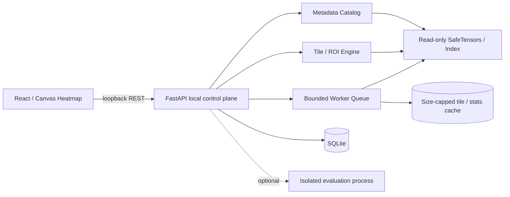

# 03 — System Architecture and Execution Model

## 1. System context

WeightLab is a locally installed HTTP service bound to `127.0.0.1` with a bundled/static React UI opened in the user's browser. The backend is Python 3.11+ using FastAPI, Pydantic, NumPy and SafeTensors. PyTorch, Transformers, PEFT, GGUF decoding and inference engines belong in **optional plugins or isolated subprocesses**, never the default startup path.



## 2. Component boundaries

**UI:** Routes, state, heatmap canvas/WebGL optionally, request coalescing, throttling, cancellation and accessible controls. Must not run model inference.  
**Local API:** Validates requests, manages project and permissions, applies resource budget policy, returns stable JSON and binary tiles.  
**Catalog module:** Imports selected local files, verifies SafeTensors metadata/shard index, persists references and renders normalized semantic tensor inventory.  
**TensorReader abstraction:** `tensor_metadata()`, `read_roi()`, `iter_contiguous_chunks()`. SafeTensors first. Default implementation uses bounded positioned reads (`os.pread` / `readinto`) into preallocated buffers over validated byte ranges, with WeightLab's own BF16/F16 decoding; mmap is an optional, measured backend (ADR-011, section 6).  
**Numerics:** Performs streaming reductions with numerically stable accumulation, sampling, min/max, percentiles, delta composition and LoRA ROI matmul.  
**Tile engine:** Serves tiles by direct bounded reads when the covered bytes are small, otherwise from an exact aggregate pyramid built in one streaming pass for that exact source and view; only sources above `pyramid_exact_max_mib` get a row-sampled preview. Cold requests return 202 with a deduplicated build job, never a silently sampled tile (ADR-012, section 5; decision table in doc 09 section 3). Tile and ROI-table budgets are separate.  
**Job supervisor:** Caps concurrency and memory; cancellation between chunks; progress; per-job CPU limits; batch results stored in SQLite or small cache.  
**Persistence:** SQLite WAL, narrow schema, project state and file references only. Cache is disposable and size-bounded.  
**Optional experiment runner:** Separate process with its own dependencies, model resource preflight and explicit user opt-in.

## 3. Repo layout

```text
weightlab/
  pyproject.toml                  # core Python deps only
  uv.lock                         # locked exact deps, committed
  README.md
  LICENSE
  frontend/
    package.json, package-lock.json
    src/app/, src/components/, src/features/, src/api/, src/types/
    e2e/
  weightlab/
    __init__.py
    cli.py                        # weightlab start / doctor / demo / diff
    api/app.py
    api/routes/{health,projects,models,tensors,tiles,comparisons,jobs,exports}.py
    core/{config,limits,errors,provenance,math}.py
    formats/{base,safetensors_reader,dtypes,shards,peft_lora}.py
    analysis/{tile,pyramid,roi,stats,diff,report,lora}.py
    storage/{db,repository,migrations,cache}.py
    tasks/{queue,worker,cancel}.py
    optional/{evaluation,gguf,activation}.py
  tests/
    unit/, property/, fixtures/, integration/, security/, perf/
  docs/
    architecture.md, api.md, research.md
  scripts/
    generate_demo_fixtures.py     # provided; golden fixtures + expected_results.json
    check_demo_fixtures.py        # provided; independent reference parser
    run_benchmarks.py
```

## 4. Data path for heatmap

1. UI requests model catalog and tensor metadata; backend returns only metadata, never entire tensor.
2. Viewport determines requested tensor region and resolution level (`aggregation`), tile boundaries and optional 3D slice.
3. UI sends at most a fixed maximum number of in-flight requests; aborts old ones on pan/zoom.
4. API validates model identity, coordinates and view budgets; checks cache key.
5. Engine computes exact low-resolution ROI or deterministic block aggregate in bounded chunks and returns values as little-endian FP32 binary plus JSON metadata or JSON for tiny debugging payloads.
6. UI colors values using legend/min-max policy, overlays non-finite/missing masks and draws axes without stretching coordinate meaning.
7. Exact per-cell reading is separate API call; hovering an aggregate tile displays aggregate + covered index range, not a fabricated exact value.

## 5. Tile pyramid algorithm

**Coordinate convention:** Logical 2D tensor `(R,C)`, rows downward, columns rightward, zero-based, half-open rectangles `[r0,r1)×[c0,c1)`. For view level `L`, `block_size=2^L` input cells per aggregate cell. A rendered tile is `tile_size=256` aggregate cells per side (smaller at tensor edges). Tile `(x,y)` covers raw columns `[x*256*2^L,(x+1)*256*2^L)` and raw rows `[y*256*2^L,(y+1)*256*2^L)` clipped to tensor dimensions. All downsampling anchored at origin to guarantee deterministic parent-child consistency.

At `L=0`: actual cell values (within the tile budget `max_tile_cells`, independent of the ROI-table budget). At `L>0`: aggregate summaries for the covered real cells using selected aggregation. A mean of children must be **count-weighted** at partial edges, and RMS must aggregate sums of squares rather than averaging per-block RMS values; min/max combine trivially. Aggregate records (format below) are sufficient for every aggregation: mean = sum/finite_count, mean_abs = sum_abs/finite_count, RMS = sqrt(sum_sq/finite_count), min/max direct. All fields merge by addition (counts, sums) or min/max.

**Exact pyramid first (ADR-012).** Typical LLM weight matrices are 30-250 MiB on disk (4096x4096 BF16 = 32 MiB; 4096x14336 BF16 = 112 MiB). Reading one end to end in row stripes is sequential I/O and is cheaper than scattered sampling. Therefore:

- **Direct reads** when the bytes covered by the requested tile are <= `direct_tile_max_mib` (default 64 MiB). Levels 0-3 always qualify for every supported dtype (an L3 tile covers at most 2048x2048 cells = 32 MiB at F64).
- **Exact pyramid** otherwise. Base level 4 (16x16-cell blocks) and coarser levels merged from children, built in one streaming pass. Pyramids are built on demand per source and view (never for a whole model at import).
- **Row-sampled preview** only for sources above `pyramid_exact_max_mib` (default 1024 MiB on disk, e.g. large-vocabulary embeddings / `lm_head`): whole rows chosen by deterministic stride or SplitMix64 seed (doc 05 section 5), read sequentially and labeled with rows sampled. The exact pyramid is available there only as an explicitly requested job.
- **Cold cache:** a request that needs a pyramid that is not ready returns 202 with a `pyramid_build` job, deduplicated by pyramid identity; the UI shows a progress placeholder and never substitutes a sampled tile for a source under the limit (doc 09 section 3).
- Per-cell scattered sampling is not used: k point samples per block over a 256x256 output is about 4M random accesses, each of which can touch a separate 4 KiB page, which is more I/O than an exact scan of most tensors.

**Aggregate record format v1** (little-endian, versioned as `pyramid_record_format=1`, part of the cache key):

| Record | Fields | Size |
|---|---|---|
| Base (L4, <= 256 cells) | `finite_count, nan_count, pos_inf_count, neg_inf_count` as uint16; `flags` uint8 + 7 B padding; `sum, sum_abs, sum_sq` float64; `min, max` float64 over finite values | 56 B |
| Coarse (L >= 5) | the same counts as **uint64** (an L8 block already holds 65,536 cells); `flags` uint8 + 7 B padding; sums and min/max float64 | 80 B |

- Counters are merged with checked addition; overflow (impossible below 2^64 elements) aborts the build with `RESOURCE_LIMIT` rather than wrapping.
- min/max are stored in float64, which is exact for every float dtype up to F64 and for integers within +/-2^53. For I64/U64 sources pyramid min/max/sums are `numeric_precision=rounded`; exact integer values come from the ROI API.
- `flags`: bit 0 `SUM_OVERFLOW`, bit 1 `SUM_ABS_OVERFLOW`, bit 2 `SUM_SQ_OVERFLOW`, set when a float64 accumulator becomes +/-Inf although every input was finite (e.g. F64 values near 1e200 squared). Flags propagate to parents. An aggregation that depends on an overflowed field is returned with tile status `NOT_REPRESENTABLE` and `numeric_precision=overflowed`; it is never shown as a source Inf or as an exact finite value.
- Blocks outside the tensor are not stored; edge blocks hold only their real cells, so parents are count-weighted automatically.
- Storage for all levels: one base record per 256 cells plus about one third as many coarse records, i.e. (56 + 80/3) / 256 = 0.323 B per cell: about **16.1% of a BF16 tensor's size**, 8.1% of F32, 4.0% of F64. The disk cache cap (`tile_cache_disk_mib`) and LRU eviction apply; a pyramid that cannot fit is kept in memory for the session or refused with `RESOURCE_LIMIT`.

**Pyramid and tile identity.** A pyramid is valid only for one exact `(source kind, input file fingerprints, tensor key(s), view: row_axis, col_axis, fixed_indices, transpose, operation parameters: transform, epsilon, LoRA native scale, experiment multiplier, module mask, numerics_version, pyramid_record_format)`. Two slices of one 3D tensor, two LoRA multipliers or two transforms therefore never share a pyramid. The tile cache key adds level, x, y, size, aggregation, quality mode and sampling seed. Identities are serialized as canonical sorted-key JSON and hashed with SHA-256 (doc 10 section 6). Any change to an input's fingerprint invalidates every pyramid and tile that includes it.

**Derived sources need their own pass.** A `delta` pyramid is built by a paired streaming pass over A and B computing `B - A` elementwise in float64 and aggregating the result; RMS, mean-absolute, min and max of `B - A` cannot be derived from separate A and B pyramids (only the signed mean can, and only with identical finite support). A pair where either input is non-finite yields the IEEE result of the subtraction, which is counted in the non-finite counters by its computed kind and in `invalid_pair_count`. LoRA sources stream `s * B[rows] @ A` in row blocks without materializing the full product, within `max_lora_scan_gmac`.

Current viewport cost and estimated bytes scanned remain visible.

**Separate budgets.** Heatmap tiles and the exact-value ROI table are different products. A tile returns at most `max_tile_cells` = 256x256 = 65,536 values for rendering; the numeric ROI table / JSON is capped at `roi_max_cells` = 4,096. Level-0 tiles carry exact cell values as colors; exact numbers shown as text come from the ROI endpoint or from a level-0 tile payload the client already holds.

## 6. Controlled reader strategy

**Default: bounded positioned reads (ADR-011).** The reader validates the header (doc 04 section 2), then serves reads with `os.pread` (POSIX) or seek + `readinto` (Windows) into preallocated, size-capped buffers covering whole row stripes of the validated byte range. Reasons:

- **BF16:** the safetensors NumPy backend cannot return BF16 (verified with safetensors 0.8.0: `TypeError: data type 'bfloat16' not understood`), and BF16 is the dominant dtype of current LLM checkpoints. WeightLab decodes BF16 itself (`uint16` bits shifted left 16, viewed as float32) and F16 via NumPy `<f2`. F8 variants (`F8_E4M3`, `F8_E5M2`, `F8_E8M0`, ...) are rejected with `UNSUPPORTED_DTYPE` in R1 until decoders with golden vectors exist.
- **Crash safety:** with mmap, truncating the file during a read raises SIGBUS on macOS/Linux and kills the Python process; stat checks before and after a job cannot prevent this. Positioned reads turn the same event into a short read, which the reader reports as `FILE_CHANGED`.
- **Windows:** an open mapping blocks deletion or rename of the user's file; positioned reads hold only short-lived, LRU-capped handles. Seek + `readinto` shares a file position, so on Windows every job and thread uses its own handle (POSIX `os.pread` is position-independent and may share one).
- **Explicit memory accounting:** peak usage is the sum of live buffers, not page-cache behavior.

mmap may be added later as an opt-in backend if benchmarks show a benefit, only inside an isolated worker process (so SIGBUS cannot take down the API) and with the same allocation tests. The safetensors library remains a reference validator: every fixture must be accepted or rejected identically by WeightLab's parser and upstream. Non-contiguous column slices are served by reading the covering row stripes and slicing in memory; the I/O estimate reports stripe bytes, not selected bytes.

Never dereference untrusted offsets without range validation. Keep file handles under an LRU cap (`max_file_handles`) to avoid descriptor exhaustion.

**Change detection and snapshot consistency.** An `fstat` on an open handle cannot see an atomic replace of the *path* (the old inode stays open), and checks race with in-place writes. WeightLab therefore defines two levels:

- **`best_effort` (default):** before a job, after every read batch and at the end, compare (a) the open handle's `fstat` (size, `mtime_ns`, `ctime_ns`, device + inode on POSIX / volume serial + file index on Windows) and (b) a fresh `stat` of the path (same fields, following the symlink chain once) against the identity recorded at import. Any difference, a short read, or a path that now resolves elsewhere (replace, rename, symlink swap) raises `FILE_CHANGED`, discards the result and invalidates caches for that file. Limitation: a same-size in-place rewrite that also preserves `mtime_ns` and `ctime_ns` is not detectable this way.
- **`verified` (job option):** additionally hash every input file before and after the job (two full reads) and fail with `FILE_CHANGED` if the digests differ. This is the only mode that may be described as a consistent snapshot.

Documentation and UI must not claim that "any mutation" is detected; they state the best-effort rule and the verified option.


## 7. Task / concurrency model

- Interactive priority queue: one active per user project for heavy scans; up to 2 interactive tile computations by default.
- Long-running statistics/compare job in separate worker/process or cancellable cooperative thread; results persisted only on success.
- Memory reservations (`estimated_peak_bytes + active_reservations <= budget`) admitted before execution. Reject/queue above budget.
- Max 1 heavy job concurrent by default; `MAX_CORES=min(2, available)` default; expose configuration.
- Each job has `created`, `queued`, `running`, `completed`, `canceled`, `failed`, `interrupted` states. App restart marks running jobs interrupted.
- API request cancellation and job cancellation are distinct; no detached zombie workers.

## 8. Normalized tensor roles

Roles are `embedding`, `attention.q`, `attention.k`, `attention.v`, `attention.o`, `mlp.up`, `mlp.down`, `mlp.gate`, `norm`, `lm_head`, `other`, `unknown`; role and layer extraction are heuristics, never required for raw metadata. Plugin architecture matchers can parse known naming families; raw tensor key is canonical identity. No heuristic key matching is valid evidence for merging.

## 9. Error model

Use stable structured errors (`VALIDATION_ERROR`, `UNAUTHORIZED`, `FORBIDDEN_ORIGIN`, `NOT_FOUND`, `CONFLICT`, `PATH_OUTSIDE_ROOT`, `INVALID_FORMAT`, `MISSING_SHARD`, `INVALID_ROI`, `RESOURCE_LIMIT`, `RATE_LIMITED`, `UNSUPPORTED_DTYPE`, `UNSUPPORTED_PRECISION`, `INCOMPATIBLE_TENSOR`, `LINEAGE_UNVERIFIED`, `FILE_CHANGED`, `NONFINITE_POLICY`, `OPTIONAL_RUNTIME_MISSING`, `NOT_ACCEPTABLE`; the enum in `contracts/openapi.yaml` is authoritative). API never returns a Python traceback to frontend; sanitized diagnostics go to local opt-in logs.

## 10. Packaging model

R1 installs as one CLI package (`uv tool install .` or `pipx install .`) plus prebuilt static frontend assets bundled in wheel. `weightlab start` binds to random/selected localhost port, prints local URL, creates user data dir and SQLite file. Later native desktop shell is optional; minimize packaging complexity initially. Windows supports native Windows Python, not just WSL. Test headless CI and browsers.

## 11. Design constraints and gotchas

- Reading != free memory: OS page cache and large scans can exert memory pressure even with low process RSS. Measure RSS and system memory pressure separately.
- File mutation during a read: best-effort detection compares handle and path identity per batch; only `verified` jobs prove snapshot consistency (section 6). Never mmap in the API process (SIGBUS).
- `safetensors.numpy.save_file` (0.8.0), used by fixtures and any future export, writes non-C-contiguous arrays in memory order, i.e. silently transposed, and does not keep multi-key `__metadata__` order stable between runs. Always pass `np.require(a, requirements="C")` (not `np.ascontiguousarray`, which turns 0-d arrays into 1-d) and use one metadata key where byte reproducibility matters.
- The browser can become the RAM bottleneck with large tiles or retained arrays; enforce per-view tile count (default 12 visible + 8 prefetched) and LRU purge.
- A single 2D matrix of 100k x 100k has 10B cells; avoid full-row materializations.
- "Exact global statistics" cost O(N) element reads; queued and cancelable, not instant.
- `model.safetensors.index.json` can reference paths; resolved files must remain within explicitly selected model directory unless user separately authorizes location.
- BF16 conversion, quantized tensors and LoRA scaling must have independent mathematical reference tests.
