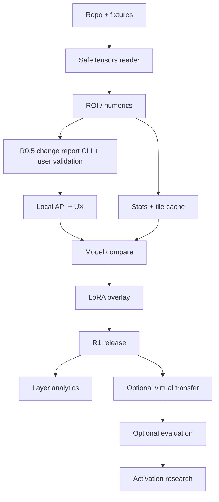

# 14 — Delivery Plan, Milestones, Dependencies and Definition of Done

This is an effort-based scope plan, **not a time promise**. The ambition is high; the application is shipped incrementally instead of implementing research, inference and UI in one untestable leap.

## Phase 0 — Decide and prove the reader

**Deliverables:** Repo skeleton, dependency lockfiles, provided synthetic fixtures wired into tests, SafeTensors reader (positioned reads, own BF16/F16 decoding), shape/ROI tests, first memory benchmark.

**Ordered tasks:**

1. Create repository with `weightlab/`, `frontend/`, `tests/`, CI and exact dependency versions.
2. Wire the provided fixtures (`scripts/generate_demo_fixtures.py`, `check_demo_fixtures.py`) into `tests/`; add the ephemeral large sparse file and mid-read truncation helpers.
3. Implement SafeTensors catalog, range verification and BF16/F16 decoding; fail all malicious fixtures with the expected error codes; agree with upstream on accept/reject.
4. Implement independent exact ROI proof and print known values.
5. Test on oversized synthetic file without copying full data into RAM.
6. Publish G0 report including measured memory and known limitations.

**Gate:** Every selected cell correct (including BF16/F16), invalid files blocked, no full tensor RAM materialization, truncation mid-read yields `FILE_CHANGED` without crashing.

## Phase 0.5 — Change report CLI and user validation

**Deliverables:** `weightlab diff BASE DERIVED` and `weightlab diff BASE --adapter DIR` (FR-023): compatibility class and unmatched/tied report first, then ranked per-tensor, per-layer and per-role tables; JSON/CSV/Markdown with provenance.

**Ordered tasks:**

1. Compatibility analyzer core (V/L/S/X, tied parameters) shared with Phase 2.
2. Single-pass streaming delta statistics over matched tensor pairs, bounded memory, cancel.
3. LoRA effective-delta norms per module without materializing full `B@A` beyond budget.
4. Report writers and golden tests on `tiny_base`/`tiny_ft`, `tiny_lora`, `compat/`.
5. Run on at least two real small public checkpoints (e.g. a 0.5B base and an instruct derivative) and record time, bytes read, RSS.
6. Put the CLI in front of 5-10 practitioners; record which questions it did not answer.

**Gate:** Golden reports match; real-checkpoint run within memory budget; written feedback summary that orders Phase 1/2 UI work.

## Phase 1 — First visible application

**Deliverables:** FastAPI, React static build, local auth, project creation, import, tensor table, tile/ROI viewer, basic stats, error states.

**Ordered tasks:**

1. SQLite schema and migration bootstrap.
2. API routes, schemas and generated contract tests.
3. UI shell with import and searchable catalog.
4. Model overview from the Phase 0.5 change table; heatmap tiles (direct L0-L3, exact pyramid L>=4, row-sampled above `pyramid_exact_max_mib`) with axes and exact ROI; exact/sampled status shown.
5. Stats with Welford/scaled norms and nonfinite policy.
6. Cancellation and memory limiter.
7. E2E offline demo, perf and accessibility pass.

**Gate:** User can open fixture/checkpoint, inspect matrices, export exact ROI; G1/G2 green.

## Phase 2 — Meaningful differentiation

**Deliverables:** Two-checkpoint comparison, strict compatibility, LoRA overlay, provenance and export.

**Ordered tasks:**

1. Compatibility analyzer with V/L/S/X statuses.
2. B-A tile pipeline and summary norms/cosine; match errors.
3. LoRA adapter import, A/B mapping and native scaling.
4. Effective-weight virtual tile and comparison UI.
5. Save/reopen project and export model-agnostic manifest/PNG.
6. Regression tests for all fixture families.
7. Cross-platform smoke tests and first release candidate.

**Gate:** R1 complete and demonstrably reproducible without GPU; G0-G5 green.

## Phase 3 — Model-level analysis (R2)

**Deliverables:** Layer dashboard, stable global summaries, timeline, histograms, annotations and polished report.

**Dependencies:** Correct streamable exact stats, cache semantics and compatibility.

**Gate:** Summary aggregates match independent tests; no difference between displayed heatmap and exported metrics caused by incompatible sampling definitions.

## Phase 4 — Research experiments (R3)

**Deliverables:** Virtual update definitions, optional controlled local eval runtime, alpha sweep and module toggles, paired metrics and controls.

**Dependencies:** R1 transfer-safe readers, deterministic adapter overlay, separate inference process, eval license and identity manifest.

**Gate:** A toy math experiment is reproducible end-to-end with baseline, treatment, negative control and retained non-math metrics. If not achievable on 8GB host, explicitly state that evaluation needs a stronger system while retaining R1 laptop promise.

## Phase 5 — Mechanistic tools (R4)

**Deliverables:** Selective activation capture, controlled activation/weight intervention, optional architecture-specific plugins and research reports.

**Dependencies:** Small supported runtime, robust hook contracts, resource isolation and interpretation guidelines.

**Gate:** Controlled activation experiment with an independent reference implementation and no universal claims.

## Milestone dependency graph

## Definition of done for every story

- Code committed with reviewed tests, docs and exact acceptance ID.
- Independent numerical fixture when arithmetic involved.
- Bounded-memory/read budget demonstrated when data path involved.
- Errors and unsupported inputs covered.
- API/OpenAPI and client types updated together.
- Offline and cross-platform assumptions not silently violated.
- Local auth/path privacy requirements remain green.
- Changelog/release note includes user-facing behavior.

## Scope-cut order if engineering capacity is limited

Cut in this order: advanced activation research, cross-family transfer, GGUF quantization, inference runtime, checkpoint timeline, advanced spectral plots, annotation/report polish. **Never cut:** exact ROI correctness, root path security, compare compatibility, memory caps, LoRA scaling correctness, export provenance or negative tests.
