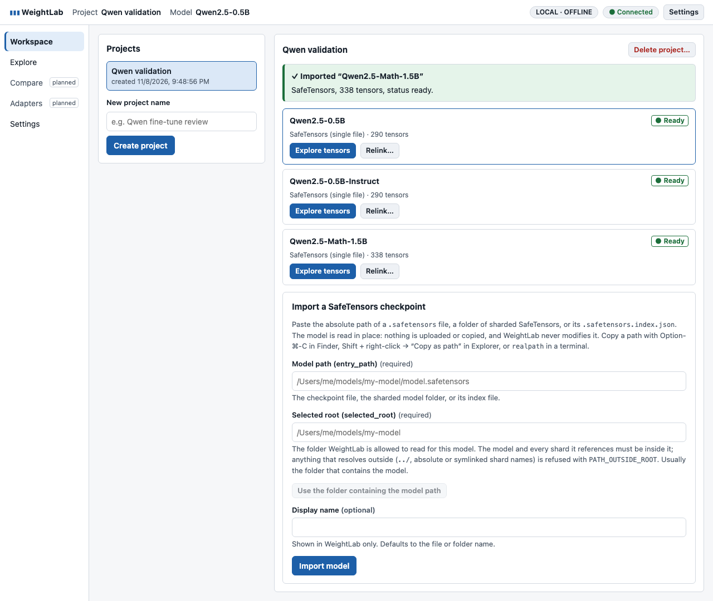
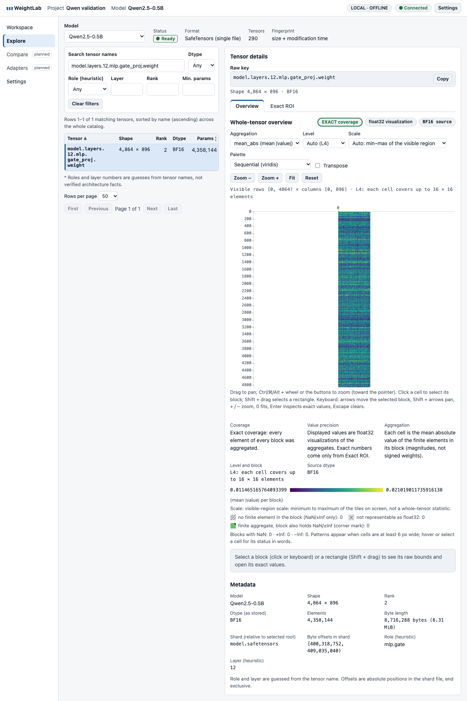
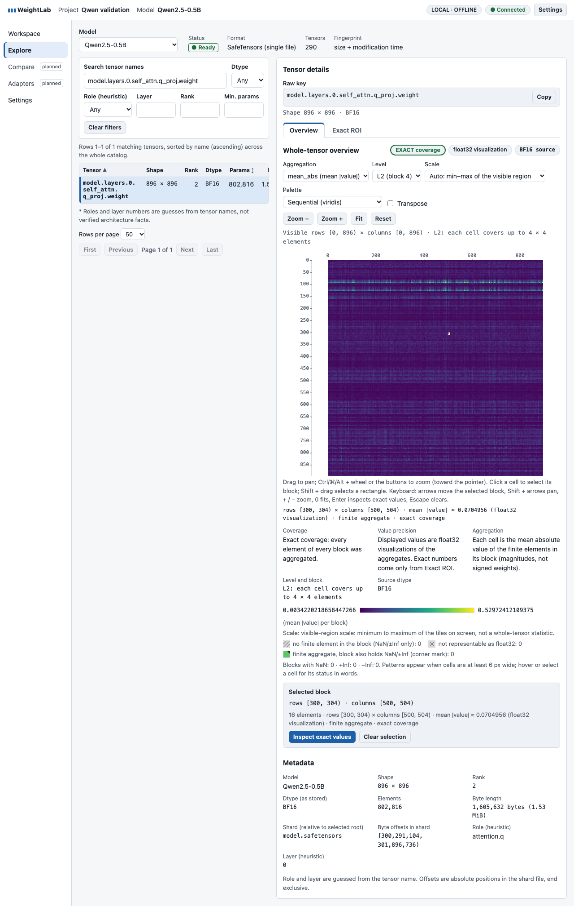
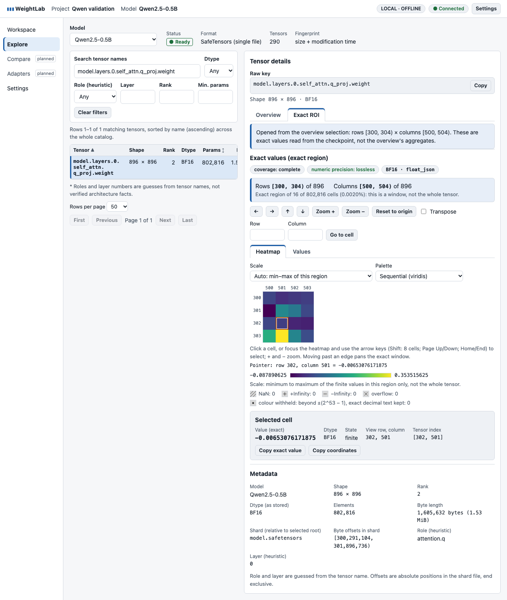
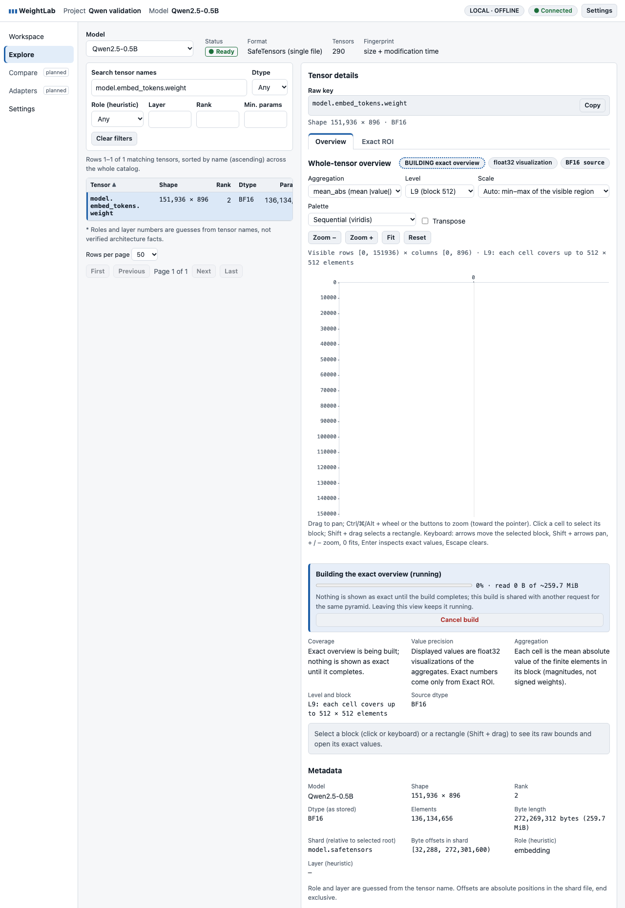
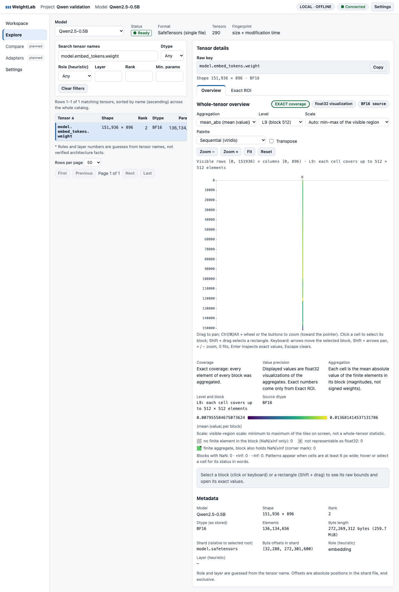
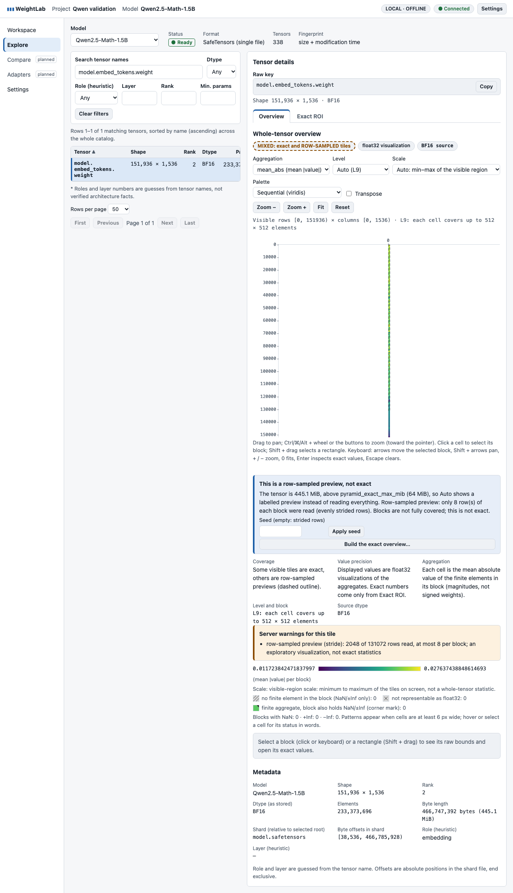
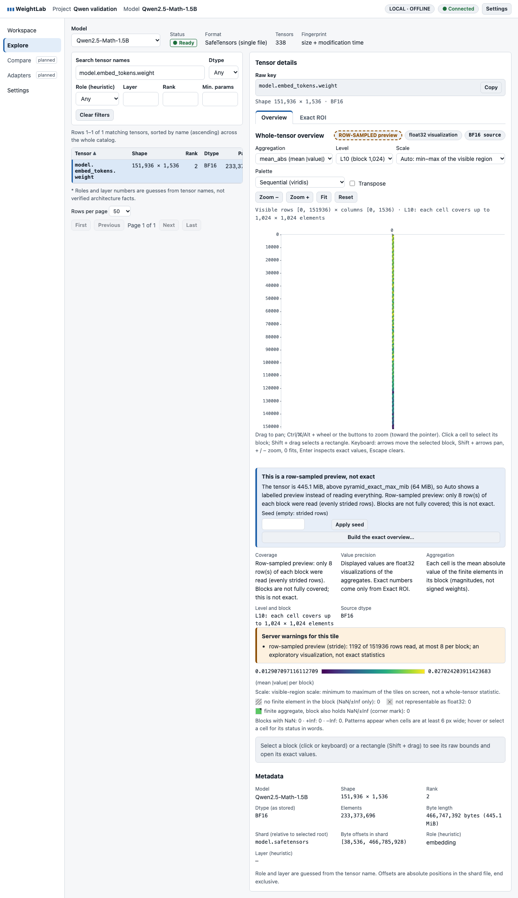

# Phase 1 real-checkpoint validation (PR #9)

The whole Phase 1 workflow, run on official checkpoints instead of synthetic fixtures: import, browse, overview tiles at every level and aggregation, pan/zoom, block selection, exact ROI, pyramid jobs, caches, job lifecycle, `weightlab diff`, and a 20-minute browser soak.

**Assessment: PASS** for every acceptance criterion this environment can check (see [the table at the end](#passfail-assessment)). **Not done:** the practitioner session; it is written up as a protocol, not as evidence. **Not verified:** the 8 GiB laptop target, Linux, Windows and browsers other than Chromium.

## Checkpoints (pinned, never committed)

All four are Apache-2.0. They are downloaded at a pinned commit to a directory **outside** the repository, and every byte is checked against the SHA-256 in [`models.json`](models.json). `fetch_models.py` refuses a destination inside the repo. Weights are never committed or redistributed.

| Model | Tier | Revision | `model.safetensors` | SHA-256 | Tensors |
|---|---|---|---|---|---|
| [Qwen/Qwen2.5-0.5B](https://huggingface.co/Qwen/Qwen2.5-0.5B/tree/060db6499f32faf8b98477b0a26969ef7d8b9987) | initial | `060db649` | 988,097,824 B (942 MiB) | `88c14255…8a0ed342` | 290 |
| [Qwen/Qwen2.5-0.5B-Instruct](https://huggingface.co/Qwen/Qwen2.5-0.5B-Instruct/tree/7ae557604adf67be50417f59c2c2f167def9a775) | initial | `7ae55760` | 988,097,824 B (942 MiB) | `fdf756fa…288fb7fe` | 290 |
| [Qwen/Qwen2.5-Math-1.5B](https://huggingface.co/Qwen/Qwen2.5-Math-1.5B/tree/4a83ca6e4526a4f2da3aa259ec36c259f66b2ab2) | extended | `4a83ca6e` | 3,087,467,144 B (2.88 GiB) | `f7aa8d66…f720857b` | 338 |
| [Qwen/Qwen2.5-Math-1.5B-Instruct](https://huggingface.co/Qwen/Qwen2.5-Math-1.5B-Instruct/tree/aafeb0fc6f22cbf0eaeed126eff8be45b0360a35) | extended | `aafeb0fc` | 3,087,467,144 B (2.88 GiB) | `08faf1e9…584540d9` | 338 |

All four are single-file SafeTensors, BF16 throughout, with tied embeddings (`tie_word_embeddings: true`, so there is no `lm_head.weight` key). Every tensor is rank 1 or 2.

## Reproduce

```bash
# 1. Fetch the pinned checkpoints (7.6 GB for --tier all; 1.9 GB for --tier initial) outside the repo
uv run python evidence/phase1-real-models/fetch_models.py --dest ~/weightlab-models --tier all

# 2. Backend validation against an independent reader (safetensors + PyTorch); about 2 minutes here
uv run --with torch --with safetensors --with psutil python evidence/phase1-real-models/validate_real_models.py \
    --models ~/weightlab-models --out evidence/phase1-real-models/results --tier all

# 3. Browser workflow + 20-minute soak (Chromium via Playwright); keep the machine awake
cd frontend && caffeinate -dims env WEIGHTLAB_REAL_MODELS=$HOME/weightlab-models WEIGHTLAB_SOAK_MIN=20 \
    WEIGHTLAB_REAL_OUT=../evidence/phase1-real-models/results/browser.json \
    WEIGHTLAB_SCREENSHOTS=../evidence/phase1-real-models/screenshots npx playwright test real
```

The backend results in `results/` come from the final head, after the ctime fix. The browser soak (`browser.json`, screenshots) ran just before that fix, at `1eaeac1`. A 2-minute rerun of `real.spec.ts` on the fixed backend passed the whole workflow (section 6).

Without `WEIGHTLAB_REAL_MODELS`, `real.spec.ts` skips, so CI never needs the weights. `caffeinate` (macOS) matters: in an earlier attempt the laptop went into idle sleep on battery four minutes into the soak. The frozen browser then failed a click at the "20-minute" mark. The spec now records the longest gap between soak iterations and rejects any run with a gap over 60 s.

## Files

| File | Contents |
|---|---|
| `models.json` | pinned manifest: repo, revision, licence, size and SHA-256 per file |
| `fetch_models.py` | resumable-safe download (`.part` then rename), size and SHA-256 verification, writes `<dest>/fetched.json` |
| `validate_real_models.py` | backend validation; writes the three files below and exits non-zero on any mismatch. It refuses to run when a checkpoint of the requested tier is missing, and it fails, rather than skips, when a phase checks less than its minimum (≥ 200 tiles and ≥ 40 ROIs per model, ≥ 3 row-sampled tiles, every diff pair with exit 0 and the expected matched counts, all three mutation cases) |
| `results/numerical_report.json` | every ROI window, tile and sampled tile compared, with the error, tolerance and verdict per item |
| `results/benchmark.json` | machine, import, pyramid builds, latency percentiles, RSS timeline, disk cache, lifecycle, diff timings |
| `results/run.log` | human-readable log of the last run |
| `results/browser.json` | browser workflow and soak samples, from `frontend/tests/e2e/real.spec.ts` |
| `results/diff_*/` | `weightlab diff` reports (`report.md`, `layers.csv`, `roles.csv`, `tensors.csv`). `report.json` (1.3–1.5 MB each) is left out; rerun to regenerate it |
| `screenshots/` | captured by the browser run |
| `USABILITY_PROTOCOL.md` | the unassisted practitioner task script (not yet run) |

## Machine

Apple M3 Pro (12 cores), 36 GiB RAM, macOS 26.0 (Darwin 25.0), internal Apple Fabric SSD, Python 3.12.11, PyTorch 2.15.0 and safetensors 0.8 (reference reader only), Chromium from Playwright. WeightLab ran with default settings (`memory_budget_mib` 1024, `direct_tile_max_mib` 64, `pyramid_exact_max_mib` 1024, `tile_cache_disk_mib` 1024) except where a check says otherwise. **This is not the 8 GiB laptop target, and that target is not verified here.**

## 1. Correctness against an independent reader

The reference is `safetensors.safe_open(..., framework="pt")`, converted to float64 by PyTorch. It shares no code with WeightLab's parser or decoders. The browser spec adds a second, separate check: its own BF16 decoder (`frontend/tests/e2e/support.ts:readTensor`) reads the file bytes directly.

| Check | Scope | Tolerance (explicit, unchanged from the unit tests) | Max error | Result |
|---|---|---|---|---|
| Shapes and dtypes | all 1,256 tensors in 4 models, catalog vs reference | identical | 0 mismatches | PASS |
| Exact ROI | 184 windows, 518,656 values (random 64×64, last corner, transposed, bias and norm vectors) | float64 identity, including the sign of zero | **0** | PASS |
| Tiles: mean, mean_abs, rms | part of 1,048 tiles / 30,254,430 cells: levels {0, 3, 4, 6, top}, first/middle/last tiles, transposed views | ≤ 1 float32 ulp of the float64 reference rounded to float32 | **0 ulp** | PASS |
| Tiles: min, max | the same tiles | exact | **0 ulp** | PASS |
| Row-sampled tiles | 0.5B embedding at L8/L9/L10 with `pyramid_exact_max_mib` = 64; 8 strided rows per block | ≤ 1 ulp vs the reference on independently selected rows (`tests/unit/test_sampling.py:ref_select`) | **0 ulp** | PASS |
| Browser ROI | `layers.0.self_attn.q_proj` rows [300, 304) × columns [500, 504), selected on the overview at L2 and opened with **Inspect exact values**; 4 cells clicked | identical to the suite's own BF16 decode | 0 | PASS |
| Checkpoints unchanged | SHA-256 and mtime of all 4 files before and after every run | identical | — | PASS |

The tiles were checked at real BF16 shapes: 151936×896 and 151936×1536 embeddings, 4864×896 / 8960×1536 MLP, 896×896 / 1536×1536 attention, 128×896 / 256×1536 k_proj, 1×N bias and norm vectors. They covered every aggregation, the direct path (L0–L3 and small tiles), the pyramid path (embeddings), and transposed views.

## 2. Workflow on real checkpoints

| Step | Result |
|---|---|
| Import (UI and API) | all four **Ready** in 0.01–0.02 s (header and index only, no weights read); 290 / 290 / 338 / 338 tensors; no warnings |
| Browse by role | `attention.q` filter → 48 (0.5B) / 56 (1.5B); roles: embedding 1, norm 49/57, q/k/v 48/56 each, o/up/gate/down 24/28 each, **0 unknown** |
| Overview, all aggregations | `layers.12.mlp.gate_proj` (4864×896): mean, mean_abs, rms, min, max all **EXACT coverage** |
| Levels | L1, L2, L4, L5 rendered. **L0 is refused**: "Level L0 would need 76 tiles for this screen (limit 48)", by design (`MAX_VISIBLE_TILES`) |
| Pan / zoom / fit / block selection | drag, buttons, keyboard; selection bounds `rows [300, 304) · columns [500, 504)` at L2 match the raw coordinates clicked |
| Exact ROI from the selection | opens on exactly those bounds; values equal the file's bytes (above) |
| Pyramid job | 0.5B embedding at L9: job panel with progress and bytes read; then exact. Math-1.5B embedding with `pyramid_exact_max_mib` = 64: **MIXED** at auto L9 (see below), **ROW-SAMPLED preview** at L10 with "8 rows per block, evenly strided" |
| `weightlab diff` | both pairs exit 0; see section 5 |

### Screenshots (captured by the final browser run)

| | |
|---|---|
|  `real-01`: three checkpoints imported, Ready |  `real-02`: `layers.12.mlp.gate_proj` 4864×896, auto L4, EXACT |
|  `real-03`: `layers.0 q_proj`, L2 block rows [300, 304) × columns [500, 504) selected |  `real-04`: Exact ROI of exactly that block, lossless BF16 |
|  `real-05`: embedding pyramid job with progress, bytes read and Cancel |  `real-06`: whole 151936×896 embedding, EXACT, after the job |
|  `real-07`: Math-1.5B embedding at L9 with a 64 MiB exact limit, MIXED |  `real-08`: L10, ROW-SAMPLED preview (8 strided rows per block) |

## 3. Performance (backend, `benchmark.json`)

| Metric | Value | Budget / target | Status |
|---|---|---|---|
| Backend peak RSS, whole validation (4 models, 1,048 tiles, 184 ROIs, 4 pyramid builds) | **166.3 MiB** (sampled every 50 ms) | 1 GiB backend target | within: 16.2 % |
| Backend idle RSS after start / after validation | 60.6 / 146.1 MiB | — | — |
| Pyramid build, 0.5B embedding (151936×896 BF16) | 1.28 s / 1.53 s; read **272,269,312 B** = the tensor's bytes exactly (estimate = actual) | — | — |
| Pyramid build, Math-1.5B embedding (151936×1536 BF16) | 2.02 s / 2.03 s; read **466,747,392 B** = the tensor's bytes exactly | — | — |
| Tile after build: first (cold memory, disk cache) / warm | 4.9–7.7 ms / 3.2–4.0 ms | — | — |
| Tile after server restart (disk cache only) | 6.0 ms, exact; repeat 3.5 ms | — | — |
| Direct tile latency p50 / p95 (cold, exact) | L0 6.4 / 8.9 ms · L2 7.3 / 76 ms · L3 37 / 71 ms · L4 55 / 106 ms · L5 61 / 64 ms · L6 186 / 333 ms · L10 (pyramid) 8.5 / 35 ms | — | — |
| Row-sampled tile (L8–L10, 0.5B embedding at a 64 MiB exact limit) | 90–188 ms | — | — |
| Exact ROI (≤ 64×64) p50 / p95 | 4.3 / 6.2 ms | — | — |
| Disk cache after validation | 239,064,116 B (228 MiB), 4 pyramids + tiles | `tile_cache_disk_mib` 1024 | within |
| Bytes read by pyramid builds | each build read its tensor's bytes exactly once (`bytes_scanned` = tensor size) | — | — |
| `weightlab diff`, 0.5B pair (2 × 942 MiB) / Math pair (2 × 2.88 GiB) | 4.3 s / 13.2 s | — | — |

The overview latency for the whole tensor is the tile latency at the auto level. A whole 4864×896 MLP fits in 1–2 tiles at L4/L5 (p50 58–62 ms). A whole embedding is 1–2 pyramid tiles at L9/L10 (≈ 5 ms warm, ≈ 1.2–2 s including the first build).

## 4. Cache and job lifecycle

| Check | Result |
|---|---|
| Cold → warm pyramid | build once (202 + job), then 200 exact from memory; after restart, 200 exact from the disk cache, with no rebuild |
| Cancellation | transposed embedding build cancelled at 10 % progress: state `canceled` in **22 ms**; no pyramid published, **0** temp files left |
| Source mutation (3 cases) | see the table below |
| Disk cap | `tile_cache_disk_mib` lowered to 113 MiB with 228 MiB cached → evicted to **72 MiB** (LRU), at most the cap |
| Read-only | checkpoint SHA-256 and mtime identical before and after every run; inputs opened read-only (the diff provenance says so too) |

**Source mutation.** Each case imports a fresh APFS clone of the Math-1.5B checkpoint (`cp -c`; the original is never touched). It then requests one tile twice, so the second answer comes from the memory tile cache, mutates the clone, and repeats the same tile request and an ROI request. Doc 03 defines the file identity as size, `mtime_ns`, `ctime_ns`, device and inode, and accepts only a same-size rewrite that preserves **both** `mtime_ns` and `ctime_ns` as undetectable.

| Case | What changes | size / mtime / ctime unchanged | Tile (same cached request) / ROI | What it proves |
|---|---|---|---|---|
| `content` | one payload byte of `layers.0 q_proj` flipped in place | yes / no / no | **409 `FILE_CHANGED`** / **409** | an ordinary in-place content edit is detected and not served from caches |
| `mtime_only` | bytes identical, mtime moved | yes / no / no | **409** / **409** | detection is by file identity, not content: a touched file must be re-imported even if its bytes are the same |
| `content_mtime_restored` | one payload byte flipped, then mtime restored | yes / **yes** / no | **409** / **409** | a same-size rewrite that hides its mtime is still detected through ctime |

The third case **failed before this PR** (tile 200 from the cache, ROI 200 with the new bytes). See "Bug found and fixed" below. No case proves content equality: an undetected rewrite would need both mtime and ctime preserved (POSIX user space cannot set ctime), or a Windows filesystem, where ctime is the creation time (doc 03's documented limit). Only a strong fingerprint (SHA-256, doc 10 §4) proves content.

### Bug found and fixed

`model_files` stored size, `mtime_ns` and `dev:ino`, but not `ctime_ns`. The cache identity (`Checkpoint.fingerprints`) also left it out. A same-size in-place rewrite with `mtime_ns` restored therefore passed every check: cached tiles of the old bytes were served, and ROI reads returned the new bytes with no `FILE_CHANGED`. Adapter weights (`adapter_model.safetensors`) had the same gap. The regression tests were written first and failed against the previous head:

- `tests/api/test_tiles_api.py::test_a_same_size_rewrite_with_mtime_restored_is_file_changed`: cached pyramid tile, cached direct tile, ROI and model status;
- `tests/api/test_review_pr3.py::test_adapter_weights_rewritten_in_place_with_mtime_restored_is_file_changed`.

The fix:

- Migration `0002` adds `model_files.ctime_ns`. It is recorded at import, compared by `open_model` and `live_status`, and refreshed by relink, since a move changes it.
- `ctime_ns` is part of the quick fingerprint, so tile and pyramid cache keys change with it.
- Adapter weights record and compare it too.

Rows imported before the migration keep NULL and the previous check (`test_rows_imported_before_ctime_was_recorded_keep_working`). A possible side effect: anything that changes only a file's ctime, such as `chmod`, `chown`, a new hard link or an xattr, now makes the model `changed` until it is re-imported. Re-importing reads only the header (0.01 s here). That is the safe direction: refused, never stale.

## 5. `weightlab diff` (base vs Instruct)

Raw parameter-change statistics only. No lineage manifest was given, so both pairs are **class S** (shape-compatible, no lineage evidence: "deltas may be meaningless"). The rankings say how much parameters moved; they say nothing about why the models behave differently.

| Pair | Matched | Missing A / B | Shape / dtype mismatch | Tied | Whole-model relative L2 | Largest relative L2 |
|---|---|---|---|---|---|---|
| Qwen2.5-0.5B → -Instruct | 290 | 0 / 0 | 0 / 0 | 0 | 0.0418 | `embed_tokens` 0.112, `layers.22 q_proj` 0.105, `layers.0 o_proj` 0.104 |
| Qwen2.5-Math-1.5B → -Instruct | 338 | 0 / 0 | 0 / 0 | 0 | 0.157 | `embed_tokens` 0.621, `layers.27 down_proj` 0.183, `layers.27 k_proj` 0.178 |

No non-finite values in any tensor. Full reports: `results/diff_*/report.md`.

## 6. Browser soak (`browser.json`)

Chromium (Playwright), the two 0.5B models alternating across 6 tensors (attention q/k, MLP gate/up/down, the 151936×896 embedding). Each iteration does a model switch, a tensor switch, an aggregation change (rotating through all five), 10 keyboard pan/zoom/fit actions, and waits for the view to settle. Samples are taken once a minute, with a forced GC (`HeapProfiler.collectGarbage`) before each heap reading.

| Metric | Value | Budget | Status |
|---|---|---|---|
| Duration / actions / tensor switches | 20 min / **41,041** / **3,157** (longest gap between iterations 1.2 s) | 20 min | PASS |
| Page JS heap after GC | 6.6 MiB at minute 1 → **7.0 MiB** at minute 20 (max 7.6; growth **+0.4 MiB**) | no growth | PASS |
| DOM nodes / JS listeners | 886–2,313 / 210–332, alternating with the catalog rows shown; no trend | no growth | PASS |
| Decoded tile cache | rises to **54.9 MiB** (360 tiles) by minute 12, then flat (LRU eviction) | **64 MiB** | PASS |
| Requests in flight (peak) | 2 (`max_active_tiles` default) | ≤ 6 | PASS |
| Backend RSS (sampled) | 47–133 MiB, no trend | 1 GiB | PASS |
| Embedding: pyramid build + whole exact overview, from the UI | 1.9 s | — | — |
| Console errors / blocked outside requests | 0 / 0 | 0 | PASS |

Per-iteration time by phase (`ms_*` in `browser.json`) shows the app staying flat: a tensor + model switch takes 263 → 294 ms, and aggregation + settle 25–37 ms. One series does grow: 10 key presses take 20 → 120 ms, and the settle after them 3 → 19 ms. It follows two measurements of the **test harness**, not the app. A no-op `page.evaluate` round-trip goes from 0.6 to 6.8 ms, and the Node test process's heap from 84 to 209 MiB. Meanwhile the page heap, DOM, listeners, and the renderer's JS CPU stay flat. A CPU profile of 40 key presses at minute 8 against minute 1 showed the same "program" time (about 47 ms) and app functions, with the extra time all renderer idle. So the page is waiting on the Playwright client.

The first soak attempts routed every request through a JS route handler in the test process, and the drift was larger (`ms_keys` 24 → 126 in 12 minutes, about 45 % lower throughput over 20 minutes). `loopbackOnly` now uses a URL RegExp that Playwright matches in the browser. Loopback traffic no longer passes through Node, and outside requests are still aborted and recorded. The drift that remains is Playwright's per-request client bookkeeping. A user's browser has no such layer.

**After the ctime fix:** a 2-minute run of the same spec on the final backend passed the whole workflow (levels, 4 browser ROI values, embedding job 1.8 s, MIXED/ROW-SAMPLED labels), then 4,667 soak actions and 359 switches. Heap was flat (6.6 MiB), the cache peaked at 20.6 MiB, and at most 2 requests were in flight. The 20-minute numbers above are from the run before the fix, which changed only how files are identified, not the tile or rendering path.

## 7. Usability

**No practitioner session took place.** This PR does not claim one, and the 5–10-practitioner gate stays open. [`USABILITY_PROTOCOL.md`](USABILITY_PROTOCOL.md) gives an unassisted 8-task script on these checkpoints. It reuses `evaluation-kit/` for recruitment, IDs, consent, questionnaire sections C–D and response handling.

Observations from building and running the automated workflow. These are mine, not a participant's:

1. **L0 refusal.** On a 4864×896 matrix, picking L0 gives "would need 76 tiles (limit 48)". This is correct and explained, but a user who wants every element has to zoom in first. The message does not say so.
2. **Partially built pyramids read as "EXACT".** While the 0.5B embedding pyramid builds at L9, the bottom edge tile (rows 131072–151936, 36 MiB) is under `direct_tile_max_mib` and is read exactly at once. The badge then shows **EXACT coverage** next to **BUILDING exact overview**, and the coverage text says "every element of every block was aggregated", while most of the canvas is still blank (`screenshots/real-05-embedding-building.png`). Nothing non-exact is labelled exact, so this is not a correctness bug. But "exact, N of M tiles pending" would be clearer.
3. **MIXED coverage is real and correctly labelled.** With `pyramid_exact_max_mib` = 64, the Math embedding at L9 has one 384 MiB row-sampled tile and one 61 MiB exact edge tile. The UI says "MIXED: exact and ROW-SAMPLED tiles" and outlines the sampled tile with dashes.
4. **Extreme aspect ratios.** At Fit, a 151936×896 embedding is a strip a few pixels wide (170:1), and the column axis shows only "0". A "fit width" option, or a hint to zoom, would help.
5. **Class S wording.** Without a lineage manifest, every base/Instruct pair from the same publisher is class S with "deltas may be meaningless". That is the frozen contract, but practitioners comparing official pairs will probably ask how to supply lineage.
6. **Deep direct tiles cost hundreds of milliseconds.** L6 tiles on matrices below `pyramid_exact_max_mib` that have no pyramid are computed directly: p50 196 ms, p95 333 ms, versus about 5 ms from a pyramid. This was not visible in the soak, but it will show on larger matrices.

## Open issues (none blocks this PR)

- [ ] Partial-exact badge while a pyramid builds (observation 2): UI wording.
- [ ] Explain how to get finer than the tile limit in the L0 refusal message (observation 1).
- [ ] Fit-width / aspect hint for very tall tensors (observation 4).
- [ ] Practitioner sessions: run `USABILITY_PROTOCOL.md` with at least one external user, then 5–10.
- [ ] Validate on Linux and Windows, Firefox/WebKit, and an 8 GiB machine.
- [ ] E2E harness: Playwright's client still slows down over very long sessions (no-op round-trip 0.6 → 6.8 ms in 20 minutes). Soak numbers that depend on input latency should be read with that in mind, or a future soak could reopen the page every few minutes.
- [ ] Rank > 2 tensors and sharded checkpoints are not covered by these models (all Qwen2.5 tensors are rank ≤ 2, single file). They are covered only by synthetic fixtures.

## Limitations

- One machine: macOS 26 on Apple M3 Pro, 36 GiB, internal SSD. No Linux, Windows or HDD/network storage numbers. **The 8 GiB laptop target is not verified.** The backend peak (159 MiB) and the browser heap are well inside it, but that was not measured on such a machine.
- Chromium only (Playwright). Frontend heap numbers are Chromium's `Performance.getMetrics` JSHeapUsedSize, sampled once a minute without forcing a GC, so single samples include garbage that has not been collected yet (sawtooth).
- Latencies were measured with warm OS page caches after the first read, which is typical for repeated sessions. Cold-disk numbers would be higher.
- Checkpoints up to 2.88 GiB and tensors up to 445 MiB. Multi-shard checkpoints and 7B+ models are untested here.
- No practitioner has used the tool (section 7).

## PASS/FAIL assessment

| Acceptance criterion | Evidence | Verdict |
|---|---|---|
| Both initial checkpoints import cleanly | 290 tensors each, Ready, no warnings (plus both extended models) | **PASS** |
| Navigation works with real shapes | role filter, overview levels, pan/zoom/selection on 896×896 … 151936×1536 | **PASS** |
| ROI matches the independent reader | 518,656 values, max error 0 (and 4 more in the browser via a second decoder) | **PASS** |
| Aggregates within the stated tolerance | 30.3 M tile cells, 0 ulp (tolerance 1 ulp; min/max exact) | **PASS** |
| No checkpoint is modified | SHA-256 + mtime before/after; mutation tests used APFS clones | **PASS** |
| Changed sources are never served | content, mtime-only and content-with-mtime-restored mutations all 409 `FILE_CHANGED` for cached tiles and ROI (the third after the fix in this PR) | **PASS** |
| Operations stay within budgets | backend peak 166.3 MiB < 1 GiB; decoded tile cache 54.9 MiB ≤ 64 MiB over a 20-minute soak; page heap flat (+0.4 MiB); disk cache ≤ cap | **PASS** |
| Cache and job lifecycle verified | cold/warm/restart, cancel, FILE_CHANGED, disk-cap eviction | **PASS** |
| CI stays green | see the PR checks | see PR |
| Limitations recorded | above | **PASS** |
| At least one practitioner attempts the workflow | not done; protocol written | **NOT DONE** |
| 8 GiB laptop target | not measured on such hardware | **NOT VERIFIED** |
